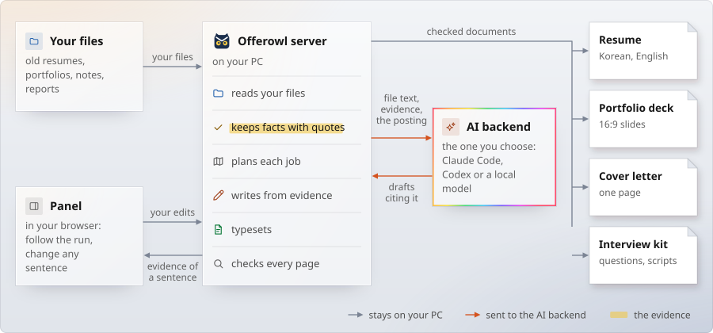
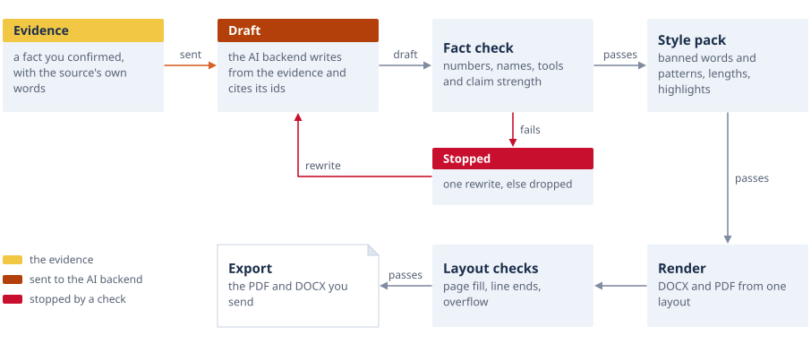
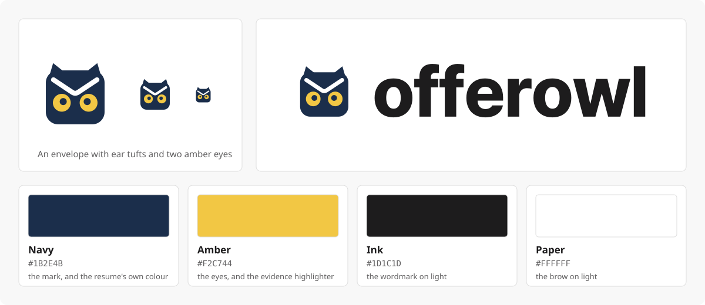

# Contributing to Offerowl

Thank you for helping. Most of Offerowl can be worked on with no AI backend and no account: the tests run with stand-in models and
fictional people, and the panel runs in a headless browser. This page takes you from a fresh clone to a pull request.

- [Ways to help](#ways-to-help)
- [How the pieces fit](#how-the-pieces-fit)
- [Set up](#set-up)
- [Run the tests](#run-the-tests)
- [Make a change](#make-a-change)
- [Release a version](#release-a-version)
- [Recipes](#recipes): a colour set, a resume form, a figure, a check, an AI backend, a language, a decision model
- [Pictures and the brand](#pictures-and-the-brand)
- [Roadmap](#roadmap)
- [Report a bug](#report-a-bug)

## Ways to help

- **Try it on your own material.** The most useful report says where a real resume, a posting or a language made Offerowl stumble, with
  the personal parts taken out or replaced by a fictional example.
- **More forms and themes.** There are three resume forms, two deck looks and six colour sets, and people need more.
- **More figures for the deck.** The library draws common shapes. A figure a project needs that it cannot draw is worth an issue.
- **Translations.** English and Korean so far ([add a language](#add-a-language)).
- **A local model that writes well.** Results for a model on the measured sets, in Korean or English, help others choose.
- **Docs.** Anything that made you stop and search is worth a sentence.

Look for issues labelled `good first issue` and `help wanted`. Ideas and questions go to
[Discussions](https://github.com/kanggu12/offerowl/discussions). For a larger change, start an idea there first, so the design can be
agreed on before the code is written. Everyone taking part follows the [code of conduct](.github/CODE_OF_CONDUCT.md).

**One rule for features.** Offerowl writes from facts a person confirmed. A change that lets a document state what its evidence does not, or
that hides a sentence's source from the person who will send it, is not accepted.

## How the pieces fit

One local server does the work, and the panel is a page that talks to it. The AI backend is outside Offerowl and sees only what a step
sends it.

<picture>
  <source media="(prefers-color-scheme: dark)" srcset="docs/assets/diagram-pieces-dark.svg">
  
</picture>

Every drafted sentence takes the same path, and most contributions touch one box of it.

<picture>
  <source media="(prefers-color-scheme: dark)" srcset="docs/assets/diagram-sentence-dark.svg">
  
</picture>

The code is laid out by that path. [docs/ARCHITECTURE.md](docs/ARCHITECTURE.md) says where to start reading for each part.

<picture>
  <source media="(prefers-color-scheme: dark)" srcset="docs/assets/diagram-modules-dark.svg">
  
</picture>

## Set up

You need Python 3.10 or newer, and for typesetting either Docker, or a browser with Node.js 22 or newer, Pillow, and poppler or pypdfium2. The
engine and the panel use only the standard library, so most tests need nothing more.

```bash
git clone https://github.com/kanggu12/offerowl && cd offerowl

# Typesetting in the container, the reference for the checks (the first build takes several minutes)
OFFEROWL_NET=1 render/run.sh npm ci
./offerowl selftest

# Or with the browser on your PC, with no Docker
npm ci
OFFEROWL_RENDERER=html ./offerowl selftest

# The panel, with hot reload by hand: edit apps/panel/static/ and reload the page
python3 apps/panel/server.py --open
```

The self-test builds the fictional example, runs the checks, plants a defect to see that a check catches it, and ends with a line that says
PASS or FAIL. `./offerowl doctor` says what is missing on your PC.

Browser tests need Playwright: `pip install playwright && python3 -m playwright install chromium`. Docs pictures need Pillow.

## Run the tests

| What you changed | Run | Time |
|:---|:---|---:|
| Anything (syntax and lint) | `python3 tests/cli/lint.py` | seconds |
| The launcher, settings, messages, a backend | `python3 -m unittest discover -s tests/cli` | seconds |
| Drafting, claim strength, style packs, JSON Resume | `python3 -m unittest discover -s tests/write` | seconds |
| The cover letter | `python3 -m unittest discover -s tests/cover` | seconds |
| The interview kit | `python3 -m unittest discover -s tests/interview` | seconds |
| The panel or the API | `python3 -m unittest discover -s tests/app` (the Playwright tests skip without it) | seconds |
| How the panel looks | `python3 tests/app/walk.py --out /tmp/walk` (Chromium; `--engine firefox`, or `--engine webkit=ws://HOST:PORT/` for a Playwright server, such as one in a container; `--only STATE,...` for a few states) | minutes |
| How the panel looks in Safari itself | Actions, `look`, **Run workflow** (a macOS runner: `.github/look/safari.py` measures the views that slide under the top bar with the walk's audit and keeps Safari's pictures as the run's artifact) | minutes |
| Where the keyboard and the page stay when the panel redraws | `python3 -m unittest tests/app/test_panel_keys.py` (headless Chromium through Playwright) | seconds |
| The renderer, or how a PDF is read | `python3 -m unittest discover -s tests/render` | seconds |
| The Word and PowerPoint files the export writes, the portfolio kept on the Desktop | `python3 -m unittest tests/render/test_office.py tests/app/test_delivery.py` | seconds |
| Resume parts, the full example | `python3 tests/parts/run.py` | minutes |
| The deck and its figures | `python3 tests/deck/run.py` | minutes |
| The app, an image, the chart, the package | `python3 -m unittest discover -s tests/packaging` | under a minute |
| The app image and the chart, running | `docker build -f deploy/docker/Dockerfile -t offerowl-app:local .` (with the network), then `tests/packaging/image_smoke.sh --selftest`, `tests/packaging/offline_e2e.sh` and `tests/packaging/chart_e2e.sh` (kind, helm and kubectl; it pulls kind's node image once) | minutes |
| The one-file app | `pip install -r apps/desktop/requirements-build.txt`, `python apps/desktop/build.py`, then `python3 tests/desktop/e2e.py --app dist/Offerowl-linux-x64 --out /tmp/e2e` | minutes |
| A decision backend | `python3 -m unittest discover -s tests/decide` | seconds |
| Everything a document goes through | `./offerowl selftest` | under a minute |

CI runs these on pushes to main and on pull requests, with no model anywhere (`OFFEROWL_LLM=none`). No CI job installs Playwright, so `walk.py`
and `test_panel_keys.py` are yours to run. The one-file app's run starts only when its files change, and the chart's cluster test runs on main
only. Tests that need a model use stand-ins, so no test costs anything or needs an account.

`walk.py` drives the panel through every state it lists (about sixty) at three window sizes, light and dark, Korean and English. It measures overflow, cut text,
overlaps, stray markup, file paths on screen, contrast, rows and columns, and the words of each key in its middle, and keeps a screenshot of each view. Look at the screenshots too: the measure finds
defects, not bad design.

## Make a change

- **Fictional data only.** Tests, examples and docs use fictional people, companies and postings. A real name, employer, client or posting does
  not go into the repository, and neither does anything from your own resume. `examples/sample_full_en.json` is a good person to borrow.
- **A check first.** A new behaviour has a check that fails without the change. A claim in the docs about quality comes from a script.
- **The checks keep their word.** Do not loosen a fact check, a layout check or a test to make a result pass. If a check is wrong, say why and
  change it in its own commit.
- **Comments say why.** Most lines of code have a short comment saying why the line is there. Read a file nearby and match it.
- **Both languages.** Words people see exist in English and Korean ([add a language](#add-a-language) shows where). `tests/cli/test_messages.py`
  fails on a missing one.
- **No path, key or command on the panel.** A person who never opens a terminal must be able to use it. The audit counts these as defects.
- **Colour means something.** Blue stays on this PC, orange goes to the AI backend, yellow is the evidence, red is stopped by a check. No colour for
  decoration ([docs/APP.md](docs/APP.md#the-design-system), [Pictures and the brand](#pictures-and-the-brand)).
- **Pictures come from data.** To change a number or a diagram, run `python3 tools/measure.py`, then `python3 docs/assets/build.py --check DIR`.
- **Small pull requests.** One purpose each, in plain English, with the tests you ran.

## Release a version

Versions follow [Semantic Versioning](https://semver.org/), and [CHANGELOG.md](CHANGELOG.md) holds each release's notes in
the form of [Keep a Changelog](https://keepachangelog.com/en/1.1.0/).

- **Which number.** A fix is a patch (0.1.1). A new feature that leaves profiles, settings and the API as they were is a
  minor (0.2.0). A change that asks people to change a profile, a setting or a call is a major. Before 1.0.0 a minor may
  also break something, and its notes say what.
- **One place.** The version is set in `deploy/python/offerowl/__init__.py`. `tests/packaging` checks the copies against it
  and names any left behind.
- **The steps.**
  1. Move what is under `## [Unreleased]` into a new `## [x.y.z] - YYYY-MM-DD` section, under `### Security` (first), `### Added`,
     `### Changed`, `### Fixed` or `### Removed`. Leave `## [Unreleased]` empty above it, and give each its link at the end of the file.
  2. Write `x.y.z` in `deploy/python/offerowl/__init__.py`, `package.json` and `package-lock.json` (its two `version` lines),
     `deploy/helm/offerowl/Chart.yaml` (`version` and `appVersion`), `deploy/docker/Dockerfile` (`OFFEROWL_VERSION` and the
     `org.opencontainers.image.version` label), and the commands of README.md, [docs/INSTALL.md](docs/INSTALL.md) and
     [docs/OFFLINE.md](docs/OFFLINE.md). Run `sh .github/badges.sh` for the release badge (it fetches it from shields.io), then
     `python3 -m unittest discover -s tests/packaging`, and commit.
  3. Push the tag `vx.y.z`. `.github/workflows/release.yml` checks that the tag, the package and the notes agree before it
     builds anything, then publishes the section as the release's notes.
- **Before the tag.** Wait for `ci` on main, which runs every test on each Python. The release runs the desktop builds and
  the chart's cluster test itself and publishes nothing until they pass, so they need not be waited for twice; start them
  by hand first (Actions, `desktop` or `chart-e2e`, **Run workflow**) only when a change to the app's build or to the chart
  could leave a tag with no release. The desktop builds run the panel's tests on Windows, the Apple silicon Mac and Linux;
  the Intel Mac builds the app and starts it with `--check`.
- **The repository's About.** Its description, website and topics (the five or so words a person looking for it types, never
  the stack) are kept in `.github/repo.json`: `sh .github/repo-meta.sh` sets them on GitHub after the file changes, and turns
  on Discussions and the private vulnerability reports of [SECURITY.md](.github/SECURITY.md).

## Recipes

### Add a colour set

1. Add a set to `src/themes.json`. Its header says what each field colours.
2. Offer it on the panel and to agents: `inspTheme` in `apps/panel/static/side.js`, `THEMES` in `apps/api/tasks.py` and in `apps/mcp/server.py`, and the `theme` lists in `core/schema/documents/edition.schema.json` and `resume.schema.json`.
3. Build it: `OFFEROWL_THEME=<name> ./offerowl build examples/sample_full_en.json examples/job_full_en.json`, and look at both documents.

The resume stays in one accent colour with dark grey text, so it prints well.

### Add a resume form

A form is a list of parts in print order: `FORMS` in `src/resume_form.js`. A new form reuses the parts there, and any new part draws with `src/layout.js`.

1. Add it to `FORMS`, and name it in `FORMS` of `apps/api/tasks.py`, in `FORM_PARTS` of `apps/api/documents.py`, in `inspTheme` of `apps/panel/static/side.js` and in the `form` list of `core/schema/documents/edition.schema.json`.
2. Add it to the loop in `tests/parts/run.py`, which builds it in both languages with the document check. Every project the resume prints must appear.
3. Build it and look at it: set `"form"` in a job file, then `./offerowl build examples/sample_full_en.json <job file>`.

### Add a figure to the deck

1. Add a drawing function to `src/deck_figures.js` and list it in `DRAW`. It draws into a box and returns its parts, using `src/portfolio/draw.js`, so
   the deck checks measure it like any other.
2. Add its required fields to the validation below `DRAW`, and an entry to `CATALOG` with what it is for and its data shape. `src/figure_draft.py`
   reads the catalog, so the drafting step can propose the new type.
3. Add a case to `tests/deck/figures_test.js` and to `tests/deck/gallery.js`, then run `python3 tests/deck/run.py` and look at the gallery.
4. Document it in [The portfolio deck](docs/DOCUMENTS.md#the-portfolio-deck).

### Add a check

- For a sentence and its evidence: `src/factcheck.py`. Add planted cases that must be caught, and cases that must not, to
  `tests/write/test_claims.py` or `tests/write/`.
- For a page: `src/check_documents.py` or `src/check_render.py`. The self-test plants a defect to prove that a check works: do the same.
- For an interview scene: `src/interview/check.py`, with a test in `tests/interview/test_check.py`.

A check that can fail on good text needs a way to tell a person why, in both languages.

### Add an AI backend

Everything goes through `src/llm.py`:

1. Add its name to `BACKENDS`, its check to `available()` and its call to `run()`. It takes a prompt and a schema, and gives back text or JSON. It must not
   be able to act on anything: Claude Code runs with its tools off, and Codex in its read-only sandbox. It keeps no session.
   An error that may pass, such as an overloaded service, raises `CallFailed`, and `run()` asks once more after a pause; a missing
   sign-in raises `LLMUnavailable`, which is not asked again.
2. Add the words for `--list` in both languages to the tables at the top.
3. Add a stand-in test to `tests/cli/test_settings.py` that records the arguments and answers with fixed JSON.
4. If the panel should find it by itself, add it to `apps/api/agent.py`.

Drafting code does not change: prompts and schemas are the same for every backend.

### Add a language

1. **The panel.** Copy `apps/panel/static/i18n/ko.js` to `<lang>.js`. It is a table from the English words to yours. Add the language to `SUPPORTED` in
   `apps/panel/static/i18n.js` and load the file in `index.html`.
   Add it to the language buttons in `apps/panel/static/app.js`, to `set_settings` in `apps/api/app.py`, and to `LANGS` in `apps/api/tasks.py`.
2. **Messages.** Every `MSG` table (`git grep -l "MSG = "` lists them), and `LANGS` in `src/llm.py`.
3. **Documents.** Section names and date forms are in `src/resume_form.js` and `src/profile_loader.js`. Fonts for the script go in `fonts/`.
4. **Interview kit.** `src/interview/i18n.py`.

Run `python3 -m unittest discover -s tests/cli` and `python3 tests/app/walk.py --out /tmp/walk`. A longer language often finds a layout that was too tight.

### Measure a decision model

Add a backend to `src/decide/` with the shape of `laya.py` or `jev.py`, add its name to `BACKENDS` and its branch in `decide()` in
`src/decide/__init__.py`, then run it on the same sets as the others:

```bash
python3 tests/decide/evaluate.py --out /tmp/decide --backends rules,agent,<yours>
```

[docs/DECISIONS.md](docs/DECISIONS.md) has the gate: a model takes over a step only when it comes within a few points of the agent, in Korean as well as
English.

## Pictures and the brand

How the README's and the guides' pictures are made, and the brand they share.

### The brand

<picture>
  <source media="(prefers-color-scheme: dark)" srcset="docs/assets/brand-dark.svg">
  
</picture>

- **The mark** is an envelope with two ear tufts and two amber eyes under its flap: the envelope is the offer. Five shapes on a
  64-unit grid keep it readable at 16 pixels.
- **The wordmark** is `offerowl` in lowercase, Pretendard at 780, outlined so it needs no font. In a sentence the name is
  Offerowl. Keep the mark and the wordmark in their own colours and proportions.
- **Colours:**

  | Name | Light | Dark | Where |
  |:---|:---|:---|:---|
  | Navy | `#1B2E4B` | `#2A4A78` | the mark, and the resume's own colour (its default theme) |
  | Amber | `#F2C744` | `#F2C744` | the eyes and the evidence highlighter |
  | Ink | `#1D1C1D` | `#E3E4E5` | the wordmark and the text |
  | Paper | `#FFFFFF` | `#E9EEF6` | the owl's face inside the mark, behind its eyes |

- **Type:** Pretendard everywhere: the wordmark, the panel, the pictures and the documents. JetBrains Mono for dates and paths.
- **Files:** `icon.svg` (the mark; its body turns to the dark navy when the system is dark), `logo-light.svg` and `logo-dark.svg`
  (the lockup), `brand-light.svg` and `brand-dark.svg` (this board). The desktop app draws the same mark in code for its icon by
  the clock and for the Windows and macOS app icons (`apps/desktop/app.py`, `tray_image`).

The panel's look (`apps/panel/static/skin.css`, over `tokens.css` and `components.css`) is described in
[docs/APP.md](docs/APP.md#the-design-system).

### The house style of the pictures

The pictures look like the documents Offerowl makes.

- **Two copies of every drawn picture and every view of the panel:** `<name>-light.svg` and `<name>-dark.svg`, or `-light.png`
  and `-dark.png` for the panel's views; the badges, the banner and the gallery are one file each. The README picks one with
  `<picture><source media="(prefers-color-scheme: dark)">`.
- **Format:**
  - Plain SVG with text as text, so it stays sharp and searchable. The exceptions are the wordmark and the mark, whose letters are
    outlines.
  - A useful `aria-label` on each SVG, and a full sentence in the README's `alt` that says what the picture shows.
- **Type:** Pretendard or the system sans, sizes between 12 and 40 pixels.
- **Parts of the documents.** Every shape is a part of the resume or the deck Offerowl prints, so the docs look like what they
  describe:
  - a step is the resume's project card, a title bar over the pale band, and a step with nothing to mark is the band alone
    with a navy title, as the resume's overview cards;
  - a finished document is a page with a folded corner;
  - a group of parts is a column under a rule, as the deck's focus columns;
  - a chart's title is the resume's section title: a short blue bar, the title in navy, a thin rule under it.
- Nearly square corners, arrows with short labels, and no colour without a meaning.
- **Colour carries meaning, on a card's title bar, an arrow or a bar, with a legend:**
  - In the pictures, navy means it stays on your PC (the panel shows the same in blue). An arrow that stays on your PC is the plain grey one.
  - Amber (the highlighter) means the evidence.
  - Orange means sent to the AI backend.
  - Red means stopped by a check.
- **Real numbers only.**
  - Every number comes from a script in this repository run on the public example, never typed by hand.
  - `tools/measure.py` writes `docs/assets/data/*.json`, and `docs/assets/build.py` draws every SVG from them.
  - Running both redraws every SVG. `build.py --check DIR` renders each one in Chrome and counts text that leaves its room
    or overlaps other text. The screenshots come from `docs/assets/scene.py` (one good run) and `tests/app/walk.py --guide DIR`; `gallery.png` and the kit's search
    view are put together by hand from the example's typeset pages and the kit's page.
  - Drafting needs a model's words, so its numbers replay `docs/assets/data/recorded/`, the answers of one recorded run.
    `measure.py --record` records them again. A replay reports how many prompts still match the recording.
- **Screenshots** show the fictional person only, taken from the running panel with a stand-in agent. The agent panel's figures in
  them come from a demo call log, as a person's day of use would leave.

### The set

| File | What it shows | Data |
|---|---|---|
| `logo-light.svg`, `logo-dark.svg`, `icon.svg`, `brand-*.svg` | The lockup, the mark, and the brand board | drawn once |
| `chart-factcheck` | Per task (resume items, cover letter, interview scenes): sentences drafted, kept, and stopped, with the reason (number, name, tool, style) | a draft run on the example, recorded |
| `diagram-pieces` | Your files and the panel on the left; the Offerowl server in the middle (ingest, profile, plan, write, render, check); the one AI backend on the right (Claude Code, Codex or a local model); outputs on the far right (resume, deck, cover letter, interview kit) | none |
| `diagram-sentence` | How one sentence is made: evidence, then draft, then fact check (stopped branch in red), then style pack, then render, then layout checks, then export | none |
| `diagram-interview` | From the posting, resume and portfolio to the question map, the scenes, the audits (coverage, consistency), the search view and practice | none |
| `diagram-ways` | Ways to run: the app, Docker, Kubernetes (Helm) and the Python package, each with what runs where | none |
| `diagram-modules` | The code as it is laid out: the programs a person starts, the engine by the part of the pipeline it serves, the interview kit | none |
| `badges/*.svg` | The README's badges (release, license, systems): shields.io's static badges, kept as files because GitHub's image proxy gives up on a slow one | `sh .github/badges.sh`, the version from `deploy/python/offerowl/__init__.py` |
| `screens-light.png`, `screens-dark.png` | Four views of the panel with the fictional person, two by two, each with a label and a line: Make (the band from the files to the documents), Profile, Documents (a sentence and its source), Applications (the fit) | `python3 docs/assets/scene.py DIR`, one good run of the example, then `python3 docs/assets/screens.py DIR` |
| `banner.png` | The mark and the opening line on a neutral near black, and the Make view's band as a chain of its four steps, each number in its step's colour: the guide's banner | the same script |
| `gallery.png` | A resume page, two slides and a cover letter of the fictional person, as they print | the example's typeset pages, put together by hand |
| `guide-*.png` | Each view for the user guide: Make before and during a run, the agent's panel, the documents with a sentence's evidence, the profile, an application's fit, its interview tab, every application by stage, the inspector's theme tab, Insights, the Library and its Trash, the setup guide, a phone | Make before, during and on a phone: `docs/assets/scene.py DIR --guide docs/assets`; the rest: `tests/app/walk.py --guide DIR` (the states in its GUIDE), in English |
| `screenshot-interview-*.png` | The interview kit's search view | the kit's page with the example's kit, taken by hand |

### Where they go

- **README:** the lockup, the badges (CI's own, and shields.io's kept as files), the panel's four views (`screens`) under
  the links, `chart-factcheck` under "Every sentence is checked", `diagram-sentence` under "How it works" and `gallery` under
  "What it makes". A picture earns its place by showing how a sentence comes from your files, what was measured, or what a
  person gets: the pages as they print.
- **User guide:** `banner.png` on top, then a screenshot of each view.
- **[docs/WRITING.md](docs/WRITING.md):** `chart-factcheck` under "The checks".
- **[docs/ARCHITECTURE.md](docs/ARCHITECTURE.md):** `diagram-pieces`, `diagram-sentence`, `diagram-modules` and `diagram-ways`.
- **[docs/INSTALL.md](docs/INSTALL.md):** `diagram-ways`. **[docs/INTERVIEW.md](docs/INTERVIEW.md):** `diagram-interview` and the search view.

## Roadmap

What is there, and what comes next. Plans change, and this section follows them. To suggest something, open a
[discussion](https://github.com/kanggu12/offerowl/discussions).

### What is there

| Area | State |
|:---|:---|
| Reading files, fact candidates with checked quotes, review | Works, with zip files, LinkedIn's data export, and OCR for scanned files and screenshots (Windows' own OCR on Windows, Tesseract elsewhere) |
| Resume in Korean and English, DOCX and PDF, and in plain words for job sites | Works; three forms, six colour sets; the Word file carries its fonts and the PDF's line heights, and goes only when this PC's Word, where there is one, gives it the PDF's pages |
| Portfolio deck, 16:9, with a library of figures drawn from data | Works; two looks, six colour sets; PDF, and PPTX of the PDF's pages; the latest kept on the Desktop when asked |
| Cover letter from the posting's duties | Works |
| Interview kit: question map, scripts, audits, search, practice, cue cards | Works |
| Panel: one run from dropped files to PDFs on the Desktop, the agent's panel, the resume written from your facts, evidence on click, editing on the canvas, one-press rewrites, job fit, application questions read from the posting, a paste or a screenshot, tracker | Works; every state measured at 3 window sizes, light and dark, Korean and English |
| Drafting with a fact check, claim strength and style packs | Works |
| JSON Resume in and out | Works |
| Ways to run: the app, a container, a Helm chart, a Python package | Works; the app needs no Docker |
| Renderer | The container's LibreOffice is the reference; the PC's browser matches its lines and pages, and only English justified lines differ slightly |
| Decision models for steps that only decide | Measured, none adopted ([DECISIONS.md](docs/DECISIONS.md)) |

### Next

**Documents**
- Figures from numbers. `figure_draft.py` asks about a project's measured numbers on their own (the measured step), and
  the panel keeps it off. On a profile whose printed numbers were sizes, settings and the ends of ranges, it rightly
  proposed no chart. On a fictional project with a before and an after, it drew the chart, and the
  facts check turned it down for a paraphrased word in a label. It needs a repair pass of its own before it is on.
- A one-page brief, a LinkedIn "About" text and a static personal site.
- Word's own line breaking of Korean text: Word breaks a line inside a Korean word where LibreOffice breaks it at the space before,
  so a few lines of a Word file end elsewhere than in its PDF, with the same pages.

**Writing and checks**
- The choice of flagship projects, and the story of the opening and the motivation, which are still the weakest parts of a draft.
- Better recall for the interview audit, measured against answer keys from more than the one example job.
- A graded set per task, with a score per backend shown in the app.
- Reading your GitHub repositories and web pages.

**Sharing**
- A reviewer mode for a friend's comments.

**Renderer**
- Match LibreOffice's justification of English lines, then make the browser the default everywhere.

### How a change is judged

As in [Make a change](#make-a-change): a change to what Offerowl produces comes with a check that can run, and a document that
gets worse on those checks does not ship, however good the idea behind it.

## Report a bug

Open a [bug report](https://github.com/kanggu12/offerowl/issues/new?template=bug_report.yml), or a [document report](https://github.com/kanggu12/offerowl/issues/new?template=document_report.yml)
when a resume, a deck or a letter comes out wrong. Please leave out anything from your own files: a fictional example is enough. A security problem goes
to [the private form](.github/SECURITY.md).
