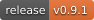
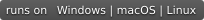
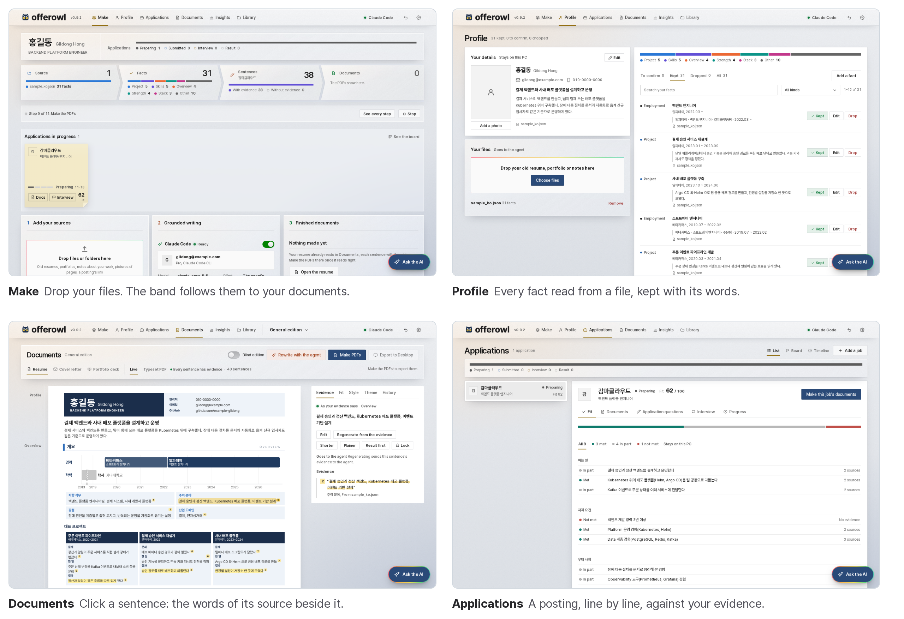
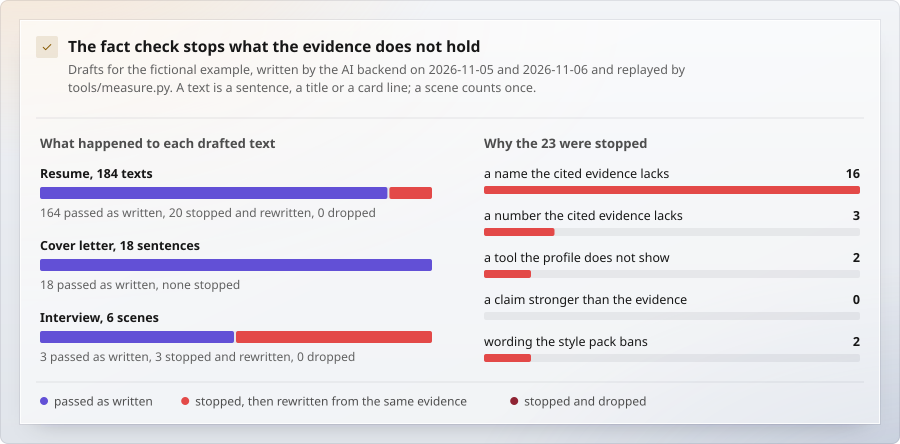
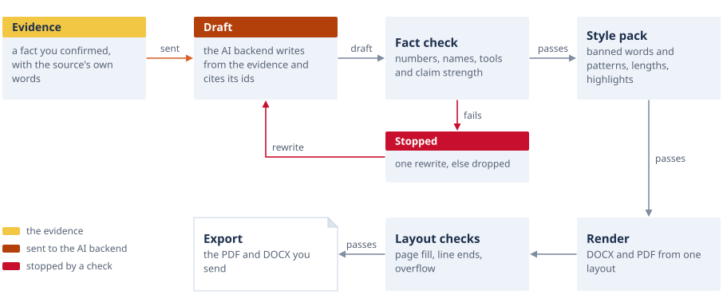
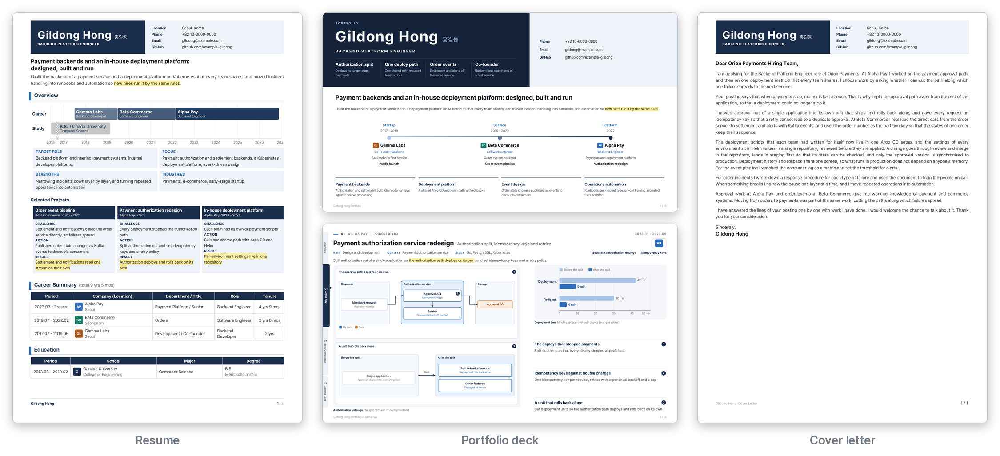

<p align="center">
  <picture>
    <source media="(prefers-color-scheme: dark)" srcset="docs/assets/logo-dark.svg">
    
  </picture>
</p>

<p align="center">
  <b>Your files in. The whole application out. Every sentence cites them.</b><br>
  Resumes, a portfolio deck, a cover letter, the form's answers and interview scripts, written only from what your files say.
</p>

<p align="center">
  <a href=".github/workflows/ci.yml"></a>
  <a href="https://github.com/kanggu12/offerowl/releases"></a>
  <a href="LICENSE"></a>
  
</p>

<p align="center">
  <a href="#quick-start">Quick start</a> &nbsp;|&nbsp;
  <a href="#what-it-does">What it does</a> &nbsp;|&nbsp;
  <a href="#how-it-works">How it works</a> &nbsp;|&nbsp;
  <a href="#guides">Guides</a>
</p>

<p align="center">
  <picture>
    <source media="(prefers-color-scheme: dark)" srcset="docs/assets/screens-dark.png">
    
  </picture>
</p>

Offerowl works like a retrieval system built for one person's career. Its only input is the files you already have: old
resumes, portfolios, notes, a posting's link, a screenshot of the application form. It reads them into facts that keep
the words of their source, retrieves the facts each part of a document needs, and has your AI agent write from those
alone. Nothing to type, nothing to fill in: you drop the files, and the PDFs land on your Desktop.

## Quick start

Pick your system, paste, and drop your files on the page that opens.

**Windows** (PowerShell)

```powershell
iwr https://github.com/kanggu12/offerowl/releases/latest/download/Offerowl-windows-x64.exe -OutFile Offerowl.exe -UseBasicParsing
.\Offerowl.exe
```

**macOS** (Apple silicon; on Intel, `arm64` becomes `x64`)

```bash
curl -fLO https://github.com/kanggu12/offerowl/releases/latest/download/Offerowl-macos-arm64.zip
ditto -x -k Offerowl-macos-arm64.zip . && open Offerowl.app
```

**Linux** (x86-64)

```bash
curl -fLo offerowl https://github.com/kanggu12/offerowl/releases/latest/download/Offerowl-linux-x64
chmod +x offerowl && ./offerowl
```

**Docker**

```bash
git clone https://github.com/kanggu12/offerowl && cd offerowl
docker compose -f deploy/docker/compose.yaml up -d --build
./offerowl open
```

**Python** 3.10 or newer

```bash
pipx install https://github.com/kanggu12/offerowl/releases/download/v0.9.2/offerowl-0.9.2-py3-none-any.whl
offerowl panel --open
```

To write, Offerowl uses the AI agent you are signed in to: [Claude Code](https://github.com/anthropics/claude-code) or
[Codex](https://github.com/openai/codex), or a local model (Ollama, vLLM, LM Studio). With no AI at all, an Offerowl
profile file still becomes PDFs. [docs/INSTALL.md](docs/INSTALL.md) has the Kubernetes chart (one person's, or several
people's, each with an Offerowl of their own), updating, removing and what to choose if your system warns about the
unsigned app; [docs/OFFLINE.md](docs/OFFLINE.md) covers networks with no internet.

[What it needs](docs/INSTALL.md#what-you-need): Windows, macOS or Linux, 8 GB of memory, and Edge or Chrome (Chromium on Linux)
to print the PDFs.

## What it does

- **Nothing to type.** Files and folders are the input: PDF, Word, PowerPoint, text, photos of pages, a zip, LinkedIn's
  export, a posting's link, a screenshot of the form with its questions and limits.
- **Facts with their quotes.** A fact is kept only when its quote is found in its file, and you keep, edit or drop each one.
- **Every sentence cites them.** Click any sentence to see the source words it was written from, and the file they came from.
- **Tailored to a posting.** Each line of the posting is rated against your evidence, and every document is written for it
  from the same facts.
- **What you made stays yours.** A resume written for one job, a Word file, the PDF you sent, a portfolio you wrote as code:
  each comes in as it is ([editions you bring in](docs/DOCUMENTS.md#editions-you-bring-in): through the API, or the workspace's
  `deck/` folder), and what was sent stays byte for byte.
- **Blind editions.** The names you choose under bars of their own width, and an export that refuses a PDF where one still shows.
- **Ready for Word and PowerPoint.** Word files with their fonts inside and the PDF's line heights, the deck as slides; where
  this PC has Office, each is opened there first and must come out with the same pages.
- **Ask in your own words.** **Ask the AI** at the window's bottom right (Ctrl+K) takes a request as Claude Code or Codex would, "the
  first call is done, write it down" or "a resume for this posting", and the agent carries it out through Offerowl's own tools only.
- **On your PC.** Your files, facts and documents stay in one folder; the agent sees only what the step in progress needs.

### Every sentence is checked

Each number, name and tool is held against the facts its sentence cites, and so is how strongly it states your part. What the
checks stopped when the AI backend drafted for the fictional example:

<picture>
  <source media="(prefers-color-scheme: dark)" srcset="docs/assets/chart-factcheck-dark.svg">
  
</picture>

<sub>Measured by `tools/measure.py`, replaying one recorded run of the AI backend ([how each check works](docs/WRITING.md#the-checks)).</sub>

## How it works

1. **Sources.** Drop files or a folder. A posting's link or text is a source too, and so is a screenshot of the form.
2. **Facts with their quotes.** Each file is read into facts, and a fact is kept only when its quote is found in the file.
3. **Grounded writing.** For each part of each document, Offerowl retrieves the facts that speak to it (to the posting,
   when there is one) and the agent writes from them, citing their ids.
4. **Checked before it leaves.** A sentence that fails is rewritten once from the same facts, and dropped if it fails again.
   Only checked PDFs are exported.

<picture>
  <source media="(prefers-color-scheme: dark)" srcset="docs/assets/diagram-sentence-dark.svg">
  
</picture>

## What it makes

| From your sources | Formats |
|:---|:---|
| Resume in Korean and English, in three forms: a detailed career description, one column for job sites, Korean application tables | PDF, DOCX with its fonts inside, plain text |
| Portfolio deck, 16:9, with figures drawn from your facts, or from slides you wrote | PDF, PPTX |
| Cover letter, the posting's duties in the posting's order | PDF, DOCX with its fonts inside |
| Answers to the application form's questions, within each limit | text |
| Interview kit: the likely questions (what an earlier round asked first), scripts from your own documents, search, practice, cue cards and a deck to read before the day | a local page, PDF |
| A talk for an interview that starts with a presentation: your portfolio's pages among slides drawn for the talk, in the interviewers' order, and the script to say over each slide with its time | PDF, a local page |
| Application board: stages, dates, next steps, reminders | a local page, iCalendar |

<p align="center">
  
</p>

## Your data

Your files, facts and documents stay in a folder on your PC. The agent gets only what the current step needs: a file's
text while it is read, the facts and the posting while a document is written. Claude Code sends to Anthropic, Codex to
OpenAI, and a local model only to the server you name. Offerowl sends no telemetry, and the panel listens on this PC only.

| AI backend (`OFFEROWL_LLM`) | Sign in |
|:---|:---|
| `claude-code`, the first choice when signed in | `claude` once |
| `codex` | `codex login` |
| `openai-compat`: Ollama, vLLM, LM Studio | `OFFEROWL_LLM_URL`, and `OFFEROWL_LLM_KEY` when the server asks for one |
| `none`: no model; profile files still become PDFs | |

Offerowl starts the CLI you installed and signed in to, for your own use on your own PC, and the terms of your plan apply
([Anthropic's legal and compliance page](https://code.claude.com/docs/en/legal-and-compliance)). Claude Code and Codex are
products of Anthropic and OpenAI; Offerowl is an independent project.

## Guides

- [User guide](docs/README.md): the panel, from your first files to a finished application
- [Installing](docs/INSTALL.md) and [closed networks](docs/OFFLINE.md): every way to run it, updating and removing
- [Command line](docs/USAGE.md): every command, for scripts and automation, and the blind edition's table
- [Interview kit](docs/INTERVIEW.md): the question map, scripts, search, practice, cue cards, the interview deck and the talk
- [Documents](docs/DOCUMENTS.md): the resume's and the deck's parts, editions you bring in, the profile format
- [Drafting from evidence](docs/WRITING.md): how every sentence is retrieved, written and checked
- [Architecture](docs/ARCHITECTURE.md) and [decisions](docs/DECISIONS.md): the code, the data, the HTTP API and what was measured

## Contributing

Bug reports and changes are welcome: [CONTRIBUTING.md](CONTRIBUTING.md) has the setup, the tests and how a change reaches a release.

## License

MIT ([LICENSE](LICENSE)). The libraries, fonts and programs Offerowl uses are listed in
[THIRD_PARTY_NOTICES.md](docs/THIRD_PARTY_NOTICES.md).
