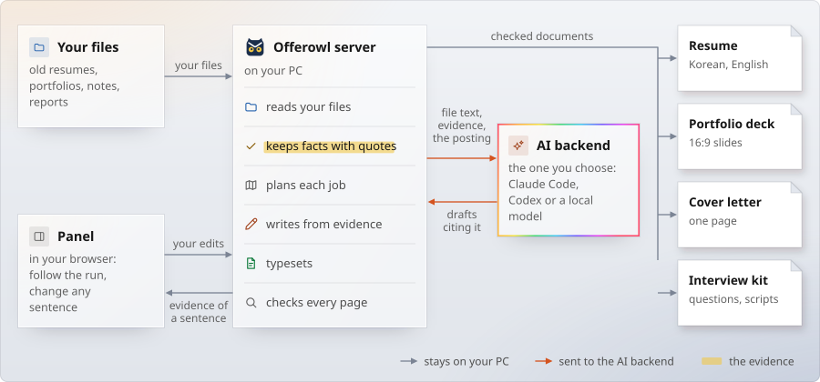
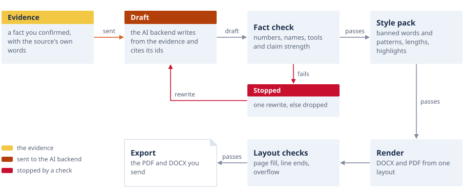
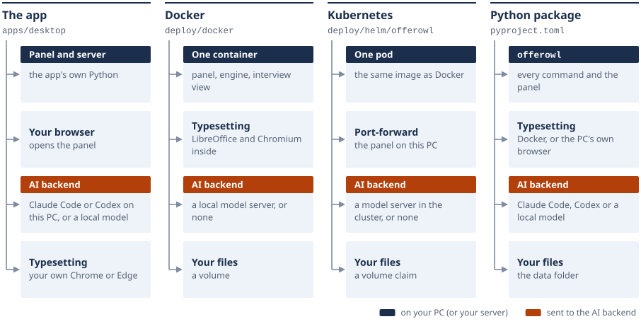

# Architecture

This page says how Offerowl is built and why. To use it, read the [user guide](README.md). To change it, read
[CONTRIBUTING.md](../CONTRIBUTING.md).

On this page: [The pieces](#the-pieces), [The way of a sentence](#the-way-of-a-sentence), [The modules](#the-modules),
[The ways to run](#the-ways-to-run), [Your workspace](#your-workspace), [The HTTP API](#the-http-api), [The
renderer](#the-renderer), [Design decisions](#design-decisions), [What it leaves out](#what-it-leaves-out).

## The pieces

<picture>
  <source media="(prefers-color-scheme: dark)" srcset="assets/diagram-pieces-dark.svg">
  
</picture>

One local server does the work. The panel is a page in your browser that talks to it. The AI backend is a program or a
server outside Offerowl, and it only ever sees what a step sends it. Everything Offerowl keeps is in one folder of plain
files.

| Part | Where | What it does |
|:---|:---|:---|
| Panel | `apps/panel` | The page: three panes, no build step. It only calls the API. |
| API | `apps/api` | One HTTP API that does everything the panel does ([The HTTP API](#the-http-api)). |
| Desktop app | `apps/desktop` | One file that starts the server as a child process, restarts it if it stops, opens the panel and keeps an icon in the notification area. |
| Engine | `src` | Reading files, drafting, typesetting, checks. Flat modules that also run from the command line. |
| Interview kit | `src/interview` | The question map, scenes, audits, search view, practice, cue cards, the interview deck and the talk ([INTERVIEW.md](INTERVIEW.md)). |
| Schemas | `core/schema` | JSON Schema for the profile, the job and each document. |
| Render container | `render` | The image LibreOffice and Chromium typeset in (`Dockerfile`), and the script that runs one command in it (`run.sh`). |
| Examples | `examples` | A fictional person, postings, a cover letter and an interview kit, used by the tests, the self-test and the pictures. |
| Fonts | `fonts` | Pretendard, which the documents and the panel set their text in. |
| Packaging | `deploy` | The app image, the Helm chart and the Python package ([INSTALL.md](INSTALL.md)). |
| Tests | `tests` | One folder per part: `app`, `cli`, `cover`, `decide`, `deck`, `desktop`, `interview`, `packaging`, `parts`, `render`, `write`. |
| Docs | `docs` | These guides; `docs/assets` holds their pictures and `build.py`, which draws them. |
| Tools | `tools` | `measure.py`, which measures on the fictional example the numbers the docs' charts show. |
| Project | `.github` | The CI and release workflows and the script that turns a changelog section into release notes, the issue and pull request forms, the code of conduct and the security policy. |

At the root are only the launcher (`offerowl`, the one command), the files npm reads (`package.json`, `package-lock.json`)
and pip reads (`pyproject.toml`), the project's own pages (`README.md`, `CHANGELOG.md`, `CONTRIBUTING.md`, `LICENSE`), and
git's two settings (`.gitignore`, `.gitattributes`).

## The way of a sentence

<picture>
  <source media="(prefers-color-scheme: dark)" srcset="assets/diagram-sentence-dark.svg">
  
</picture>

1. **Evidence.** `src/ingest.py` turns files into text (PDF, DOCX, PPTX, images through Windows' own OCR or Tesseract; `apps/api/workspace.py` opens zip files and LinkedIn's data export into them) and asks the backend for fact
   candidates, each with a quote. A candidate whose quote is not in the source is dropped. A person keeps, edits or drops
   the rest, and only kept facts reach the profile.
2. **Draft.** `src/write_resume.py`, `src/cover.py`, `src/interview/draft.py` and `src/figure_draft.py` ask for typed JSON
   whose sentences cite evidence ids. A model never sees more than a step needs, and every call goes through `src/llm.py`.
   The panel keeps a resume draft with its job (`apps/api/drafts.py`): the draft owns the sentences it wrote, and names, dates and skills
   stay with the facts. With no agent the resume is the kept facts' own sentences.
3. **Fact check.** `src/factcheck.py` compares each sentence with the evidence it cites: numbers and counted words, names,
   tools, and how strongly it states the person's part. A sentence that fails gets one repair call from the same evidence,
   and is dropped if it still fails.
4. **Style pack.** Banned words and patterns, lengths and highlight rules (`src/style/`, or your own).
5. **Render.** `src/layout.js` writes the DOCX and a renderer makes the PDF ([The renderer](#the-renderer)). The deck is HTML printed
   by a browser.
6. **Layout checks.** Page fill, line ends, overflow and, on slides, overlap, arrow ends, small text and contrast
   (`src/check_render.py`, `src/check_documents.py`, the deck's browser probe); the printed words and the highlights and last
   lines the typesetting set (`src/check_lines.py`, [Printed words](WRITING.md#printed-words)).
7. **Export.** The PDF and the DOCX. A sentence with no evidence blocks the export. "Lock when submitted" keeps exact copies
   with their hashes.

A locked sentence keeps its words: Edit, Regenerate and the rewrite buttons are refused until it is unlocked, and a new draft puts it back in its place.

## The modules

<picture>
  <source media="(prefers-color-scheme: dark)" srcset="assets/diagram-modules-dark.svg">
  
</picture>

Where to start reading:

| To understand | Read |
|:---|:---|
| How one call reaches a model | `src/llm.py`, then a prompt in `src/prompts/` |
| How the resume is made | `src/profile_loader.js` (the loader), `src/resume_form.js`, `src/layout.js`, `src/save.js` |
| How the deck is made | `src/deck_slides.js`, `src/deck_structure.js`, `src/deck_figures.js`, `src/portfolio/draw.js` |
| What the panel can do | `apps/api/routes.py`: every endpoint in one table |
| How the kit is made | `src/interview/cli.py`, then `plan.py`, `draft.py`, `audit.py` and `server.py` |
| How the talk is made | `src/interview/talk.py` (the brief, the plan and the run), then `talk_write.py` (the agent's words) and `talk_page.py` (the script) beside it, and `src/talk_slides.js` (the deck) |
| Which fields a document reads | [Resume and deck parts](DOCUMENTS.md#resume-and-deck-parts) and [The profile format](DOCUMENTS.md#the-profile-format) |

The Python and JavaScript modules import each other by their place in the folder, so the same code runs from a checkout, in
the container, in the Python package and inside the one-file app.

## The ways to run

<picture>
  <source media="(prefers-color-scheme: dark)" srcset="assets/diagram-ways-dark.svg">
  
</picture>

The code is the same in each. What differs is who starts the server and what typesets:

- **The app** is built with PyInstaller. It carries Python, the engine, Node.js (unpacked once into the data folder), the
  typesetting libraries and PDFium for reading PDFs, and it prints with the PC's own Chrome or Edge. When the engine starts one of its helper scripts, the
  app stands in for Python.
- **The container** holds LibreOffice and Chromium, so its PDFs are the reference for the checks.
- **The chart** runs that image in one pod with a volume claim. With `tenants` it runs one such pod for each person, each
  with a claim, a Service, a NetworkPolicy and a host name of their own: Offerowl keeps one person's documents and has no
  login, so several people are several Offerowls, never one panel shared.
- **A container** counts as Offerowl's own image, where the tools are called directly, only when it carries LibreOffice;
  any other container (a dev container, a CI job's) is taken for a PC.
- **The Python package** installs the whole engine folder as data and starts the launcher from there. It typesets with Docker
  where Docker is here, else with the PC's browser ([Which renderer runs](#which-renderer-runs)).

## Your workspace

All in the data folder (`%LOCALAPPDATA%\Offerowl`, `~/Library/Application Support/Offerowl`, `$XDG_DATA_HOME/offerowl`
(`~/.local/share/offerowl`), or wherever `OFFEROWL_DATA_DIR` points):

| Folder | What it holds |
|:---|:---|
| `workspace/profile/` | `profile.json` built from the confirmed facts, `evidence.json` (which facts each part rests on), your own details, the photo, and the photos removed, each waiting in the Trash under a name of its own (`removed-photo-<day>-<time>.*`) |
| `workspace/sources/` | The files you added, the fact candidates, what you kept or dropped, your edits and locked sentences; `removed/<id>.json`: what a removed file took along (its facts, the imported profile it was), so the Trash can put it back |
| `workspace/jobs/<job>/` | `posting.md`, the plan, the resume draft, the card and its reminders, the form's questions and answers (`questions.json`), each edition's PDFs and checks, an edition you brought in (`own/`), the interview kit and the talk's brief (`interview/`, `talk.json`), the materials you brought in for its interview (`materials/`, each file as it came, with its hash in `index.json`), and frozen copies with hashes when you submit |
| `workspace/out/interview/<job>/` | The question map, the drafted scripts, the practice sessions and the talk (`talk/`) |
| `workspace/out/desk_portfolio.json` | The portfolio copies the setting `desk_portfolio` wrote on the Desktop, by language: each name and its hash, the only files it replaces |
| `workspace/blind.json` | Your own table for the blind edition, when you picked one (else `src/blind.json`, which covers nothing) |
| `workspace/style/` | Your own style packs ([Style packs](WRITING.md#style-packs)) |
| `workspace/deck/` | Your own deck source, when you keep one ([Editions you bring in](DOCUMENTS.md#editions-you-bring-in)) |
| `workspace/ask/history.json` | The command bar's last 30 asks and answers, until emptied (`POST /api/v1/ask/clear`) |
| `workspace/.history/` | The last 50 undo steps. Deleting a thing for good rewrites them, so none of them can bring it back |
| `workspace/.gone/` | A job's folder for a moment while it is deleted for good; what a stopped deletion leaves goes at the next start. Never in a backup |
| `*.<process>.<thread>.tmp` | A write in progress beside its file (every write goes through one and a rename). One an hour old, left by a write that was stopped half way, goes at the next start |
| `workspace-before-restore-<day>-<time>/` | Beside `workspace/`: the workspace as it was before a backup was restored. The Trash lists these folders and deletes them |
| `logs/` | Each log capped in size, with one older file kept |
| `runtime/` | The Node.js the desktop app carries, unpacked at its first start |
| `settings.json` | The language, the theme, the agent, the resume's form, the deck's look, the photo, the writing rules, and what the export writes |

## The HTTP API

Offerowl has one HTTP API. The panel uses it for everything it does, and the panel never runs a command of its own.
The command line can call the same table in its own process. The code is in `apps/api/`:

| File | What it holds |
|---|---|
| `routes.py` | Every endpoint in one table, with no HTTP in it: `Router.handle(method, path, query, body)` |
| `web.py` | The table behind HTTP, with the safety rules below |
| `client.py` | The same table in this process (`Client().get(...)`, `.post(...)`, `.wait(task)`) |
| `app.py` | The API object: settings, workspace, facts, the agent card, the tasks, and every action |
| `documents.py`, `evidence.py` | The canvas's documents, and the resume model with the evidence of each sentence |
| `fit.py`, `tracker.py`, `studio.py`, `postings.py` | The fit to a posting, the tracker, the interview board, and a posting from a link |
| `materials.py` | A job's own materials: kept byte for byte, listed, previewed by kind (LibreOffice prints a deck or a Word file where the typesetting runs), copied to the Desktop and removed with an undo |
| `delivery.py` | Where the export's files go (the Desktop the person sees, under WSL the Windows one, and the file manager that shows them), and what the export writes besides the PDFs: the Word files made ready for Word (`src/docx_word.py`) and the deck as a PowerPoint file (`src/deck_pptx.py`), each opened in this PC's Word or PowerPoint where it can be (`src/office_check.py`); and the portfolio kept on the Desktop |
| `workspace.py`, `facts.py`, `tasks.py`, `agent.py`, `standin.py` | Files and undo, facts and the profile, long tasks, the agent card, and the stand-in agent for tests |
| `task_own.py`, `task_kit.py`, `task_export.py`, `task_answers.py` | Parts of the long tasks, by area (`Tasks` inherits them): an application's own edition, the interview kits, the export and the lock, the form answers |
| `stamps.py` | A file's version without reading it, and the short hashes the panel's every poll asks for, worked out once while a file is unchanged |

The data model is JSON Schema in `core/schema/`: the profile, the job (its card, its plan and its fit) and each
document (the resume as the canvas draws it, the cover letter, the interview board and a typeset edition).
`python3 core/schema/validate.py NAME FILE` checks a file, and `GET /api/v1/schema/NAME` serves a schema.

### Running it

| How | Command |
|---|---|
| With the panel (the usual way) | `python3 apps/panel/server.py` (or `./offerowl panel`): the page and the API on 127.0.0.1:8797 |
| The API alone | `python3 -m apps.api serve --port N`: no page, the same rules |
| One call from a shell, no server | `python3 -m apps.api get /api/v1/state`, `python3 -m apps.api post /api/v1/jobs '{"posting": "..."}'`: a write waits for the tasks it starts, which run in that process, and prints how they ended |
| A file from disk, then read it | `python3 -m apps.api add-file cv.pdf` |

`--data DIR` names another data folder (the default is the app's: [Your workspace](#your-workspace)).

### Answers

- A read answers with JSON, except the files: PDFs, page pictures, a job's materials and the calendar file.
- A write answers `{"ok": true, ...}` with the new state of everything under `"state"`, so the panel redraws from one
  answer. Add `?state=0` to leave the state out. The in-process client leaves it out unless asked, and a file upload's
  answer never carries it.
- A write that made an undo step names it in `"step"`; `POST /api/v1/undo {"only": step}` takes back that change alone,
  never one another writer made just after it.
- A job or a named edition in the Trash is refused like one that is not there (`job`) by every route but the Trash's own,
  so nothing is made, changed or started for it until it is put back.
- A refusal answers status 400. A read or a JSON write says `{"error": "bad_request", "what": "<check>"}`, and `what`
  names the rule: `posting`, `job`, `sentence`, `locked`, `unsupported:<n>`, `not_built`, `bad_link` and the rest below.
  A file upload says `{"error": "<check>"}` in the same words (for example `empty`, `photo`, `not_scenes`, `material_kind`).
- A request the safety rules turn away answers 403 `{"error": "<rule>"}` (`host`, `cross_site`, `origin`, `type`,
  `length`), and a file over its cap 413 `{"error": "too_large"}` ([Safety](#safety)).
- An unknown path answers 404 `{"error": "not_found"}`.
- A bug answers 500 `{"error": "unexpected"}`. Its trace goes to the log, never to the answer.
- Long work runs as a task. The write answers at once with `"started"`, and `state.tasks[<key>]` follows it:
  `{state: running | done | error, step, result, error: {code}}`.

### Safety

- The server listens on 127.0.0.1 only, and holds its port alone (`src/ownport.py`): on Windows, Python's HTTP server would
  let a second server bind a port one is already listening on, and the two would share its requests.
- Each server (the panel, the API alone, each kit's view) serves at most 64 requests at once (`OFFEROWL_MAX_REQUESTS`, 4 to
  1024); a connection that finds none free for a second is answered 503 `busy` with `Retry-After: 2` at once, without a
  thread of its own (`src/ownport.py`). The page sends that request again after the seconds asked, twice at most: it
  never reached the API, so nothing of it was done.
- A JSON body is at most 2 MB (else 403 `length`); a file upload is at most 60 MB, a photo 10 MB and a backup 500 MB (else
  413 `too_large`), each refused before its body is read. A job's material has a cap of its own ([Writes](#writes-post)).
- It answers only when the `Host` header names this PC and its port, which stops DNS rebinding.
- A read that another site's page sets off (an image, a fetch or a frame: the browser's `Sec-Fetch-Site` says `cross-site`
  or `same-site`, or the page's `Origin` is not the panel's) is refused for the API and the kits, whose answers do work
  even when that page cannot read them (a backup zipped, a kit server started). The panel itself may be opened from a link.
- A socket read or write waits at most 120 seconds, so a client that names a length and stops sending lets its thread go.
- A write needs a JSON body (`Content-Type: application/json`). From a browser it also needs an `Origin` of the page
  itself, so a form or another site's page cannot write.
- A file upload needs `Content-Type: application/octet-stream` and an `X-File-Name` header. A browser must ask first
  (a CORS preflight) before it can send that, and the server never says yes.
- Job ids, sentence ids and file names are checked against fixed patterns before they touch the disk.
- A job's material that is a web page is answered with a `sandbox` policy beside the panel's own, so opening it runs nothing at
  the panel's address; its preview is a frame with a sandbox and its scripts taken out.
- A link is fetched only when it is http or https and every address of its name is on the public internet (not this PC,
  its network, a carrier's shared range such as 100.64.0.0/10, a link-local or test range, nor such an address written as
  IPv6). The name is asked once and the connection goes to the address that was checked, so a name cannot answer one
  address for the check and another for the connection; through a proxy of the person's settings (`HTTP_PROXY`,
  `HTTPS_PROXY`) the name is checked first and the proxy resolves it. Every redirect is checked the same way. One time
  limit covers the whole fetch, the size is capped, and only the page's text is kept.
- The panel's page loads nothing from elsewhere and frames no address at all: its policy allows its own scripts and
  styles, pictures from itself or written into the page (`data:`), media from itself and from `blob:` (a practice answer
  played back from its recording, which never leaves the page except to the kit's transcriber), no frame source
  (`frame-src 'none'`: a deck's or a saved web page's preview is written into its frame), and no page may frame it. The
  interview tab draws every part itself from the API's data; script text is set as text, and the kit's cards go through
  the kit's own escaping.
- The interview kit's pages, served at the panel's address (`/kit/<job>/`), run only the scripts they were built with:
  each page names its scripts by their hashes in its own policy, its data block has no `<` at all, and its print keys
  carry no handler in an attribute. In the panel every path a kit's `kit.json` names stays inside the workspace (a
  `kit.json` can come with a restored backup); the kit's own command keeps reading files beside it.
- The command bar's agent fetches only the links written in the person's own words (`OFFEROWL_MCP_LINKS`), and is told
  that what it reads through the tools is material, never instructions: a posting cannot send what the agent read to a
  server of its own in a link's query. Offerowl never opens a CLI's own files, its settings included.

### Load and stops

What keeps the panel whole when much is asked at once, when it is stopped, and when it crashes:

- **Many requests at once.** The request slots above: past them a client is told `busy` and when to try again, where a
  thread each would grow without end. A request's body has its cap and a socket its time limit (Safety). The system holds
  512 connections for the accept loop: with Python's own 5 the rest of a burst was dropped and its clients asked again a
  second, then 3, 7 and 15 seconds later. Measured on a 32-core PC, 1,000 requests for the state at once: 100 timed out
  after 30 seconds with 5, and all were answered within 7 seconds with 512.
- **What a load costs.** The state is a few milliseconds of work and a poll that finds nothing changed gets 304; the page's
  own files (index.html, its scripts and styles) come with an ETag and `no-cache`, compressed for a browser that takes
  gzip: a first load fetches 260 KB instead of 932, and a reload gets 304 for each file it holds, while a changed file
  comes again at once.
- **Heavy work at once.** One model task runs at a time (`model_lock`) and one rendering (`render_lock`: LibreOffice and
  Chromium), so documents asked for together are made one after the other within the memory one of them needs, never all
  at once past it. A task that waits its turn says so on the page (step `waiting_turn`) and shows its own step again once
  it runs. One task per key: a second click on a running task starts nothing.
- **A stop.** SIGTERM or SIGHUP (`docker stop`, a pod's end, the desktop app's quit) ends the panel as Ctrl+C does: no new
  request is taken, the ones being answered finish (up to `OFFEROWL_STOP_GRACE` seconds, 5), the tasks still running are
  named in `logs/panel.log`, and the port is let go. A running task ends with the panel; the page starts it again.
- **A crash.** Every file is written to a file of its own beside its place and moved there whole, so a kill at any moment
  leaves the last finished write, and the next start sweeps what a stopped write left. Compose starts a crashed panel
  again three times at most (`restart: on-failure:3`), Kubernetes replaces its pod (the probes ask `/health`), and the
  desktop app restarts its server within a limit.
- **Several people.** With the chart's `tenants` each person has a pod, limits and a claim of their own, so one person's
  load or crash never reaches another's panel.

### Reads (GET)

| Path | Answer |
|---|---|
| `/api/v1/health` (also `/health`) | `{"ok": true, "app": "offerowl", "api": 1}` |
| `/api/v1/state` | Everything the panel draws: Offerowl's `version`, settings, the agent card and the day's calls (`agent_calls`), materials, the facts' counts and a stamp of their rows (`facts: {counts, rev}`; the rows themselves are `/api/v1/facts`), details, problems, jobs with their fit summary and editions, the job in view, tasks, the finished runs (`runs`), undo (`undo`: the next step's label, `undo_id`: its name, `history`: how many steps), what the Trash holds by kind (`removed: {sources, photo, jobs, editions, materials, all}`), due reminders, whether PDFs can be made here (`engine`, with what the browser lacks in `engine_needs`) and the renderer in use (`renderer`: `html` or `container`), and the names of the portfolio copies kept on the Desktop (`desk: {kept}`). It carries an `ETag`: a request with that tag in `If-None-Match` gets `304` with no body while nothing changed, and a client that sends `Accept-Encoding: gzip` gets it compressed |
| `/api/v1/agent?refresh=1` | The agent card, read again |
| `/api/v1/blind` | `{table, own, counts, stamp}`: the blind edition's table as kept (your own, else the shipped one), whether it is yours, how many patterns `mask`, `mask_whole` and `leak` hold, and a short hash of yours (an edition made with another table is stale). The state carries the same summary as `blind` |
| `/api/v1/profile` | `{profile, problems, schema}`: the profile built from the kept facts, what stops a resume, and its schema problems |
| `/api/v1/photo?w=240` | The resume's photo as kept; with `w`, a small copy at most that wide for the panel's own display (with Pillow installed; else the picture itself). 404 with no photo |
| `/api/v1/facts` | Every fact with its state (kept, dropped, to confirm), its quote and the name of its file |
| `/api/v1/documents/resume?lang=ko&theme=navy&job=<job>` | The resume as the canvas draws it (`documents/resume.schema.json`): blocks in print order, and per sentence its text, state (`ok`, `typed`, `edited`, `unsupported`), lock, issues and evidence (quote, where, file). With a job, its plan orders the skills and projects |
| `/api/v1/documents/cover?job=<job>&lang=ko` | The cover letter's paragraphs with each sentence's evidence, or `{"state": "none"}` before it is drafted |
| `/api/v1/jobs` | Every job |
| `/api/v1/jobs/<job>` | One job with its posting |
| `/api/v1/jobs/<job>/fit` | The fit (`job.schema.json#/$defs/fit`): a score from 0 to 100, each posting line rated strong, weak or none with the evidence that covers it, and the gaps. Worked out by words, with no model |
| `/api/v1/jobs/<job>/interview?lang=ko` | The interview board (`documents/interview.schema.json`): the question map by category, the script cards with the dialogue first and its translation as one note below, and the links to the kit's search view, practice mode, cue cards and interview deck |
| `/api/v1/jobs/<job>/interview/view?lang=ko` | What the Interview tab's contents, search and script cards read (`apps/panel/static/kit.js`): every item with its script, the other phrasings, the kit's settings, the synonym groups and the view's words in the panel's language (`src/interview/server.py` view_data), with `model` (a similarity model can be switched on), `api` (`/kit/<job>/`, where its similarity questions go) and `stamp` (changes when a kit file does). With an ETag: asked again with `If-None-Match`, an unchanged kit is a 304 with no body. 404 `no_kit` with no kit |
| `/api/v1/jobs/<job>/interview/deck?lang=ko` | The interview deck as data, for the tab's Deck part (`src/interview/deck.py` data): `{company, role, english, words, counts, posting, scenes, stall}`, the same scripts in the same order as the printed deck, each line as written with its speech marks, the deck's words in the language asked. With an ETag, as the view. 404 `no_kit` with no kit |
| `/api/v1/jobs/<job>/talk/script` | The talk's speaker script as data, for the Presentation part (`src/interview/talk_page.py` script_data): `{title, sub, notes, parts, slides, qa, words, at}`, each slide with its time, the running total, whether it has a picture, where to point, its lines, the line when late, the questions to expect and whether its words are a draft. 404 `no_talk` before a talk is made |
| `/api/v1/jobs/<job>/talk/slides/<n>.png` | The picture of the talk's n-th slide (1 for the first), by its place only; 404 when there is none |
| `/api/v1/jobs/<job>/talk` | The presentation interview: the brief as kept (`jobs/<job>/interview/talk.json`), whether the talk is made, and when it is, its slides, its scripted seconds against the brief's minutes, and the checks' counts (layout defects, slides whose words do not fit their time, texts the checks dropped) |
| `/api/v1/workspace/backup` | The whole workspace as one zip file to save |
| `/api/v1/jobs/<job>/deck/<lang>?theme=` | The deck as it will print, for the canvas's frame: `{html, slides}`, or `{missing}` when it cannot be drawn yet. The page holds its pictures and runs no script. Nothing stays in the engine's folder |
| `/api/v1/jobs/<job>/figures/<lang>/<name>.png?theme=` | A picture the printed resume carries, drawn for the canvas from the edition's profile: `timeline`, `stack` (the hierarchy figure) or `logo_<id>`; the canvas's resume model names each address. 404 when this resume has none |
| `/api/v1/jobs/<job>/files/<lang>/<name>` | A typeset edition's file: `resume.pdf`, `resume.txt` (its plain text), `deck.pdf`, `cover.pdf`, `preview/r-1.png` (resume), `preview/d-1.png` (deck), `preview/c-1.png` (cover letter). The earlier `/doc/<job>/<lang>/<name>` still answers for the PDFs and the pictures |
| `/api/v1/jobs/<job>/materials` | `{materials: [{id, title, name, kind, size, added, sha256}]}`: the job's own materials in the order they came (each job in `state.jobs` carries the same list) |
| `/api/v1/jobs/<job>/materials/<id>` | The file byte for byte, with its type (a text file with its character set) and its own name in `Content-Disposition`; a web page with a `sandbox` policy too. 404 once it is removed |
| `/api/v1/jobs/<job>/materials/<id>/preview` | What the panel shows of it: `{view: "pages", pages, of, more, wide}` (PDF, PowerPoint, Word; the first 60 pages), `{view: "blocks", blocks, cut}` (Markdown), `{view: "text", text, cut}` (text, Python), `{view: "frame", html}` (HTML, scripts taken out) or `{view: "image"}` (PNG, JPG); `{missing: no_tools \| unreadable \| too_large}` when it cannot be shown here. Pages are drawn once and kept |
| `/api/v1/jobs/<job>/materials/<id>/pages/<n>.png` | One page picture of that preview |
| `/api/v1/tracker` | `{stages, jobs, timeline, due}`: the board's columns, every card, every dated step in order, and the reminders due now |
| `/api/v1/insights` | `{kpi, stages, results, funnel, weeks, fits, areas, unsorted, evidence, ready, persona}`: the Insights view's numbers. `areas` sorts every requirement line of every posting into an area by its words (the profile's skill groups add their tools to the area their name belongs to) with the lines met, in part and not met, and the facts that back each area; lines about the hiring itself and lines of no area are counted in `unsorted` |
| `/api/v1/library` | `{rows, counts, bytes}`: every file brought in or made (`source`, `input`, `made`, `sent`, `kit`), each with its owner, size, date, the route that opens it and the write routes that copy it to the Desktop or take it off |
| `/api/v1/materials/<id>` | A file brought in for the profile, byte for byte under its own name |
| `/api/v1/jobs/<id>/posting`, `/sent/<name>`, `/kit/<name>`, `/kit/out/<name>` | A job's posting as read, a copy that went out (only one its lock recorded), a note of its interview kit, the deck and plan the kit's maker wrote |
| `/api/v1/reminders/due` | The reminders that are due and not done (the desktop app can ask this to show them) |
| `/api/v1/reminders.ics` | Every open reminder as an iCalendar file |
| `/api/v1/history` | `{steps: [{n, t, label, id}]}`: the undo steps, newest first; `id` names a step for `history/undo` |
| `/api/v1/removed` | The Trash (apps/api/removed.py): `{rows, asides}`. `rows` is everything removed, newest first: `{id, kind, name, at, size, note, owner, restore, delete}`, with `kind` `source`, `photo`, `job`, `edition` or `material`, `at` the day it went (empty for one removed by an older Offerowl), and the routes that put it back and delete it for good. `asides` are the folders a restore kept beside the workspace, to delete only |
| `/api/v1/ask` | `{history, running}`: the command bar's asks and answers, oldest first, and whether one runs now |
| `/api/v1/schema/<name>` | A schema: `profile`, `job`, `plan`, `fit`, `resume`, `cover`, `interview`, `edition` |

### The agent card and the day's calls

`state.agent` (also `/api/v1/agent`) is the card: `{backend, state, email, plan, found, install, signing_in}`.
`state` is `checking`, `ready`, `signed_out`, `missing` or `off`; `email` and `plan` are what `claude auth status` (or
`codex login status`) reports. Offerowl never opens a CLI's login files and never sees a token, so the card has no
meters of the plan's limits.

`state.agent_calls` counts the card's own agent's calls over the last day, from `src/llm.py`'s call log. The log holds
sizes, times, tokens and error codes, never text. `calls`, `median` (seconds, p50), `tok_in`, `tok_out`, `model` and
`recent` (the last 24 calls' seconds) count answered calls only. The other keys:

| Key | What |
|---|---|
| `effort` | The effort last named: Claude Code's `CLAUDE_CODE_EFFORT_LEVEL` (its settings file is never opened: it can hold keys); a local server's `reasoning_effort`. Empty when none was set |
| `ttft_avg` | Mean seconds to the first token, over the calls whose CLI reported `ttft_ms` in its result; `null` when none did |
| `tps_avg` | Mean output tokens a second while writing (the call's time less its first-token wait, or the whole call when the wait is not known); `null` with no tokens |
| `cost` | The sum of the CLI's `total_cost_usd`, in US dollars. On a subscription this is what the API would charge. `null` when no call reported one |
| `errors` | Failed tries, each try counted (a failure that is asked again counts twice). An answer in the wrong shape is an answered call, not an error |
| `last_error` | `{code, t}`: the latest failure's short code (`timeout`, `exit 1`, `is_error`, `http 429`, `login`, ...) and its epoch seconds, or `null` |
| `bars` | The last 24 answered calls as `{sec, ttft?}`: `ttft` is there only when the CLI reported it, and is never more than `sec` |

### Writes (POST)

| Path | Body | What it does |
|---|---|---|
| `/api/v1/autopilot` | `{ids, paths, posting, url, theme, max_pages}` or `{again: job}` | `max_pages` is 1 to 7. One run from files to finished documents (task `autopilot`, apps/api/autopilot.py): the uploaded `ids` and the files under `paths`, read, kept, written, translated, the deck's figures drawn, typeset, and copied to the Desktop; with a posting, its job, the cover letter and ten interview scripts. A posting alone tailors the facts already kept. `again` makes one edition's PDFs once more; `job` makes the documents of a job already added. While a run goes, a new one waits for it (`queued: true`), and several that wait are merged (their files together, the newer posting). Answers the files found, those skipped and an estimate of calls and minutes. The finished run's `result` names the editions it made (`langs`), the files on the Desktop and `stopped` |
| `/api/v1/style` | `{name, pack}` | A person's own style pack, checked, kept in the workspace's `style/` folder and chosen. Answers `{style}` |
| `/api/v1/blind` | `{table}` or `{table: null}` | Replaces the blind edition's table with your own, kept as the workspace's `blind.json`, or takes it away (the shipped table applies again); one undo step. A table must be an object of at most 200,000 characters whose `mask`, `mask_whole` and `leak` hold at most 500 patterns of at most 300 characters, each compiling alike in Python and JavaScript and none matching empty text, with colours of six hex digits and short words for the band, the label and the contacts to unlink. Refused with `blind_table`, or `blind_pattern:<list>:<n>` for the first pattern that cannot be used. Answers `{blind}`, the summary |
| `/api/v1/photo` | the picture's raw bytes (`application/octet-stream`, `X-File-Name`) | The resume's photo, a JPEG or a PNG by its bytes, kept as `profile/photo.jpg` or `.png` and put on the resume. `GET` reads it ([Reads](#reads-get)) |
| `/api/v1/photo/remove` | `{}` | The photo removed: it waits in the Trash as `profile/removed-photo-<day>-<time>.*` (settings `{photo: false}` only takes it off the resume). It has no undo step: the answer's `removed` is its id in the Trash, which `/api/v1/removed/restore` puts back |
| `/api/v1/jobs/questions` | `{job, questions: [{text, limit, unit}]}` | A job's application questions in order (at most 12; `unit` is `chars` or `words`); an unchanged question keeps its answer |
| `/api/v1/jobs/questions/paste` | `{job, text}` | A form's questions pasted as the form shows them, read with their limits and added after the ones kept. Answers `{added}` |
| `/api/v1/jobs/questions/file?job=<id>` | the file's raw bytes (`application/octet-stream`, `X-File-Name`) | A screenshot, a PDF or a saved page of the form: its questions read (by OCR for a picture) and added. Answers `{added}` |
| `/api/v1/jobs/questions/write` | `{job, ids?}` | Their answers by the agent (task `answers:<job>`), every one or those named |
| `/api/v1/jobs/questions/edit` | `{job, id, answer}` | The person's own words for one answer, checked as a drafted one is |
| `/api/v1/jobs/questions/export` | `{job}` | The questions and answers as one text file on the Desktop; refused (`answers_need_attention`) while one has a problem |
| `/api/v1/interview/scenes?job=<id>` | a scene file's raw bytes | Interview scenes written before into the job's kit; refused (`not_scenes`) when it holds none. Answers `{scenes, file}` |
| `/api/v1/jobs/materials?job=<id>` | the file's raw bytes (`application/octet-stream`, `X-File-Name`) | Keeps one file as the job's material, byte for byte: PDF, PowerPoint (.pptx), Word (.docx), Markdown, HTML, text, Python, PNG or JPG, up to 50 MB. Refused with `material_kind`, `empty`, `job` (no such job; the general edition has none), or 413 `too_large`. Answers `{material}` |
| `/api/v1/jobs/materials/remove` | `{job, id}` | Takes a material off the job's list, with the day (undoable; the file stays in the folder, and the Trash lists it) |
| `/api/v1/jobs/materials/export` | `{job, id}` | Copies a material to the Desktop under the name it came with, never over another file, and reads the copy back against its hash. Refused with `material_changed` when the kept file is not the one added, `copy_unreadable` when the copy does not read back. Answers `{exported: [name]}` |
| `/api/v1/library/export` | `{id}` | Copies the file of one Library row (its `id` in `/api/v1/library`) to the Desktop byte for byte, under a name of its own, never over another file. Refused with `no_file`. Answers `{exported: [name]}` |
| `/api/v1/autopilot/stop` | `{}` | Stops the run after the step in progress (checked between steps and between the pieces the agent reads), and drops what was waiting. A request sent after the stop runs |
| `/api/v1/materials` | the raw file, with `X-File-Name` | Keeps a file in the workspace. Then read it with `/materials/read` |
| `/api/v1/materials/read` | `{ids: [...]}` | Reads the files (task `ingest`). A profile file is read as it is; any other file goes to the agent |
| `/api/v1/materials/remove` | `{id}` | Takes a file and its facts out, with the day (undoable; the Trash puts both back later, or deletes them for good). Refused with `material` when the file is not listed |
| `/api/v1/example` | `{lang}` | Adds the fictional example person, in English when `lang` is `en`, else in Korean, and reads it: Make's "Try an example", which then keeps its facts. Answers `{material}` |
| `/api/v1/facts/decide` | `{cid, action: keep\|drop\|edit\|reset, fields}` | One fact kept, dropped, edited or put back |
| `/api/v1/facts/keep-all` | `{}` or `{material}` | Keeps every fact still to confirm, or only those of one file with `material`. Answers `{kept}` |
| `/api/v1/facts/add` | `{kind, org, period, title, statement}` | A fact typed by the person |
| `/api/v1/details` | `{fields: {name, email, ...}}` | The person's own fields. Typing in one field is one undo step per pause |
| `/api/v1/sentences/edit` | `{sid, text, lang, job}` | A sentence's new words, written into the fact it rests on. The answer's `sentence.state` says whether the evidence still covers it |
| `/api/v1/sentences/lock` | `{sid, locked, lang, job}` | Locks a sentence against Edit and Regenerate, or unlocks it. A new draft keeps a locked sentence's words |
| `/api/v1/sentences/regenerate` | `{sid, lang, job, way}` | New words from the sentence's evidence alone, from the agent and checked like every draft (task `regen:<sid>`). `way` is the direction of a rewrite button: `shorter`, `plainer` or `result` (the result first) |
| `/api/v1/undo` | `{}` or `{only: id}` | Takes back the last change. With `only` (the state's `undo_id` when a change was made, as a removal's note sends it) only while that change is still the newest: otherwise nothing is undone and the answer says `moved: true` |
| `/api/v1/history/undo` | `{steps: n}` or `{steps: n, newest: id}` | Takes back the last n changes. With `newest` (the `id` of the first step `GET /api/v1/history` listed) only while that step is still the newest: otherwise nothing is undone and the answer says `moved: true` |
| `/api/v1/jobs` | `{posting}` or `{url}`, with `company` and `role` optional | A job from a pasted posting or a link. With neither `company` nor `role`, both are read from the posting, and so are any application questions it lists. Its analysis starts at once, by words on this PC (task `analyze:<job>`): adding a job sends nothing to the agent. Answers `{job}` |
| `/api/v1/jobs/select` | `{job}` | The job in view |
| `/api/v1/jobs/analyze` | `{job}` | Analyzes the posting again (task `analyze:<job>`): the agent orders the skill groups, strengths and projects when one is on, else the fit by words does |
| `/api/v1/jobs/posting` | `{job, posting}` | Replaces the job's posting with the text pasted (the Fit tab offers it when the reading found no duty or requirement line), one undo step, and analyzes it again by words; nothing is sent |
| `/api/v1/jobs/tailor` | `{job, lang, theme, maxPages, cover, typeset}` | One action for all three documents (task `tailor:<job>`, with `parts`): the resume ordered for the job, the cover letter drafted from the same plan, the interview kit's question map, and with an agent a few scripts. `typeset` also makes the PDFs |
| `/api/v1/jobs/build` | `{job, lang, theme, maxPages, cover, blind}` | `maxPages` is 1 to 7. The typeset PDFs and their page pictures (task `build:<job>`; typeset with the renderer in use, [below](#the-renderer)). `blind: true` makes a blind edition ([docs/USAGE.md](USAGE.md#a-blind-edition)), `false` an ordinary one; without it the edition stays what it was last made as, or what a resume brought in as its own edition was made as (`form.blind`). A blind build gets its own environment ([Settings](#settings)), never the server's; its `build.json` says `blind` and which table, and its notes say what it left out (`blind_own_file`, `blind_no_deck`, `blind_no_cover`) |
| `/api/v1/jobs/export` | `{job, lang}` | Copies the PDFs to the Desktop (the Word and text files too with settings `export_extras`, the deck as a PowerPoint file with `export_pptx`), each read back: its pages, and a title and an author of its own. Answers `{exported, refused}`: the names on the Desktop, and each Word or PowerPoint file kept home by its own check, `{file, why}` with `why` one of `word_pages:<word>:<pdf>`, `word_unopened`, `docx_unready`, `ppt_slides:<slides>:<pages>`, `ppt_unopened` or `pptx_unmade` ([docs/APP.md](APP.md#documents-the-live-canvas)). While `desk_portfolio` is on, the general edition's deck it keeps on the Desktop is named, not copied again. Refused with `unsupported:<n>` while a sentence has no evidence, `checks_failed` when the build's checks found problems, `changed` when a PDF differs from the one checked, `copy_unreadable` when a copy does not read back. A blind edition's PDFs are read first, with the table as it is now: `blind_leak:<n>` when n of its `leak` and `mask` patterns match their text, a title or author of any revision, an outline entry or a link's address, `blind_unread` when their text cannot be read. Its files are named with "블라인드" or "Blind", without a name the table covers |
| `/api/v1/jobs/write` | `{job, lang}` | Starts task `write:<job>`: the agent writes the resume's sentences from the evidence, for the job's posting, or for no job with `-general`. Every sentence cites its evidence, and locked sentences keep their words |
| `/api/v1/workspace/restore` | the backup as the raw body, sent like a material | A backup in the workspace's place, refused while a task runs. The workspace as it was stays in a folder beside it, named in `kept` |
| `/api/v1/jobs/figures` | `{job, lang}` | Starts task `figures:<job>`: the agent draws figures for each printed project from its evidence. Every number and name is checked, and a figure that fails twice is left out. Before the resume is written, the task ends with the error `needs_draft` |
| `/api/v1/jobs/lock` | `{job, lang}` | Freezes what was submitted: exact copies and their hashes. Refused like the export |
| `/api/v1/jobs/remove` | `{job}` | Takes the job off the board, or a named edition off the editions, with the day (undoable; the Trash lists it) |
| `/api/v1/removed/restore` | `{id}` | Puts one thing from the Trash back where it was, in one undo step (the photo has none): a file of the profile with its facts as they were decided, or unread (`read_again: true`) when they cannot come back whole. The photo put back sends a photo added since to the Trash in its place. Refused with `removed` when it is not in the Trash |
| `/api/v1/removed/delete` | `{id}` or `{all: true}` | Deletes for good one thing in the Trash, or every row (an aside only by its own id): its files and records, the facts read from it, and its copies in the undo steps, which are rewritten so none can bring it back. Documents and drafts already made from a file's facts and the details it filled in, Desktop copies, backups and the command bar's history stay. Refused with `busy` while a task runs (for a file of the profile or a job), `removed` for anything not in the Trash, `delete_failed` when a file stayed (held open). Answers `{deleted, steps}` |
| `/api/v1/ask` | `{text}` | The command bar: the person's words to the agent, which acts through Offerowl's own tools (task `ask`, apps/api/ask.py). Refused with `no_panel` from a process with no server of its own |
| `/api/v1/ask/clear` | `{}` | Empties the command bar's history. Refused with `busy` while an ask runs. Answers `{cleared}` |
| `/api/v1/jobs/own` | `{job, profile, langs, name, form}` | A resume the person already wrote for this job (or a named edition), brought in whole as its own edition: `profile` in the profile format, `langs` its languages, `form` its layout choices per language (`blind: true` among them makes it a blind edition until the switch says otherwise). A second one replaces the first. Returns `{facts}` |
| `/api/v1/editions` | `{name}` | A named general edition: no posting, never on the board, listed in the state's `editions`. Returns `{job}`, its id, which the other job routes take |
| `/api/v1/jobs/own-file?job=&lang=&kind=` | the file as the raw body, sent like a material | A document the person made for this edition: `kind` is `resume` or `cover` (PDF or Word) or `deck` (PDF). Making the PDFs uses it in place of the typeset one |
| `/api/v1/jobs/sent-file?job=&lang=&kind=` | the file as the raw body, sent like a material | A file that went out with this application (PDF, Word or slides), kept byte for byte as its submitted copy; the job counts as submitted |
| `/api/v1/tracker/edit` | `{job, stage, date, dates, next, result, company, role}` | A card moved or edited. `date` is the current stage's day, `dates` any stage's (`{stage: YYYY-MM-DD}`, empty to clear). `result` is `offer`, `rejected`, `withdrawn`, `closed` or the person's own words |
| `/api/v1/tracker/round` | `{job, kind, at, asked, notes}`, or `{job, id, ...}` or `{job, id, remove: true}` | Keeps an interview round (`kind`: `call`, `first`, `second`, `third`, `final`, `coding`, `assignment`, `culture`, `other`; `at` `YYYY-MM-DD` or with its time; `asked` the questions, one a line), changes one, or removes it. A recorded round counts as an interview reached. The questions asked lead the job's question map (kind `asked`), so the next scripts answer them first |
| `/api/v1/tracker/clear_day` | `{day}` | Empties the stage days equal to `day` on the applications added that day that carry it as a stage's day, when five or more were added at once (a list brought in stamps its day on every card: `tracker.batch_day`). A `day` that is not that batch's changes nothing. One undo step; answers `{cleared}`, the ids changed |
| `/api/v1/tracker/next` | `{job}` | A card moved one column on |
| `/api/v1/reminders` | `{job, at, text}`, or `{job, id, done}` or `{job, id, remove: true}` | Adds a reminder (`at` is `YYYY-MM-DD` or `YYYY-MM-DDTHH:MM`), marks it done, or removes it |
| `/api/v1/interview/kit` | `{job, lang}` | Makes the job's interview kit folder and its question map, with no model |
| `/api/v1/interview/scripts` | `{job, lang, ids}` | Writes the next 10 scripts, the likeliest questions first, or a script for each of the map's entries named in `ids` (up to 30, such as an earlier round's questions that no script answers) (task `scripts:<job>`, with `done` and `total`) |
| `/api/v1/interview/start` | `{job}` | Serves the job's kit (search view, deck, cue cards, practice) on a port of its own in this process, reached at the panel's `/kit/<job>/`; the last four jobs' kits stay up |
| `/api/v1/interview/talk/brief` | `{job, brief}` | Keeps the brief of a presentation interview, merged into the one kept: `topics` (in the interviewers' order), `minutes`, `when`, `format`, `where`, `request` (their words), `lang`, and the other keys of [The talk](INTERVIEW.md#the-talk), which gives their defaults. A brief that is not an object, or whose topics all lack a title, is refused (`bad_brief`). Answers `{brief}` |
| `/api/v1/interview/talk` | `{job, lang}` | Makes the talk: its deck from the job's portfolio and its own slides, and its script (task `talk:<job>`; [INTERVIEW.md](INTERVIEW.md#the-talk)) |
| `/api/v1/interview/talk/deliver` | `{job}` | Puts the talk's slides and script (PDF) on the Desktop, read back against their bytes, under the names [The talk](INTERVIEW.md#the-talk) gives. Answers `{files}` |
| `/api/v1/translate` | `{job}` | The English profile for English editions (task `translate`, needs the agent). When the job's resume draft holds English, only what the draft does not hold is translated, and the profile is marked partial |
| `/api/v1/engine/setup` | `{}` | Installs the typesetting libraries (task `setup`, the one step that uses the network) |
| `/api/v1/settings` | `{lang, theme, backend, agent, llm_url, llm_model, form, deck_style, photo, style, export_extras, export_pptx, desk_portfolio}` | The settings. `lang` is `auto`, `ko` or `en`; `theme` is `auto`, `light` or `dark`; `form` is the resume's form, `detailed`, `compact` or `table` ([Resume forms](DOCUMENTS.md#resume-forms-srcresume_formjs-job-setting-form)); `deck_style` is the deck's look, `classic` or `clean` ([The portfolio deck](DOCUMENTS.md#the-portfolio-deck)); `photo` puts the photo on the resume or takes it off; `style` is the writing rules, `default` or a pack of the workspace's `style/`. `backend` is `auto`, `claude-code`, `codex`, `openai-compat` or `none`. `agent` is the switch: `off`, or `on` to go back to the backend chosen before. `OFFEROWL_LLM`, `OFFEROWL_LLM_URL` and `OFFEROWL_LLM_MODEL`, set when Offerowl starts, win over saved settings until the menu changes them. `export_extras` and `export_pptx` (off by default) add the Word and text files and the PowerPoint file to the export; `desk_portfolio` (off by default) keeps the general edition's portfolio on the Desktop after every build of it that passes, and when turned on copies one that passed already |
| `/api/v1/onboarding` | `{step, done}` | A record of where a first look stands, kept with the workspace for older pages |
| `/api/v1/agent/login` | `{}` | Starts the agent CLI's own sign-in, which opens the browser |
| `/api/v1/agent/refresh` | `{}` | Reads the agent card again now |
| `/api/v1/open` | `{what: workspace\|desktop}` | Shows a folder in the file manager. The folder's path never reaches the page |

### What is sent to the agent

| Call | Sent |
|---|---|
| `/materials/read` | The text of each file in parts of up to 12,000 characters; a profile file sends nothing |
| `/jobs/analyze` | The posting (up to 8,000 characters) and the names of the skill groups, strengths and projects |
| `/jobs/write` | The kept facts as evidence blocks and the posting, part by part ([Stages and calls](WRITING.md#stages-and-calls)) |
| `/jobs/figures` | Each printed project's evidence and its pages' card heads ([Drafting figures](DOCUMENTS.md#drafting-figures-srcfigure_draftpy)) |
| `/jobs/tailor` | What `/jobs/analyze`, `/jobs/write` and the scripts below send, and the cover letter's calls: the posting's lines with an index of the profile, then each paragraph's evidence ([The four steps](DOCUMENTS.md#the-four-steps)) |
| `/interview/scripts`, and the scripts of `/jobs/tailor` | Once per job, the posting and the resume, for the expected questions; for each script, the passages of your profile, confirmed facts, stories, documents and research that share its question's rare words (up to 18,000 characters) |
| `/interview/talk` | The brief and its pasted words, the posting and the company research notes, the titles of the talk's slides, and the blocks of your profile for the projects the talk shows; for the script, each slide's own words and the blocks it rests on |
| `/jobs/questions/write` | Each question, the posting (up to 3,000 characters) and the kept facts that share its rare words (up to 7,000 characters) |
| `/sentences/regenerate` | The sentence and its evidence |
| `/translate` | The profile's text fields in Korean, in batches; with a resume draft, only those the draft does not hold |
| `/ask` | Your words, and what the agent reads through Offerowl's own tools |
| `/autopilot` | What its steps send: each file as `/materials/read` does, the resume, the translation and the figures, and with a posting the analysis, the cover letter and ten scripts |
| Everything else | Nothing. Adding a job, the fit, the question map, the canvas, the tracker and the checks run on this PC |

## The renderer

Offerowl can typeset every document with the browser that is already on the PC: Edge on Windows, Chrome or Chromium
anywhere, or the Chromium that Playwright downloads. It needs no Docker and no LibreOffice, so the desktop app can make
documents on a PC that has neither. This section says how it works, what it needs, how it was checked against the
container, and what still differs.

### Two renderers, one switch

| `OFFEROWL_RENDERER` | What typesets | Needs |
|---|---|---|
| `container` | LibreOffice turns the DOCX into a PDF and Chromium prints the deck, inside the render container (`render/run.sh`) | Docker, bash |
| `html` | the PC's own Chrome or Edge prints both, on the host | a browser, Node.js, Python with Pillow |

```bash
OFFEROWL_RENDERER=html ./offerowl build examples/sample_ko.json      # resume and deck with the PC's browser
python3 src/render_html/render.py doctor                            # what this PC has for each renderer
python3 src/render_html/render.py docx in.docx out.pdf               # one DOCX of src/layout.js to PDF
python3 src/render_html/browser.py --list                           # the browsers found, the one in use first
```

Unset, it uses the container where Docker is here and the browser where it is not, and on Windows always the browser
(see "Which renderer runs").
An unknown value stops with a message; it never falls back to the other renderer by itself.

Where the switch is wired in: `src/resume.py` (`build`, `build_deck`, the document check, `selftest`), so `./offerowl build`
and `./offerowl selftest` follow it, and `src/cover.py build`, which prints the letter with the browser through
`render.fit_pages`, the same density loop as the container's script.

### How it works

The design keeps one source. [src/layout.js](../src/layout.js) writes every resume and cover letter as DOCX, for both
renderers, and the DOCX is the export format. The html renderer then does with that DOCX what LibreOffice does in the
container:

1. `src/render_html/docx2html.py` reads the DOCX (paragraphs, runs, tab stops, borders, shading, tables, inline and
   floating pictures, hyperlinks, page size and margins, the footer with its page fields) and writes one HTML page with
   the same structure. It needs only the Python standard library.
2. `src/render_html/page.js` runs in that page before printing and applies LibreOffice's layout rules: line heights,
   tab stops, floating pictures, page breaks and the footer on every page.
3. `src/render_html/browser.py` finds a browser and prints the page headless to PDF, at the page size of the DOCX.
4. The deck is HTML already (`src/deck_slides.js`): the same driver prints it and reads the deck's own measurement out
   of the page (`.probe.json`), as the container did with a second Chromium run.

Writing the design twice, once as DOCX and once as HTML templates, was the alternative. That was rejected: the same code in two
files drifts apart, and a bug fixed in one comes back from the other.
Converting the DOCX means a change to layout.js reaches the PDF and the DOCX export together.

#### Fonts

The page never relies on fonts installed on the PC. Every family a document asks for becomes an `@font-face` rule that
points at a font file (`src/render_html/fonts.py`), under a private name, so two PCs typeset the same letters with the
same widths and break lines in the same places. The files come from the repository's `fonts/` (Pretendard, which the
resume, the cover letter and the deck use), then the folders in `OFFEROWL_FONT_DIRS`, then the system font folders of
Windows, macOS and Linux. Palatino Linotype resolves to TeX Gyre Pagella as fontconfig does in the container. Each rule
carries the vertical metrics LibreOffice uses (the typographic ones when the font asks for them, else hhea) as
`ascent-override` and `descent-override`, so line boxes and baselines come out the same on every system.

#### LibreOffice's rules, measured

Each rule below was found by measuring LibreOffice's PDF of the same DOCX, word by word, with a small test document or
with the examples (tests/render/compare.py lists word positions with `--words`):

- A `w:line` without `w:lineRule` is an exact line height in twips, not 240ths of a line (LibreOffice 7.4 reads it that
  way; the docx package never writes the rule). `line="264"` gave lines 13.2pt apart at 8, 9 and 12pt. Every line of an
  exact paragraph is that high, with the baseline at 80% of it.
- Single spacing: a line is as high as the largest ascent plus the largest descent of the letters on it.
- Between two paragraphs the larger of the spacing after and the spacing before counts, not their sum (a section title
  sat 12.5pt below a paragraph with 3pt after). CSS margins collapse the same way.
- At the top of a page after a natural break the spacing before is dropped.
- A left border sits outside the indent; the text stays at the indent.
- Every cell of a table row takes the largest top margin and the largest bottom margin in that row (layout.js notes it
  for the photo header). Left and right margins are measured from the grid line, so half of a border lies inside them;
  top and bottom margins start inside the border. A table's outer borders lie inside its height.
- The empty paragraph that Word needs after a table at the end of a cell is dropped.
- Hangul next to a Latin letter or a digit gets a gap of a fifth of the font size; a WORD JOINER stops it (save.js
  writes them). A non-breaking hyphen is drawn as a plain hyphen.
- A paragraph keeps at least two lines on each side of a page break. Keep-with-next moves a title with the block after
  it, unless the chain starts the page. Header rows of a table repeat on the next page.
- The footer sits at the footer distance from the bottom edge and grows upwards. LibreOffice's PDF places everything
  0.1pt right of and below the DOCX position; the page does the same.
- When a run names different Latin and East Asian fonts, spaces, digits and punctuation take the script of the letter
  before them, as LibreOffice splits script runs.

Two browser roundings would undo that precision: Chrome snaps baselines and line boxes to whole CSS pixels, keeps glyph
advances in 1/64 pixel and floors border widths to whole pixels. The page is therefore laid out at 24 times its size and
drawn back at 1/24 when printed. A pixel is then 1/32pt, and every OOXML border width (a multiple of 1/8pt) is a whole
number of pixels. Line heights are written as numbers, never `normal`, which the browser rounds to whole pixels.

#### Finding the browser

`browser.py` tries, in order:

1. `OFFEROWL_BROWSER`, a path the person chose;
2. Edge and Chrome where their installers put them on Windows (`Program Files`, `Program Files (x86)`, `LOCALAPPDATA`),
   Chrome, Edge and Chromium in `/Applications` and `~/Applications` on macOS, and `google-chrome`, `chromium`,
   `microsoft-edge` on PATH elsewhere;
3. the Chromium that Playwright keeps (`PLAYWRIGHT_BROWSERS_PATH`, else its cache folder of each system): its headless
   shell first, then the full build, the newest of each first. `python -m playwright install chromium` puts both there.
   On Linux the headless shell printed the full Korean example in 0.4 s, pixel for pixel the same PDF as Google Chrome;
   Playwright's full Chromium never finished a print and is only the last resort.

Without `OFFEROWL_BROWSER`, each browser found is tried in turn until one prints, so a browser that fails or hangs (a
print gives up after 90 seconds) does not stop the build. Each print uses a throwaway profile folder, never the person's
own, and runs headless. The sandbox stays on except as root or in a container, where Chromium cannot start it. On
Windows the browser is never started just to learn its version (`msedge.exe --version` opens a window there); the
version is read from the folder named after it next to the program.

### What the html renderer needs

| Part | Why | Without it |
|---|---|---|
| A Chromium-family browser | prints the pages | the build stops: "is missing on this PC: Chrome or Edge" |
| Node.js | `resume_form.js`, `deck_slides.js` and `cover_form.js` write the DOCX and the deck page | the build stops and names Node.js |
| Python with Pillow | `overview_figures.py` draws the timeline and the hierarchy figures | the build stops and names Pillow |
| `node_modules` | the docx package (`OFFEROWL_NET=1 render/run.sh npm ci` once) | the build stops and names the libraries |
| A PDF reader: poppler, or pypdfium2 with Pillow (`pipx inject offerowl pypdfium2 pillow`; the desktop app carries it) | the document check, the page previews and the self-test read the PDF (`src/pdftools.py`) | the check cannot run on that PC |
| LibreOffice, only for a Word file you bring in as an edition's own and for the pages of a job's Word or PowerPoint material | turns them into PDF on this PC | that edition's build stops and names LibreOffice; the material's preview answers `no_tools` |

`render.py doctor` (and `resume.renderers()` from Python) reports the browser, Node.js, Pillow, the fonts and `node_modules`
for the html renderer, and Docker for the container.

### Settings

| Setting | Meaning | Default |
|---|---|---|
| `OFFEROWL_RENDERER` | `html` or `container` | `container` where Docker is here, else `html` where a browser can typeset; `html` on Windows |
| `OFFEROWL_BROWSER` | the browser to use | the search order above |
| `OFFEROWL_FONT_DIRS` | more font folders, separated like PATH | none |
| `OFFEROWL_KEEP_HTML` | `1` keeps the HTML page next to the PDF (`render.py docx`) for a look in a browser | off |
| `PLAYWRIGHT_BROWSERS_PATH` | where Playwright keeps its browsers | Playwright's own |

`render/run.sh` hands `OFFEROWL_RENDERER` to the scripts in the container too; there `html` prints with the container's
Chromium.

A blind edition's three switches go the same way, per build: `OFFEROWL_BLIND=1`, `OFFEROWL_BLIND_LANG` (`ko` or `en`) and
`OFFEROWL_BLIND_TABLE`, a table inside the repository (the panel stages the workspace's `blind.json` under `output/_inputs` and takes
it away after the build). `src/blind.js` reads them for the Word file and the deck, `src/blind.py` for the figures, the page-one band
and the document check. With the html renderer they reach the same scripts on the PC, through the environment the build is given,
and the browser draws a bar's horizontal scale (`w:w`, written only on the bars) and the band anchored to the page as LibreOffice does.

### The parity gate

`tests/render/compare.py` compares two PDFs of one document page by page:

- **Pages:** the same count.
- **Text layer:** every line of the old PDF must be in the new one with the same characters in the same order, and no
  line may be extra. This catches any changed line break and any changed word order. Lines are matched as a set, each
  to the nearest line with the same text, because pdftotext's reading order across table columns depends on tiny
  position differences. Spaces are not compared: pdftotext splits letter-spaced text into words differently per
  producer.
- **Pixels, strict:** the share of pixels whose grey value differs by more than 40 of 255 at 60 dpi, the metric the
  parts test uses. The rasters are aligned at the page's top-left corner and cropped to the common area: Chrome
  prints A4 as 594.96pt wide and LibreOffice as 595.30pt, and stretching one onto the other instead shifts the right
  edge by a whole pixel.
- **Pixels within one pixel:** a pixel counts only when no pixel within one pixel of it in the other image is that close,
  in either direction. A letter that moved by a fraction of a pixel does not count; a missing, extra or recoloured part
  still does.

How sensitive the strict share is: LibreOffice's own PDF against itself moved by 0.12pt scores 0.00%, moved by 0.24pt
0.99%. A strict share above 1% therefore means letters sit about a quarter of a point from LibreOffice's.

`tests/render/parity.py --container` builds every fictional example with both renderers under their own output names
(the usual outputs are never overwritten) and compares the resume, the deck and the cover letter. Its last line reads
`parity: N documents, P pages, worst page X% strict / Y% within 1px, text same|differs`.

#### Results on the fictional examples (2026-11-06)

Container: LibreOffice 7.4 and Chromium 156 in `offerowl-render`. html: Google Chrome 151 on the host (Linux).

| Example | Document | Pages (container / html) | Lines the same | Worst page, strict | Worst page, within 1px | Per page, strict |
|---|---|---|---|---|---|---|
| sample_ko | resume | 2 / 2 | 128 / 128 | 1.04% | 0.08% | 0.87, 1.04 |
| sample_ko | deck | 6 / 6 | 137 / 137 | 0.00% | 0.00% | 0.00, 0.00, 0.00, 0.00, 0.00, 0.00 |
| sample_full_ko | resume | 3 / 3 | 168 / 168 | 1.24% | 0.09% | 0.58, 1.24, 0.52 |
| sample_full_ko | deck | 13 / 13 | 519 / 519 | 0.00% | 0.00% | 0.00, 0.00, 0.00, 0.00, 0.00, 0.00, 0.00, 0.00, 0.00, 0.00, 0.00, 0.00, 0.00 |
| sample_full_en | resume | 3 / 3 | 179 / 179 | 1.66% | 0.15% | 1.25, 1.66, 1.21 |
| sample_full_en | deck | 13 / 13 | 528 / 528 | 0.00% | 0.00% | 0.00, 0.00, 0.00, 0.00, 0.00, 0.00, 0.00, 0.00, 0.00, 0.00, 0.00, 0.00, 0.00 |
| export_shape | resume | 1 / 1 | 71 / 71 | 0.64% | 0.06% | 0.64 |
| export_shape | deck | 3 / 3 | 52 / 52 | 0.00% | 0.00% | 0.00, 0.00, 0.00 |
| cover_ko | cover | 1 / 1 | 28 / 28 | 0.92% | 0.06% | 0.92 |
| cover_en | cover | 1 / 1 | 33 / 33 | 1.67% | 0.09% | 1.67 |

Every document has the same page count and the same lines in both renderers. The decks are pixel-identical: they were
HTML in both, and only the browser changed. Within one pixel every page differs by 0.15% or less. The strict share
is under 1% on 5 of the 11 resume and letter pages.

#### What still differs

- **Glyph positions within a line.** LibreOffice places each glyph on its own grid, so words of the same length in its
  PDF are up to 0.09pt wider or narrower than in the browser's, and positions wander by up to 0.2pt along a line. That is
  a fraction of a pixel at 60 dpi, but it moves anti-aliased letter edges past the strict threshold. Korean pages have it
  too, and it is what keeps the strict share near 1% on them.
- **Justified Latin lines.** On every justified English line LibreOffice adds about 0.045pt less per space than the line
  needs, so its lines end 0.5 to 1.4pt short of the margin; Korean justified lines fill the margin. The browser fills
  every line, so `page.js` gives an English paragraph its lines' average shortfall as a right padding (strict share 2.81%
  to 1.67% on the English letter, 2.13% to 1.66% on the English resume). A line's own shortfall would mean cutting up its
  runs, so what is left is the difference between a line and its paragraph's average. A paragraph whose lines would break
  elsewhere with the padding keeps its full width, because LibreOffice breaks its lines first and falls short after.
- **Keep-with-next before a picture.** LibreOffice can leave a section title alone at the bottom of a page and move
  only its picture to the next one; in the test documents it moves both, as the browser does. The rule behind the
  exception is not known yet.

#### Which renderer runs

Offerowl judges the two renderers by what a reader can see: the same pages, the same lines, and within one pixel. The
strict share measures how far letters sit from LibreOffice's glyph grid, a fraction of a pixel that no reader sees, and
closing it would mean copying that grid into `page.js`.

So with `OFFEROWL_RENDERER` unset, the container runs where Docker is here, so that nothing changes for someone who has
it, and the browser runs where it is not, so a PC with no Docker just works. On Windows the browser runs even with Docker:
the container is started by `render/run.sh`, a shell script Windows cannot run, and `container` set there says so and
points to the browser or to WSL. A value that is set always decides. The desktop app always uses the browser.

### Tests

```bash
python3 -m unittest tests/render/test_render.py -v     # the converter's rules, fonts, the browser search, the switch (seconds)
python3 tests/render/compare.py old.pdf new.pdf --words 10 --diff --images DIR   # one document, with what moved
python3 tests/render/parity.py --container --md table.md                        # every example both ways (minutes, needs Docker)
python3 tests/render/parity.py --md table.md                                    # the browser side again, against the last container run
```

Without `--container` the parity script compares with the container's PDFs of the last `--container` run and warns when a
file under `src/` or `examples/` is newer than them: a difference may then come from the changed inputs. `test_render.py`
needs nothing but Python for most tests; one prints a small DOCX with a real browser (skipped when there
is none, or with `OFFEROWL_TEST_BROWSER=0`) and compares it with itself through poppler (skipped without poppler).

## Design decisions

1. **One AI backend at a time.** You pick one, and every task uses it. There is no routing between a local model and a cloud
   agent: an application is a few long documents, so steady quality matters more than the cost per call. Prompts and schemas are
   the same for every backend.
2. **Facts before words.** A model may only write from evidence a person confirmed. This is why reading files and writing
   sentences are separate steps, and why a sentence cites ids rather than free text.
3. **Rules first, models where only a model can.** Typesetting, the fact check, the layout checks, search and the fit by words need
   no model. So Offerowl stays useful with no AI at all, and its checks cannot be talked out of a result.
4. **Local first.** Profiles, sources and outputs stay on the PC. The panel is open to that PC only, and with an agent on, every
   action that sends something says so.
5. **No terminal for normal use, and nothing to click in between.** Files or a folder are dropped, and one run makes every
   document. Nothing asks for a key or a command. The command line stays for automation and tests.
6. **One design language.** The envelope mark in navy and amber; frosted glass cards and bar on a desk lit by a lamp, printed pages
   and what is read opaque, the highlighter on evidence, Pretendard, light and dark, Korean and English. Colour carries meaning: blue stays on this PC, orange goes to the AI backend, yellow is the
   evidence, red is stopped by a check, green is ready or done.
7. **Checks you can run.** Every claim in these docs about quality comes from a script: the tests, `tools/measure.py` for the
   pictures, and `tests/decide/evaluate.py` for [decision models](DECISIONS.md). Fictional people only, so anyone can run them.

## What it leaves out

- It does not search for jobs, fill in application forms or send anything. Other tools do that well.
- It does not judge what makes a document good: which project leads, what the story is. It follows the posting and your style
  pack, and you decide.
- It has no accounts and no server of its own. A shared instance is outside what it is built to protect, because the panel has no
  login.
