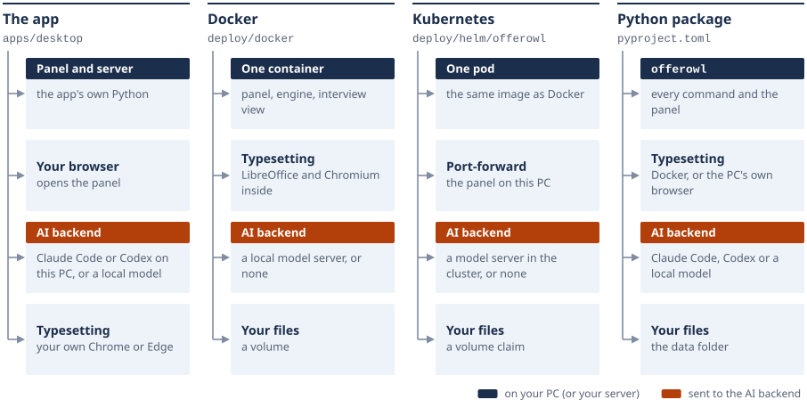

# Installing Offerowl

Four ways to run the same panel. Paste the block for yours; the panel opens in your browser, and you drop your files on it.

| Way | For | Needs |
|:---|:---|:---|
| [The desktop app](#1-the-desktop-app) | most people | the file for your system; Edge or Chrome to print the PDFs |
| [A container](#2-a-container-docker-compose) | one PC or a home server | Docker 24 or newer with Compose, and git |
| [A Helm chart](#3-a-kubernetes-cluster-helm) | a Kubernetes cluster | Kubernetes 1.25 or newer, Helm 3.8 or newer |
| [A Python package](#4-the-python-package) | the command line and scripts | Python 3.10 or newer (tested on 3.10 to 3.15) |

<picture>
  <source media="(prefers-color-scheme: dark)" srcset="assets/diagram-ways-dark.svg">
  
</picture>

If something is missing, `offerowl doctor` says what and how to fix it ([5](#5-the-doctor)). With no internet, see
[closed networks](OFFLINE.md).

## What you need

| | |
|:---|:---|
| System | Windows 10 or 11 (64-bit); macOS 13 or newer, Apple silicon or Intel; Linux on x86-64 with glibc 2.35 or newer (Ubuntu 22.04, Debian 12). The Docker image is built for x86-64 and ARM |
| Memory | 8 GB; typesetting uses up to 4 GB while it runs |
| Disk | about 200 MB for the app; 4 GB with Docker, whose typesetting image is about 1.5 GB |
| Network | to download; to install the typesetting libraries once (the package); for Claude Code and Codex, a model server that is not on your PC, and a posting's link. Making documents works offline ([closed networks](OFFLINE.md)) |

**Typesetting.** The app prints with the Edge, Chrome or Chromium already on your PC. The container and the chart carry their
own LibreOffice and Chromium. The package uses Docker where it is installed, and the browser otherwise and on Windows (then
it also needs Node.js 22 or newer, Pillow, and poppler or `pipx inject offerowl pypdfium2 pillow`). `OFFEROWL_RENDERER=html` or
`container` picks one (on Windows only `html`: `container` there stops and points to the browser or WSL); both give the same
pages ([how they compare](ARCHITECTURE.md#the-renderer)).

**The AI.** One backend at a time ([The AI backend](USAGE.md#the-ai-backend)): Claude Code or Codex you are signed in to, on
the PC that runs the app or the package; a model server with an OpenAI-compatible address (Ollama, vLLM, LM Studio), for any
way; or none, where you confirm the facts yourself and the documents are still made and checked. The container and the
chart carry no Claude Code or Codex, so they use a model server or none.

## 1. The desktop app

**Windows** (PowerShell)

```powershell
iwr https://github.com/kanggu12/offerowl/releases/latest/download/Offerowl-windows-x64.exe -OutFile Offerowl.exe -UseBasicParsing
.\Offerowl.exe
```

**macOS** (Apple silicon; on Intel, `arm64` becomes `x64`)

```bash
curl -fLO https://github.com/kanggu12/offerowl/releases/latest/download/Offerowl-macos-arm64.zip
ditto -x -k Offerowl-macos-arm64.zip . && open Offerowl.app
```

**Linux** (x86-64)

```bash
curl -fLo offerowl https://github.com/kanggu12/offerowl/releases/latest/download/Offerowl-linux-x64
chmod +x offerowl && ./offerowl
```

The panel opens in your browser. The icon by the clock opens it again, opens the data folder, or quits. Sign in to Claude
Code or Codex before you start it if you want the AI steps. The first start unpacks the app's Node.js (about 125 MB, once).

Downloaded with a browser from the [Releases page](https://github.com/kanggu12/offerowl/releases) instead, the app is not
code-signed yet, so the system asks once:

| System | File | What to choose |
|:---|:---|:---|
| Windows | `Offerowl-windows-x64.exe` | **More info**, then **Run anyway** |
| macOS, Apple silicon | `Offerowl-macos-arm64.zip` | macOS 15 or newer: **System Settings**, **Privacy & Security**, **Open Anyway**. macOS 13 and 14: right-click the app, **Open**, then **Open** again |
| macOS, Intel | `Offerowl-macos-x64.zip` | the same |
| Linux | `Offerowl-linux-x64` | the file's **Properties**, **Allow executing as a program** |

**Check the download.** The release lists a SHA-256 for each file in `SHA256SUMS`, and GitHub records where each was built:

```bash
sha256sum -c --ignore-missing SHA256SUMS
gh attestation verify Offerowl-linux-x64 --repo kanggu12/offerowl
```

On Windows, compare `Get-FileHash Offerowl.exe` with its line. The files are built and checked on Windows, on macOS (Apple
silicon and Intel) and on Linux. The image has no line in `SHA256SUMS`; GitHub's record of where it was built is checked by
name: `gh attestation verify oci://ghcr.io/kanggu12/offerowl-app:0.8.0 --repo kanggu12/offerowl`.

**Options.** `--no-browser`, `--no-tray` (no notification area), `--port N`, and `--check` (a throwaway copy with a stand-in
agent reads one file, makes the example's documents, and stops). [APP.md](APP.md) describes the panel.

**Your files** are in the data folder: `%LOCALAPPDATA%\Offerowl` on Windows, `~/Library/Application Support/Offerowl` on
macOS, `~/.local/share/offerowl` on Linux (`$XDG_DATA_HOME/offerowl` when that is set). `OFFEROWL_DATA_DIR` names another
folder.

**Update.** Quit the app and run the block again. The data folder stays.

**Uninstall.** Quit the app from its icon and delete the file (on macOS, the app). Deleting the data folder deletes your
profile and documents for good.

## 2. A container (Docker Compose)

```bash
git clone https://github.com/kanggu12/offerowl && cd offerowl
docker compose -f deploy/docker/compose.yaml up -d --build
./offerowl open
```

The panel, the engine, the interview view and the typesetting tools run in one container, with a volume for your files. The
first build takes several minutes; later starts take seconds. `./offerowl open` needs Python 3.10 or newer (on Windows,
`python offerowl open`); without it, open http://127.0.0.1:8797.

A published image instead of a build (the version is on the Releases page):

```bash
OFFEROWL_APP_IMAGE=ghcr.io/kanggu12/offerowl-app OFFEROWL_APP_TAG=0.8.0 docker compose -f deploy/docker/compose.yaml up -d
```

Settings come from your shell or from a `.env` file next to `deploy/docker/compose.yaml`:

| Setting | Meaning | Default |
|:---|:---|:---|
| `OFFEROWL_PANEL_PORT` | the panel's port, the same number on your PC and in the container; the interview kit is on it too, at `/kit/<job>/` | 8797 |
| `OFFEROWL_LLM`, `OFFEROWL_LLM_URL`, `OFFEROWL_LLM_MODEL`, `OFFEROWL_LLM_KEY`, `OFFEROWL_LLM_REASONING` | the AI backend: `none`, or `openai-compat` with a model server ([USAGE.md](USAGE.md#settings)). A server on your PC is `http://host.docker.internal:11434` from the container | `none` |
| `OFFEROWL_LANG` | `ko` or `en`, for the log messages | `en` |
| `OFFEROWL_DATA` | the absolute path of a folder for your files, in place of the volume | the volume `offerowl-app_offerowl-data` |
| `OFFEROWL_UID`, `OFFEROWL_GID` | the user the container runs as; with a folder in `OFFEROWL_DATA`, `$(id -u)` and `$(id -g)` | 10001 |
| `OFFEROWL_CPUS`, `OFFEROWL_MEM` | the container's caps (Docker refuses a CPU cap above the CPUs it has) | 4, `4g` |
| `OFFEROWL_APP_IMAGE`, `OFFEROWL_APP_TAG` | the image to run | `offerowl-app`, `local` |
| `TZ` | the time zone of dates and logs | UTC |

The container gets only the settings in this table. The port opens on your PC's loopback only, because the panel has no
login and holds your documents. The container runs as a user that is not root, with a read-only root filesystem and no
added privileges. The doctor and every command of [USAGE.md](USAGE.md) run inside it:
`docker compose -f deploy/docker/compose.yaml exec app offerowl-doctor`.

From another PC, forward the port over SSH with the same number on both sides: `ssh -L 8797:127.0.0.1:8797 <server>`, then
open http://127.0.0.1:8797 there.

**Your documents.** A container has no Desktop: **Export to Desktop** writes to `export/` in the data folder (`/data/export`).
With a folder in `OFFEROWL_DATA` they are there; with the volume, this copies them out:
`docker compose -f deploy/docker/compose.yaml cp app:/data/export .`

**Update.** `git pull`, then the `up -d --build` line again; with a published image, the new `OFFEROWL_APP_TAG` and `up -d`.
The volume stays.

**Uninstall.** `docker compose -f deploy/docker/compose.yaml down` keeps your files; `--volumes` deletes the volume for good
(a folder in `OFFEROWL_DATA` stays). `docker image rm offerowl-app:local`, or the published image's name, removes the image.

## 3. A Kubernetes cluster (Helm)

```bash
helm install offerowl oci://ghcr.io/kanggu12/charts/offerowl --version 0.8.0 --namespace offerowl --create-namespace
kubectl --namespace offerowl port-forward svc/offerowl 8797:8797
```

Then `offerowl open`, or the address Helm's notes print. One pod with a claim for your files (5Gi by default); it needs a
default storage class or a claim you name. The chart exposes nothing; the panel is reached by a port-forward with the same
port on both sides. `helm test offerowl --namespace offerowl` asks its health check.

From a checkout, with an image you built and pushed where the cluster can pull it:

```bash
docker build -f deploy/docker/Dockerfile -t registry.example.com/offerowl-app:0.8.0 .
docker push registry.example.com/offerowl-app:0.8.0
helm install offerowl deploy/helm/offerowl --namespace offerowl --create-namespace --set image.repository=registry.example.com/offerowl-app
```

Settings go in a file passed with `-f`; `deploy/helm/offerowl/values.yaml` describes every value:

```yaml
# my-values.yaml
ai:
  backend: openai-compat                      # none (the default) or openai-compat
  url: http://ollama.models.svc:11434         # the model server the pod can reach
  model: my-model
  existingSecret: offerowl-model-key          # only for a server that asks for a key; the Secret has a key named "key"
persistence:
  size: 10Gi
resources:
  limits:
    memory: 6Gi
```

Make the key's Secret first: `kubectl create namespace offerowl`, then
`kubectl --namespace offerowl create secret generic offerowl-model-key --from-literal=key=<the key>`.

- **The pod** runs as user 10001 with a read-only root filesystem, no capability and the runtime's seccomp profile, so the
  `restricted` Pod Security level accepts it. A NetworkPolicy lets no pod connect to the panel.
- **The AI** is written into the panel's settings at every start: change it with `helm upgrade`, not in the panel. A model
  server's key is read from the Secret you name and stored nowhere else.
- **An Ingress** (`ingress.enabled`) is off. With it on, the chart passes the Ingress hosts as `OFFEROWL_ALLOWED_HOSTS`, and
  the Ingress controller's pods reach the panel once `networkPolicy.allowFrom` lists them (values.yaml has the form). The panel
  has no login of its own: the Ingress takes your controller's basic-auth or OAuth annotations (`ingress.annotations`) and TLS
  (`ingress.tls`).
- **Your documents** go to `export/` on the claim (`/data/export`) when you choose **Export to Desktop**; this copies them
  out: `kubectl --namespace offerowl exec deploy/offerowl -- tar -C /data -cf - export | tar -xf -`

**Several people.** Offerowl holds one person's profile and documents and has no login, so people never share a panel.
List them in `tenants` and one release runs an Offerowl for each, named `<release>-offerowl-<name>`:

```yaml
# team-values.yaml
ingress:
  enabled: true
  className: nginx
  tenantHost: "{name}.offerowl.example.com"     # alice.offerowl.example.com, bob.offerowl.example.com
networkPolicy:
  allowFrom:
    - namespaceSelector:
        matchLabels:
          kubernetes.io/metadata.name: ingress-nginx
tenants:
  - name: alice
    ingress:
      annotations:
        nginx.ingress.kubernetes.io/auth-type: basic
        nginx.ingress.kubernetes.io/auth-secret: alice-basic-auth
  - name: bob
    resources:
      limits:
        memory: 6Gi
    persistence:
      size: 10Gi
    ingress:
      annotations:
        nginx.ingress.kubernetes.io/auth-type: basic
        nginx.ingress.kubernetes.io/auth-secret: bob-basic-auth
```

- **Each person's own:** a pod, a Service, a claim (`<release>-offerowl-<name>-data`), a NetworkPolicy that lets no
  other pod in (another person's neither), a `helm test` pod, and with the Ingress a host name and a login of their own. A
  panel answers its own host name only, so a request meant for another person is refused even if it reaches the wrong pod.
- **Each person's limits:** a heavy build stays inside its person's CPU and memory limits, and the pods are spread over the
  nodes (softly: a small cluster still runs them all), so one node lost takes the fewest panels with it.
- **Each person's settings:** every value of the chart is each person's default, and a person's `ai`, `resources`,
  `persistence`, `language`, `timezone`, `extraEnv` (added to the release's), `ingress` and scheduling fields replace it for
  them alone. values.yaml lists them under `tenants`.
- **Refused before anything is made:** a name that is not a DNS label or is listed twice, a field that is not a person's
  own (a typo), a claim or a host name given to two people, `persistence.existingClaim` for the whole release (everyone would
  share it), and a person without a host name when the Ingress is on. Each refusal says what to change.
- **Turning a release to tenants** removes its own Offerowl but keeps its claim (`<release>-offerowl-data`): give it to its
  person with `tenants[].persistence.existingClaim`. Removing someone from the list stops their panel and keeps their claim.
- **Without an Ingress**, forward one person's Service at a time: `kubectl --namespace offerowl port-forward
  svc/team-offerowl-alice 8797:8797`.

**Update.** `helm upgrade offerowl oci://ghcr.io/kanggu12/charts/offerowl --version <new> --namespace offerowl`. The claim
stays.

**Uninstall.** `helm uninstall offerowl --namespace offerowl` leaves the claim;
`kubectl --namespace offerowl delete pvc offerowl-data` deletes your files for good.

## 4. The Python package

```bash
pipx install https://github.com/kanggu12/offerowl/releases/download/v0.8.0/offerowl-0.8.0-py3-none-any.whl
offerowl panel --open
```

The first time, the panel offers to install the typesetting libraries (once, with the network). `offerowl doctor` checks the
rest and `offerowl --help` lists every command ([USAGE.md](USAGE.md)). From a checkout, in a virtual environment:

```bash
python3 -m venv ~/offerowl-venv && ~/offerowl-venv/bin/pip install .
~/offerowl-venv/bin/offerowl panel --open
```

(On Windows the command is `offerowl-venv\Scripts\offerowl.exe`.) Extras: `pipx inject offerowl pystray pillow` for the
`offerowl-app` icon by the clock, `pypdfium2 pillow` to read PDFs with no poppler; for the interview page checks,
`pipx inject --include-apps offerowl playwright`, then `playwright install chromium` (it downloads Chromium). The package
carries the engine as data; `OFFEROWL_ENGINE_ROOT=<folder>` uses the engine in a checkout instead.

**Update.** `pipx install --force` with the new wheel's address, then `offerowl doctor`.

**Uninstall.** `pipx uninstall offerowl`. Your files are in the data folder ([1](#1-the-desktop-app) lists it) and stay until
you delete it.

## 5. The doctor

`offerowl doctor` (in the container, `offerowl-doctor`) changes nothing: it creates no folder, installs nothing, calls no
model, and prints no key, password or e-mail address. Each row ends in `OK`, `WARN` (a feature is missing; Offerowl still
runs) or `FAIL` (documents cannot be made yet), and a row that is not `OK` has a `Fix:` line. It exits with 1 when a row fails.

| Row | What it looks at |
|:---|:---|
| Python | 3.10 or newer |
| Data folder | exists or can be created, can be written, 1 GB free |
| Engine folders | the engine can write its output folder |
| Typesetting libraries | the resume and deck writers' libraries are installed |
| Typesetting | the renderer in use works: Docker and its image, or a browser with Node.js 22, Pillow and the fonts, or the container's own tools |
| Browsers | the Chromium-based browsers found, Playwright for Python, a default browser for the panel |
| AI backend | Claude Code and Codex installed and signed in, a model server answering, the one in use |
| Fonts | the Pretendard files of the panel and the documents |
| Ports | 8797 (or `OFFEROWL_PANEL_PORT`) free, or held by a running Offerowl |
| PDF reader | poppler or pypdfium2, for old PDFs, previews, checks and the interview kit |

`--json` prints the rows for a script, `--only python,render` limits them (`--help` names them), and `OFFEROWL_LANG=ko`
prints Korean.

## If something does not work

- Run the doctor first.
- The logs are in the data folder's `logs/`: `panel.log`, and for the app `app.log` (what stopped it) and
  `server-console.log`; in a container, `docker compose -f deploy/docker/compose.yaml logs`; in a cluster,
  `kubectl --namespace offerowl logs deploy/offerowl`.
- "Port in use" (`offerowl panel` says "port N is in use"): another program, or a panel already running, holds 8797.
  `offerowl open` shows a panel that runs. Stop the other program, or pick another port: `--port N` for the app and the package,
  `OFFEROWL_PANEL_PORT` for the container, `service.panelPort` for the chart.
- The panel answers 403 in a browser: the address bar must say `127.0.0.1` or `localhost` and the panel's own port. A
  port-forward or a published port with another number on your side is refused on purpose.
- The container cannot write to the folder in `OFFEROWL_DATA`: run it as the folder's owner
  (`OFFEROWL_UID=$(id -u) OFFEROWL_GID=$(id -g)`), or give user 10001 write access.
