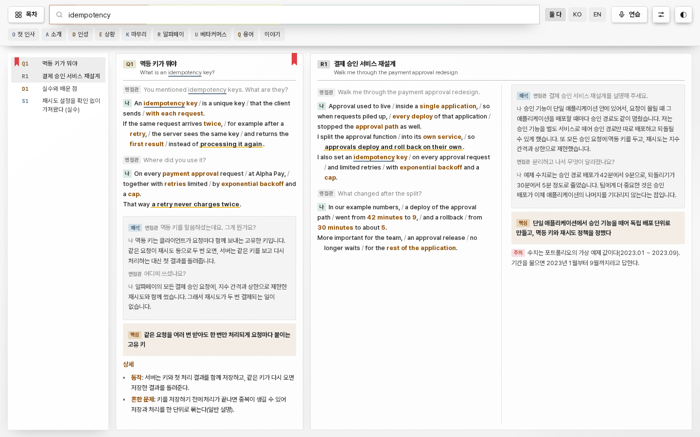

# Interview kit

The interview kit turns a job's scene files into a search view of your own scripts, checks those scenes before you
rely on them, and lets you practise them aloud. For an interview that starts with a presentation it also makes the deck
and the script ([The talk](#the-talk)). The code is the `src/interview/` package; the commands run through
`src/interview/cli.py`.

<picture>
  <source media="(prefers-color-scheme: dark)" srcset="assets/diagram-interview-dark.svg">
  
</picture>

```bash
python3 src/interview/cli.py serve --job <workspace>/jobs/<job>          # the search view, at the address it prints
python3 src/interview/cli.py check --job <workspace>/jobs/<job>          # scene checks
python3 src/interview/cli.py cards --job <workspace>/jobs/<job>          # card defects in the real page
python3 src/interview/cli.py eval  --job <workspace>/jobs/<job>          # search hit rate on the job's eval set (--questions FILE: another set)
python3 src/interview/cli.py plan  --job <workspace>/jobs/<job>          # question map; --anticipate adds the job's scenario and technical questions (model, once)
python3 src/interview/cli.py draft --job <workspace>/jobs/<job>          # new scenes for planned questions (model); --limit caps them, --jobs writes several at a time
python3 src/interview/cli.py audit --job <workspace>/jobs/<job>          # posting coverage and portfolio claims; consistency with --consistency (model)
python3 src/interview/cli.py cue   --job <workspace>/jobs/<job>          # printable cue cards
python3 src/interview/cli.py deck  --job <workspace>/jobs/<job>          # the printable interview deck (16:9); --pdf prints it
python3 src/interview/cli.py talk  --job <workspace>/jobs/<job>          # the presentation interview's slides and script (model; --backend none keeps to the documents; --lang ko|en; --no-pdf skips the script's PDF)
```

`--job` takes the job folder or its `interview/` folder. Every command also takes `--kit` (a kit.json kept somewhere
else), `--workspace`, `--profile` and `--out`. Messages are in Korean or English: `OFFEROWL_LANG=ko|en`, else the
kit's `ui`, else Korean (the kit is written for Korean speakers who interview in English).

Only `cards`, `eval`, `cue --pdf` and `deck --pdf` need Playwright with Chromium (`pip install playwright && python3 -m
playwright install chromium`). `talk` draws and prints its deck with the renderer in use, as the documents are
([The renderer](ARCHITECTURE.md#the-renderer)). Only `draft`, `talk`, `audit --consistency`, `audit --judge`,
`plan --phrase`, `plan --anticipate` and practice mode with an agent call a model. Practice mode transcribes speech only
when faster-whisper is installed. Everything else uses the Python standard library.

## The workspace

```
profile/profile.json          confirmed facts (docs/DOCUMENTS.md)
stories.md                    behavioral stories, shared by every job
style/<name>.json             style packs
jobs/<job>/posting.md         the posting
jobs/<job>/research/*.md      company research notes
jobs/<job>/submitted/         the resume and portfolio that were sent (text, markdown or PDF)
jobs/<job>/interview/         scene files (*.md), kit.json, alts.json, eval_questions.json, talk.json (a talk's brief)
jobs/<job>/materials/         the panel's own: decks, notes and briefs brought in for the interview (docs/APP.md); the kit
                              does not read them
out/interview/<job>/          what the commands write: plan, anticipated questions, drafts, audit, eval and card results,
                              cue cards, practice/ (one file per practice session), model_cache/ (the audit's
                              model answers) and talk/ (the talk's deck, script and record)
```

Nothing is written into the job folder: every output goes to `--out`, by default `<workspace>/out/interview/<job>`.
The drafts in that default folder join the search view, practice and cue cards as soon as they are written.

## Scene files

A scene file is markdown. `## A. Section title` opens a section (one capital letter or a digit, then the title).
`### A1. 한국어 제목 / English title` opens an item; the id is a letter and a number, and a stories file may use
`## S8b. title` for an item at the second level. A section without item headings becomes one item per bold-labelled
bullet when it has three or more, and one item otherwise.

Labelled lines are written `**label** text` or `- **label**: text`:

| Label | Meaning |
|---|---|
| `면접관` | the interviewer's English line |
| `나` | my English line |
| `해석` | the Korean translation of the line above it |
| `핵심` | the one line to land |
| `주의`, `꼬리 대비` | cautions and follow-up notes |
| `KO`, `국문`, `EN` | an answer in one language |

Any other bold label in a bullet (`- **상세**: ...`) is a note. Bullets labelled with one of the kit's `hidden_labels`
(default `사용자 원문`, `근거`) are notes for the writer and never appear on the page.

My lines carry speech marks: ` / ` for a breath, ` // ` between sentences inside a line, `**stress**`, one
`==key phrase==` per scene, `backticks` around commands and settings, and Korean stage notes in brackets such as
`(웃으며)`. Answers are 3 to 5 sentences of 15 to 30 words; the first answer of the one-minute self-introduction stays
one minute. What the person did comes only from evidence, and how a tool works may come from general knowledge, in the
present tense.

## kit.json

Every key is optional.

| Key | Default | Meaning |
|---|---|---|
| `ui` | `ko` | language of the page and the messages |
| `sources` | every `*.md` in the folder, then the workspace's stories | `[{"file", "label", "prefix", "role"}]` in order. `file` is relative to the interview folder; `@stories` is the workspace's stories file. `label` names the source on the page, `prefix` makes ids for items without one, `role` is `scenes`, `deep` (resume deep dives), `terms` ("what is X" entries) or `reference` (notes, stories) |
| `sections` | heading text | short tab name per section letter, e.g. `{"A": "Intro"}` |
| `synonyms` | none | extra synonym groups, added to `src/interview/synonyms.json` |
| `strip` | none | regular expressions (JavaScript syntax) for the writer's cross-references, removed before showing |
| `hidden_labels` | `사용자 원문`, `근거` | bullet labels that are never shown |
| `fallback` | none | the item shown when nothing matches (an "I don't know" scene) |
| `weak_hint` | none | `{"ko", "en"}` advice shown on the best card when nothing is close |
| `examples` | built in | `{"ko", "en"}` examples in the search box |
| `company` | "this company" | `{"ko", "en"}` the company's name for the question map |
| `alts`, `eval` | `alts.json`, `eval_questions.json` | the phrasings and the eval set, in the interview folder |
| `profile`, `stories` | `profile/profile.json`, `stories.md` | relative to the workspace |
| `style` | none | style pack name (`style/<name>.json` in the workspace) or path |
| `posting` | `posting.md` | relative to the job folder |
| `resume`, `portfolio` | first `submitted/*resume*` and `*portfolio*` file | relative to the job folder; `.txt`, `.md` or `.pdf` |
| `materials` | `posting.md`, `research/*.md`, `submitted/*.txt`, `submitted/*.md` | job-relative patterns that ground facts, besides the profile, the stories, the submitted resume and portfolio (PDFs too) and every markdown file of the interview folder |
| `research` | `research/*.md` | company research for the question map |
| `names` | none | a job-relative file of `Korean = English` lines: the spellings a scene's English lines use for names. They join the evidence of every drafted scene and ground the checks. The panel writes it from the resume draft and the profile's English names |
| `grow_skip` | none | ids or section letters left out of the length-growth rule |
| `draft_sections` | `asked L, posting P, resume R, portfolio F, term Q, behavioral D, company C, opening O, scenario E, technical T` | the section letter a drafted scene of each kind joins (`asked`: a free letter when the kit already uses L) |
| `evidence_chars` | `18000` | characters of evidence for one drafted scene; lower it for a local model with a small context |
| `coverage` | `{"strong": 0.6, "weak": 0.3, "spoken": true, "strong_roles": ["scenes", "deep"]}` | coverage thresholds; whether a scene is measured on what it says only, and the roles that can rate a line strong |
| `size_queries` | first, middle and last eval question | the three searches of `cards --sizes` |

`alts.json` maps an item id to other ways the question may be asked. `eval_questions.json` is
`{"questions": [["Tell me about yourself", ["A1"]], ...]}`: a question and the ids that answer it.

## Style packs

The interview rules come from `src/interview/style_default.json` (AI-sounding words, padding phrases, banned
characters, particles spaced after Latin words) and the job's style pack. A style pack is the same file the resume
uses, with an `interview` object; lists add to the built-in ones:

```json
{
 "banned_chars": "",
 "interview": {
  "banned_words": ["rockstar"],
  "padding": ["That's a great question"],
  "forbidden": [{"pattern": "single-handedly|sole owner", "why": "it was a team effort", "in": "en", "except": ["A10"]}],
  "spaced_josa": true
 }
}
```

`banned_words` are whole English words, `padding` exact phrases, `forbidden` patterns checked in the English lines
(`en`), the 해석 lines (`ko`) or both, with `except` naming items they do not apply to.

## The search view (`serve`)

`serve` reads the scene files and serves one page on 127.0.0.1 (port 8796 by default). The page puts the English scene first with the Korean 해석 note box under it (its badge on the first line), the interviewer's
lines dimmed, the contents screen that folds the largest groups until it fits, the tabs, the board of equal columns
that places short answers in stacks and long ones across several columns, and the type size and column width settings.
It ranks by keywords (BM25 over the title, key line, phrasings and text, with Korean particles stripped and synonym
groups) in the browser, so it needs no model. Term entries come first for a "What is X?" question and step back for a
scenario question. Edits to the scene files show on the next page load. In the panel, an application's Interview tab draws
the same contents, board and cards with its own parts, ranked by the same code (the page's marked engine blocks, copied
byte for byte into `apps/panel/static/kit.js` and checked by `tests/packaging/test_kit_engine.py`), so a question finds the
same script in both.

<picture>
  <source media="(prefers-color-scheme: dark)" srcset="assets/screenshot-interview-dark.png">
  
</picture>

The similarity model is optional and off by default: `serve --model <bge-m3 folder>` (`tokenizer.json`,
`onnx/model_int8.onnx`; needs numpy, onnxruntime and tokenizers) shows a switch on the page that loads the model and
blends similarity into the ranking. `OFFEROWL_SEARCH_MODEL=<that folder>` names it once instead: `serve` then takes it
without `--model`, and so does the panel for the kit it shows in an application's Interview tab and at `/kit/<job>/`.
Without either there is no switch, and a folder that lacks the two files is named (in `serve`'s output, or in the panel's
log) and gives none.

The switch loads the model in about ten seconds and holds 1.4 GB while it is on; in the panel each job's kit holds its
own copy while its switch is on. Turning it off asks first, on a sheet under the switch, since a stray click in the
middle of an interview would cost those seconds again. On a question asked in other words than the cards use, the
model is what finds the card: of the 28 reworded questions about the example kit
(`tests/decide/fixtures/kit_questions_reworded.json`) the keywords put the right card first for 16 and the model for
24, and every right card is then among the first three ([DECISIONS.md](DECISIONS.md#the-kits-search)).

The server listens on 127.0.0.1 only and refuses requests whose Host header names another address. In a container,
use `--host 0.0.0.0` and publish the port to 127.0.0.1 only.

On a window 720 pixels wide or less (a phone) the same page changes shape: the question box takes its own row under
the keys, the tabs scroll sideways, the contents are one column, and the answers are one column that scrolls down
instead of screens that slide sideways, a size larger. Wider windows keep the board: the phone rule never
applies at the sizes `cards` and `eval` measure by default, and `cards --size 390x844` measures every card in the
phone layout.

## Practice mode

The 연습 (Practice) key in the bar, or the page's address with `#practice`, opens a mock interview. In the panel the same
practice is the Interview tab's **Practice** part, drawn with the panel's own parts and talking to this API at the
panel's `/kit/<job>/api/practice/` ([APP.md](APP.md#an-applications-interview)). The microphone is used only between
Record and Stop, and the feedback and your own script appear only after you answer.

- **Questions.** The question map (`plan`, built when practice first opens) gives the topics an interviewer has in
  front of them. Every topic a scene covers becomes one question, one per scene, the kinds taken in turn (what the earlier
  rounds asked, posting, resume, portfolio, behavioral, company, scenario and technical by default; openings and terms on
  request). Without an agent the question is the scene's own first interviewer line and the follow-ups are its later
  interviewer lines (the fixed list); a question an earlier round asked comes in the words it was written down in. With an
  agent, one call per session (`src/llm.py run()`) phrases the questions as an interviewer would (never one asked before), and
  one call per answer asks a follow-up about what you actually said, in English whatever language the agent usually
  answers you in; a follow-up that comes back in another language gives way to the scene's own.
- **Answers.** Record answers aloud (the browser's MediaRecorder) or type them. A recording is transcribed on this
  PC when faster-whisper is installed (below); otherwise its time and pauses are still measured and you type what you
  said. You can play the recording back in the tab; it is never saved.
- **Feedback, without a model,** compared with the scene's answer for that turn and with the job's evidence:
  - length: words against the scene's (short under 60 percent, long over 150 percent), and for a spoken answer its
    time against the scene spoken at 140 words a minute, and your own rate;
  - long pauses: silences of 2.5 seconds or more inside the answer, from the speech model's word times, else from the
    microphone level the page records every 50 ms;
  - fillers: the style pack's `fillers` list (um, uh, you know, ...; "like" only between commas, "kind of" not after
    "what"), with their rate a minute;
  - departures from your facts: a number changed against the same unit in the scene ("5 minutes" where it says 4,
    number words read as digits), numbers and names found neither in the scene nor in the evidence, and claims
    stronger than the scene's ("I led" where the scene gives the work to the team, a colleague or a proposal). With
    an agent, the follow-up call also lists departures; each is kept only when both of its quotes are found;
  - the key phrase: the scene's `==key phrase==` for that turn, landed when 60 percent of its words were said.
- **Timer and sessions.** The pane shows the session's clock and the answer's clock. Each session is kept on this PC
  as `<out>/practice/<id>.json` (every turn, its feedback and a summary: answers, time, mean length, long pauses,
  fillers, departures, key phrases landed); only the newest 500 files are kept. The setup screen lists the recent
  sessions, and the summary links to the session's cue cards.

| Setting | Meaning |
|---|---|
| `serve --backend` | the agent for practice (default: `OFFEROWL_LLM`, else the signed-in Claude Code CLI); `none` keeps to the fixed list |
| `OFFEROWL_STT_PYTHON` | a Python that has faster-whisper (default: the one running the server) |
| `OFFEROWL_WHISPER_MODEL` | model size or folder, default `base` (`small` is slower and more accurate) |
| `OFFEROWL_WHISPER_THREADS` | CPU threads for a transcription, default 4 |
| `OFFEROWL_WHISPER_DOWNLOAD=1` | allow one download of the model; without it only a model already on this PC is used |

The speech model never runs inside the server: each recording is decoded by `src/interview/transcribe.py` in its own
process at a lower priority, because a process holding the model's native threads must not start other programs, and
the server starts the agent's CLI. Recording needs a page the browser trusts with the microphone, which on a phone
means the page reached as `127.0.0.1` (for example through `adb reverse tcp:8796 tcp:8796`) or over HTTPS; typed
answers work on any page the server answers.

## Cue cards

`/cue` on the search view (`?ids=A1,B2`, `?sec=A,B`, `?roles=scenes,deep`) and the `cue` command print one scene per
card: the title, each interviewer line small and grey, my lines at full size with `**stress**` in bold, the
`==key phrase==` on the yellow highlighter, a faint mark for each breath and a new line for each sentence mark, and the
해석 under each of my lines in small type. Cards flow in two columns on A4 with dashed edges to cut along, and a card
breaks only when it is longer than a page; on a phone the page is one column. `cue --pdf` prints the page to
`cue_cards.pdf` with Playwright.

## The interview deck

`/deck` on the search view and the `deck` command print one deck for the application on 16:9 pages, to read through
before the day:

- the cover: the company and the role, how many scripts the deck holds and which questions they answer;
- the posting, line by line, with the script that answers each line and how well (answered, in part, a draft, none yet);
- the likeliest questions in the order an interview runs: the opening minutes, what the earlier rounds asked (up to ten),
  the introduction and the questions about you, why this company, the posting's lines, the resume, the portfolio, the expected situations, the technical
  questions and the questions you ask at the end. Each prints one script: the question as it is asked (its Korean under
  it in an English deck), the dialogue with the interviewer's lines small and grey and mine at full size (the cue cards'
  marks: stress, the highlighter, breaths, a new line per sentence mark), then the translation as one note after the
  dialogue, the notes written under the script (the key line, what to say if they dig further) and the other questions
  the same script answers. A script prints once; a question script comes before a resume's deep dive;
- in an English deck, a last page with the lines that ask again and buy time.

Scripts run on from one page to the next, so no page ends half empty. `?kinds=posting,resume` keeps some parts,
`?ids=A1,B2` prints those scripts, `?n=8` sets the scripts per part (a few of each by default, the likeliest first) and
`?lang=ko` the deck's own words; the panel's Interview tab opens it in the panel's language. The browser's print dialog
saves it as a PDF; `deck --pdf` writes `deck.pdf` with Playwright. The panel's **Interview deck** part draws the same
scripts in the same order with its own parts (`deck.data`, `GET /api/v1/jobs/<job>/interview/deck`), each line as written
and its speech marks drawn by the panel.

A kit written by hand for one call, with every script in the order you expect it, can set `"deck": {"order": "file"}`
in kit.json. The deck then prints every question script once, in the file's order, under its file heading, with up to
four common questions the map surely ties to it (an earlier round's questions among them); deep dives, terms and
references stay out. `?kinds` and `?ids` still
pick from the map as above.

## The talk

Some interviews start with a presentation: the interviewers name the topics, the length and the day, and ask for a deck. `talk`
makes that deck and the script to say over it, from the same profile, edition and portfolio the job's documents came from.

**The brief** is `jobs/<job>/interview/talk.json` (the panel's Presentation part writes it):

```json
{
 "lang": "ko",
 "minutes": 45,
 "when": "2026-11-20 14:00",
 "format": "Presentation + Q&A, video call",
 "request": "the interviewers' own words, pasted",
 "topics": [{"title": "About me and my strengths"}, {"title": "What my work taught me", "minutes": 20},
            {"title": "The hardest problem I solved"}, {"title": "Why this role, and my plan"}],
 "pages": [9, 10, 14],
 "challenge": {"page": 16},
 "theme": {"frame": "#14213d", "accent": "#d9480f"}
}
```

Every key has a default: without `topics` the talk takes the four topics of the example above, in its language, and
`minutes` is 30 unless the brief gives 5 to 120. A topic's words say what it asks for (`kinds`, which may also be given):
`intro`, `experience`, `challenge`, `motivation`, `plan` (motivation and plan together for "why this role, and your plan") or
`custom`. Each kind's slides come once: a second topic that asks for a kind already taken is a topic of the person's own. A topic
without `minutes` shares what the others leave, by what it asks for; given minutes that add up to more than the talk are scaled
so that every topic keeps some time. `company` names the company on the cover and on the Desktop copies (else the kit's
`company`, else the posting's); `where` (the call's service, say) follows `format` on the cover; `headline` replaces the
resume's headline on the cover; `swaps` (`[[from, to]]`) changes words of the portfolio's pages in the talk only. `pages`
picks the portfolio pages of the experience part (else the pages that match the posting best, as many as the minutes hold,
oldest first; `"order": "portfolio"` keeps the portfolio's order), `challenge` the story's page or project (else the
resume's first selected project), and `theme` the company's two colours, which go on the cover, the dividers and the end,
and mark only order and place.

**The slides**, in the interviewers' order: the cover (the name, the role line, the headline and the day), the agenda (a time
bar with a cell per part, each part's slides with their pages, the talk's three messages), and for each part its divider (the
portfolio's chapter slide) and its slides:

| Kind | Slides |
|---|---|
| `intro` | About me (the career, the education, the overview and the skills, in rows that line up across the columns) and the strengths with the pages that show them |
| `experience` | The portfolio's own pages, as the portfolio prints them, then what the work taught (four to six principles, each from a real event) |
| `challenge` | The story's portfolio page, then the problem (the two positions that met, and the open question), the way through (its steps) and what came of it |
| `motivation` | Why this job: the person's reasons, three cards (this job as the posting describes it, the company now, what the person wants to do there) and the line to remember |
| `plan` | Three phases, each with what it does, what it leaves and how it is measured, and what is still to build |
| `custom` | The topic's points as cards |

The deck holds no slide that holds the posting against the record line by line, and why this job gives reasons, never the
posting's lines: it is a talk, not a checklist.

The portfolio's pages come from the job's own deck source (the workspace's `deck/` folder) when there is one, else from the
deck drawn from the profile: `src/talk_slides.js` builds the portfolio as the edition does, keeps its slides before they are
written, and draws the talk's own slides with the same frame and drawing parts, so both kinds share one look. With no edition
in the talk's language, the portfolio and the profile are read in that language from the profile.

**The words.** What the documents already hold is used as it is: the headline, the introduction, the overview, the career, the
strengths and the selected projects. The rest is written by the agent from the person's evidence in up to five calls (the
messages and each part's opening; why; the story; the lessons; the plan), then the script in calls of a dozen slides. Every
text the agent writes, a label included, cites evidence ids and faces the resume's checks: numbers, names and tools against the
cited evidence, a claim no stronger than the evidence (labels are not held to the claim rule), the style pack's words. Only
where to point, the questions an interviewer asks and a sentence that leads from one slide to the next may cite nothing, and
then they may hold no number and no name. A text that fails goes back once with its reasons and is dropped if it still fails.
A plan's wishes and the reasons for this job need no evidence, but their names and tools come from the posting, the company
notes or the record. A slide's lede is one line. With `--backend none` the talk keeps to the documents' own words: no lessons
and no plan, the story on one slide titled by its own cards, why this job as the documents' motivation, and a script made
from each slide's own words and marked as a draft. A topic only the agent can write (a topic of the person's own) then has
no slide: its part leaves the talk, the others keep its minutes, and the record lists it under what was dropped.

**The script** gives each slide its seconds (the part's minutes shared by the slides' weights) and the running total, the
sentences to say, where to point, the one line to say when time runs short, and the questions to expect with what backs each
answer; at the end, every question again. The words of each slide are measured against its time (165 to 270 Korean characters
a minute, 110 to 160 English words; slides under a minute and drafted scripts are not measured).

**Checks and files.** The deck is measured by the browser as the portfolio is (overflow, overlap, small text, contrast, a
word alone on a last line). Everything goes to `<out>/talk/`: `deck.pdf` and `deck.html`, `script.pdf` and `script.html`,
`deck.probe.json`, `thumbs/`, and `talk.json` (the brief as used, every slide with its words and script, the checks, what was
dropped and why, the calls made). The command's exit code is 2 when the deck has a layout defect. The kit's server shows the
script and the two PDFs ([The kit's address](#the-kits-address)).

In the panel, the Interview tab's Presentation part saves the brief (`POST /api/v1/interview/talk/brief`), makes the talk
(`POST /api/v1/interview/talk`, task `talk:<job>`), shows where it stands (`GET /api/v1/jobs/<job>/talk`) and draws the
script itself from `GET /api/v1/jobs/<job>/talk/script` and the slides' pictures, as [The HTTP API](ARCHITECTURE.md#the-http-api)
lists them. **Save to the Desktop** copies both PDFs as
`<company> Talk slides.pdf` and `<company> Talk script.pdf`, or `<company> 발표 자료.pdf` and `<company> 발표 대본.pdf` for a
Korean talk, never over another file (`POST /api/v1/interview/talk/deliver`).

## The kit's address

`serve` answers these paths on its own port, and the panel answers them under `/kit/<job>/`
([`/api/v1/interview/start`](ARCHITECTURE.md#writes-post)), where its interview tab reads the similarity and practice API
and its print keys open the cue cards and the deck. The practice writes come from the page's own origin, each with a JSON
body but the recording.

| Method and path | What |
|---|---|
| `GET /` | The search view, with the scenes inlined |
| `GET /cue`, `GET /deck` | [Cue cards](#cue-cards) and [the interview deck](#the-interview-deck), with the queries they take |
| `GET /talk`, `/talk/deck.pdf`, `/talk/script.pdf` | [The talk](#the-talk)'s script (`?embed=1` leaves out its keys to the PDFs) and its two PDFs |
| `GET /api/health` | `{ok, items, built_ms, model, state, error, vectors, rss_mb}` |
| `GET /api/dense?q=`, `POST /api/model/on`, `POST /api/model/off` | Each item's similarity to the query, 503 while no model is on; the model's switch, with `--model` only |
| `GET /api/practice/setup`, `GET /api/practice/history` | The interviewer, the speech model, the kinds and the recent sessions; `{sessions}` |
| `POST /api/practice/start` | `{n, kinds, agent, seed}`: a session of 1 to 30 questions |
| `POST /api/practice/answer` | `{sid, qid, turn, text, typed, seconds, speech_seconds, pauses, words, question}`: the feedback on one answer |
| `POST /api/practice/followup`, `POST /api/practice/end` | `{sid, qid, turn}`: the next question; `{sid, seconds}`: the session's summary |
| `POST /api/practice/transcribe` | The recording as the body, at most 30 MiB: its words, or 503 when no speech model runs here |

In the panel, a job that is not there answers 404 `no_job`, one with no kit 404 `no_kit`, and a kit whose server stopped
502 `kit_unreachable`.

## Checks

`check` reads every scene (an item with 면접관, 나 or 해석 lines) and reports, per scene:
- form: the scene starts with 면접관; every 면접관 and 나 line has its 해석 right under it; every 해석 has Korean; the
  stress and key-phrase marks pair up; ` // ` never starts or ends a line;
- grounding: numbers and names in the English lines appear in the job's materials and the profile. By default the
  files as they are now are the reference, so a hand-written scene grounds itself;
  `--base <earlier copy of the interview folder>` makes the earlier files the reference, so a rewrite may not bring in
  a number or a name the earlier files did not hold; `--strict` grounds in the materials outside the checked files
  only, with whole-word name matching (the mode `draft` uses);
- wording: banned words, padding phrases, forbidden wording, banned characters and spaced particles from the style
  packs;
- length, with `--base`: no scene's lines may get shorter, and with `--grow F` they must reach F times their earlier
  length (except `grow_skip`).

The last line is the verdict: `checked N scenes (of M items), problems K`, where K counts scenes with any problem. Two
sections with different titles under one letter (a section taken over from another kit) are named in a line of their own
before it, `NOTE two sections share the letter A: qa.md "…"; common.md "…"`, and do not count as a problem: their keys and
their colour look alike in the search view.

`cards` opens every card in the real page (an id search shows that card first) at 2560x1300 and 1440x900 in the dark
theme and counts clipped text, speech marks left visible, empty fields, dialogue lines without a name tag, Korean lines
without their note box, interviewer-only scenes and wrong first cards. `--sizes` also opens the contents and three
searches at four window sizes in both themes. The verdict line per size is `W H cards N with problems M`.

`eval` types every question of the eval set into the page at 1920x1080 and counts a hit when the first card (rank one)
or one of the first three cards (top three) is one of the expected ids: `top-1 a/n, top-3 b/n`. `--questions FILE`
measures another set of the same form instead, such as the example kit's cards asked in other words
(`tests/decide/fixtures/kit_questions_reworded.json`, measured in `docs/DECISIONS.md`).

`cards` and `eval` start their own server on a free port, or use `--url` for one that is already running.

## Question map (`plan`)

`plan` collects the likely questions from the job's own text files, without a model:
- first, the questions the earlier rounds asked, as written down after each one (the panel's interview rounds, kept in the
  job's `status.json`; one a line, list marks dropped). A question asked again is one entry with every round that asked it,
  and its id comes from its words (`a1b2c3`), so a draft written for it stays its draft when lines are added above it;
- one entry per item of the posting (its list items, or its sentences when it has no lists);
- "tell me about this line" for each line of the submitted resume;
- follow-ups for each page of the submitted portfolio (pages split at form feeds, as pdftotext writes them, or at
  markdown headings);
- every abbreviation in the submitted resume and portfolio (a title set in capitals is not one) and every skill in the
  profile;
- behavioral and company questions (`src/interview/questions.json`), one more per heading of the research files;
- the opening logistics: greeting, sound check, camera, sharing the portfolio.

Each entry has rule-made questions in English and Korean and a coverage rating against the existing scenes (below).
`plan --phrase` asks the model to phrase the questions naturally, one small call per kind.

No line of a document shows what an interviewer asks about the work itself: "several nodes went down at 3 a.m., what do
you do?" or "what is the difference between SRE and DevOps?". `plan --anticipate` asks the model once, with the posting
and the resume, for about 24 such questions (`src/interview/prompts/anticipate.md`), half scenarios and half technical.
They stay in `anticipated.json` and join every later map, so remaking the map costs no call. The panel asks when it
first writes scripts for a job.

The map goes to `plan.json` and `plan.md` in the output folder.

## Drafting scenes (`draft`)

`draft` writes scenes for planned questions: by default those that no scene or draft covers, or the ones named with
`--ids`. The likeliest kinds come first (what an earlier round asked, then behavioral, company, scenario, technical,
posting, resume, portfolio, opening, terms), so `--limit` keeps the questions nearly every interview asks, and the next run
goes on where this one stopped. The scenes for questions asked before answer them as asked (`draft_depth.json` `asked`) and
go under a section of their own: L, or when the kit already uses L for a section or an id, the first letter it leaves free;
a later run finds that section by its name.

For each question, the evidence is collected without the model (`src/interview/evidence.py`). Every source is cut into
passages, and the passages are ranked by the rare words they share with the question (BM25), so "Slurm" counts for much
more than "job". Each source has its own share of the room: the lines of the resume that was sent, the confirmed facts,
the passages of the profile's projects and notes, the skill groups, the stories, the portfolio, the posting and the
research. A question about a portfolio page also has that page whole, and a question that names no topic ("what are you
most proud of?") has the person's summary and representative work in view. If no project shares a word with the
question, as with an English posting line and a Korean profile, the latest work stands in.

The writing rules (`src/interview/prompts/draft_scene.md`, and `draft_depth.json` for how deep each kind goes, with the
style pack's words filled in) and the evidence go to the model through `src/llm.py` `run()`, one call per scene.

Each answer is written in the scene format and checked in strict mode. In a scenario, technical or term scene, only the
sentences that say what the person did must be grounded: a sentence that explains how a tool works may name what the
person's documents never mention. A scene that says the person has not done something their own documents show is
rejected, because the evidence is a selection and not everything they have done. A scene that fails is written once more
with the reasons in hand. A scene that is hard to say aloud (an answer over about 110 words, more than three commands in
one answer, a command too long to say, or most words in bold) is written once more as well, and kept either way.

With a real model, a scene that passes is then read a second time (`src/interview/prompts/verify_scene.md`). The
evidence is collected again by what the scene itself says, since what qualifies a claim ("proposed", "a maintenance
window") may sit in a passage the question did not reach. A statement told as done that stayed a proposal, the team's work
told as the person's own, or two measurements merged into one goes back once with what the evidence does back, and the
corrected scene stands when it still passes the checks.

Passing scenes go to a new `drafts/drafts-<n>.md` in the output folder as they are finished, failing ones to
`drafts-<n>.rejected.md` with their reasons. New ids continue after the highest id of their section letter, and a
drafted term joins the kit's term section. Nothing is overwritten. In the default output folder, drafts join the search
view, practice and cue cards at once; `check` leaves them out, since they passed when they were written, and the
scene you edit by hand belongs in a scene file.

## Audits (`audit`)

`audit` writes `audit.json` and `audit.md` (and `recall.json` with `--key`) to the output folder.

**Posting coverage** (no model) rates every posting line strong, weak or none (`src/interview/cover.py`). A term
counts when an item uses the word, a synonym, or (for a Korean word) all its syllable pairs. Strong: a scene or a
resume deep dive uses at least 60 percent of the line's terms and is about it (a term in its title, key line, first
interviewer line or phrasings); weak: some item uses at least 30 percent; none: no item does. A scene is measured on
what it says (titles, key line, dialogue in both languages), not on the writer's notes, which often quote the posting
line they answer; and a "what is X" term entry can make a line weak but never strong, since a definition does not show
you did the thing. `kit.json` `"coverage": {"spoken": false, "strong_roles": [...]}` restores the looser rule of
earlier versions. `--judge` adds one model call that reads each line with its closest scenes (the rule's covering
scenes, then the closest by rare words) and says yes, partly or no: a strong line that no scene answers drops to weak,
a weak line that a candidate answers rises to strong, and the judge's reasons go into the report.

**Portfolio claims** (no model) list the lines of the portfolio an interviewer may ask about that no scene speaks to.
The portfolio is read in reading order and cut into claims (a sentence, a badge or a label of two words or more). A
claim is unanswered when it holds a phrase no scene or deep dive says: a number with its unit, where quantity words
count as numbers and "1,000+" and "a thousand" are the same amount; a name; or two content words in a row. When the
scenes give the same unit another amount ("Hundreds of teams" against "dozens of teams"), the claim says
so and ranks higher. The rule ranks the claims by the rarity of what is missing and by their shape (badges and
sentences before lists of tools) and lists the first 30. A portfolio holds many such claims (about a thousand on a
32-page deck), and rarity alone does not tell a notable claim from an unusual pair of words, so `--judge` adds one
call that reads every candidate and keeps the 40 an interviewer is most likely to ask about.

**Consistency** (`--consistency`, model-assisted) compares each scene's English with the submitted resume and
portfolio and with what the other scenes say:
- The documents are read in reading order and cut into paragraphs; a short header (a company, a date line, a title)
  stays with the paragraph it heads, because a date is only useful next to its name.
- Each scene gets the paragraphs of each document and the other scenes' sentences that share its rarest words
  (inverse document frequency over an inverted index, no model).
- Scenes are ranked by risk: how often the scene limits its own scope ("already existed", "a colleague's", "stayed a
  proposal"), claims in the first person ("I founded", "I ported"), gives dates or titles, and how closely it touches
  the documents. `--calls N` sends only the N riskiest batches of 12 scenes; without it every scene that touches the
  documents goes, four to a call.
- The model lists disagreements of number, date, title, scope, claim or name with the documents or with another scene,
  quoting both sides exactly. A flag is kept only when both quotes are found in the texts (the other scene's lines for
  a scene-to-scene flag); the others are counted as dropped. `--ids` and `--limit` narrow the scenes.

Every model answer of an audit is kept in `<out>/model_cache/` under a hash of the backend, the task and the prompt,
so a rerun over the same scenes asks the model nothing again (the newest 400 answers are kept; delete the folder to
ask afresh).

## Answer keys

`audit --key <file>` scores the audit against a person's own audit of the same kit:

```json
{
 "coverage_gaps": [{"posting_line": "Terraform and infrastructure as code", "expect": "none"}],
 "resume_contradictions": [{"id": "R2", "what": "the scene says ..., the resume says ..."}],
 "portfolio_contradictions": [{"id": "R1", "what": "the scene says about 5 minutes, the portfolio says 4"}],
 "portfolio_claims_without_answer": ["shown at the engineering day"]
}
```

- A coverage gap is found when the audit rates the same posting line (60 percent of its words) weak or none.
- A contradiction is found when a kept flag is on the same scene and is about the same problem: its quotes and reason
  share at least two content words with the key's description. The document a flag quotes does not decide it, since a
  person may file under the resume what the model shows from the portfolio. Flags on the same scene about another
  problem are counted beside it as `same_scene`.
- A claim is found when a listed claim holds at least half of the phrase's words, two of them for a phrase of two
  words or more, and one of its names or numbers when it has any.
- Recall is the share of the key's items found; precision is the share of the audit's findings (weak or none lines,
  kept flags and listed claims) that match a key item. A key is one person's list, so precision against it counts real
  findings the person did not list as misses.

## Models

Every model call goes through `src/llm.py` `run()`: `OFFEROWL_LLM=claude-code|codex|openai-compat|none`, or
`--backend`. With `none` the commands say that no model was used and keep the rule-made results. Each call is logged
with its sizes only, never its text (`output/_llm/calls.jsonl`).

## The example

`examples/interview/` is a fictional workspace: the person of `examples/sample_ko.json` applying for a fictional
platform job at a fictional company. It has a posting, research notes, a submitted resume and portfolio as text, three
stories, a style pack, 15 scenes in three files, phrasings, a 15-question eval set and an answer key
(`expected_findings.json`). One scene (R1) says a rollback took "about 5" minutes where the portfolio says 4, so that
`check --strict` and `audit --consistency` have something to find, and one portfolio line (the engineering day) is
answered by no scene, for the portfolio claims.

```bash
python3 src/interview/cli.py serve --job examples/interview/jobs/gamma-platform
python3 src/interview/cli.py check --job examples/interview/jobs/gamma-platform
python3 src/interview/cli.py plan  --job examples/interview/jobs/gamma-platform --out /tmp/iv   # --out keeps outputs out of the repository
python3 src/interview/cli.py audit --job examples/interview/jobs/gamma-platform --out /tmp/iv \
        --key examples/interview/jobs/gamma-platform/expected_findings.json                       # coverage and claims scored, no model
python3 src/interview/cli.py cue   --job examples/interview/jobs/gamma-platform --sec A --out /tmp/iv
python3 -m unittest discover -s tests/interview   # no model, no browser, no speech model
```

## Compatibility

Nothing about one job lives in code. The source files, their labels and roles, the section names, the synonym pair for
the company, the cross-reference patterns, the hidden labels, the fallback item and its advice, the search examples and
the wording rules are all data (kit.json and the style pack). 
