

  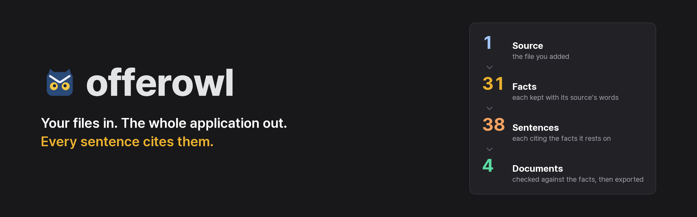

# Offerowl user guide

Offerowl works from your files alone. It reads your old resumes, portfolios and notes into facts that keep the words of the
file they came from, and writes your resume, portfolio deck, cover letter and interview scripts from those facts, every
sentence citing them. There is nothing to type or fill in. This guide takes you from your first files to a finished
application, in the panel. The pictures show a fictional person.

In this guide:

- Getting started: [1. Start Offerowl](#1-start-offerowl), [2. Make: your files in, your documents out](#2-make-your-files-in-your-documents-out)
- Your material: [3. Your profile](#3-your-profile), [4. An application](#4-an-application), [5. Your documents](#5-your-documents)
- After you apply: [6. Prepare for the interview](#6-prepare-for-the-interview), [7. Keep track](#7-keep-track)
- Looking after it: [8. The AI agent](#8-the-ai-agent), [9. Your files](#9-your-files),
  [10. Keys, screens and languages](#10-keys-screens-and-languages), [11. Troubleshooting](#11-troubleshooting),
  [12. Security and privacy](#12-security-and-privacy)

| More guides | For |
|:---|:---|
| [Installing](INSTALL.md) | Each way to run it, the doctor, updating and removing |
| [Closed networks](OFFLINE.md) | What to carry to a PC or cluster with no internet, and what cannot work there |
| [The command line](USAGE.md) | Every command, for scripts and automation |
| [The interview kit](INTERVIEW.md) | The question map, the scripts, search, practice, cue cards, the interview deck and the talk |
| [The portfolio deck](DOCUMENTS.md#the-portfolio-deck) and [cover letters](DOCUMENTS.md#cover-letters) | The deck's slides and figures, and how a letter answers a posting |
| [The panel and the app](APP.md) | Every view of the panel, the desktop app and its one-file build |
| [AI agents (MCP)](MCP.md) | Letting Claude Code or another agent drive Offerowl through typed tools |
| [Architecture](ARCHITECTURE.md) and [drafting](WRITING.md) | How Offerowl is built, and how each sentence is written from evidence |

## 1. Start Offerowl

[INSTALL.md](INSTALL.md) has the four ways to run it. The panel is the same in all of them. With the
desktop app it opens by itself, and an icon by the clock opens it again or quits. Run any other way, `offerowl open` brings it
up in your browser.

To read your files and write, Offerowl uses an AI agent you are signed in to: install Claude Code or Codex and sign in once,
in a terminal or with **Sign in** on the agent's panel ([8. The AI agent](#8-the-ai-agent), which also covers a local model).
With none, an Offerowl profile file still becomes PDFs.

The first time, while the workspace holds nothing, the **setup guide** opens over the page. Its four steps say how things
stand, and each holds the one key that fixes what is missing; a step that works shows a tick.

| Step | What it shows |
|:---|:---|
| AI agent | The agent this PC has and whether it is signed in, with **Sign in**, **Turn it on** or the page to get it from, and the choice of agent |
| Typesetting | Whether the PDFs can be made on this PC, with **Install them** for the libraries (once, with the network) or **Get Docker** |
| Look | The language and the theme |
| Start | **Choose files** for your own, or **Try an example** for the fictional person's |

It opens by itself once in a browser. **Setup guide**, the first item of the settings menu (the gear), opens it again.

<picture>
  <source media="(prefers-color-scheme: dark)" srcset="assets/guide-setup-dark.png">
  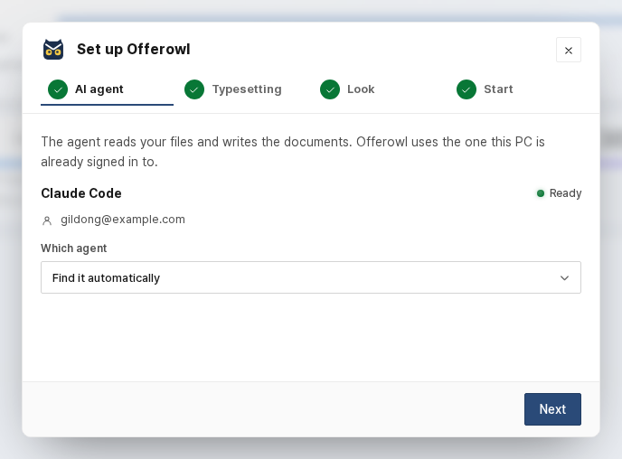
</picture>

## 2. Make: your files in, your documents out

The panel opens on **Make**. Its head is your resume's: your name (or **Add your name**), where your applications stand, the
next date and the latest documents. Under it, the band follows your files to your documents with this workspace's own numbers:
the files you added, the facts kept from them with their quotes, the sentences of the document in view (and any without
evidence), and the documents made. A click opens the view each one lives in. Every application still going stands under the
band as a note with **Docs** and **Interview**; **See the board** shows them by stage. Then three columns read from left to
right: **Add your sources**, **Grounded writing** (your AI agent reads the files and writes from the facts alone) and **Finished
documents**.

<picture>
  <source media="(prefers-color-scheme: dark)" srcset="assets/guide-make-dark.png">
  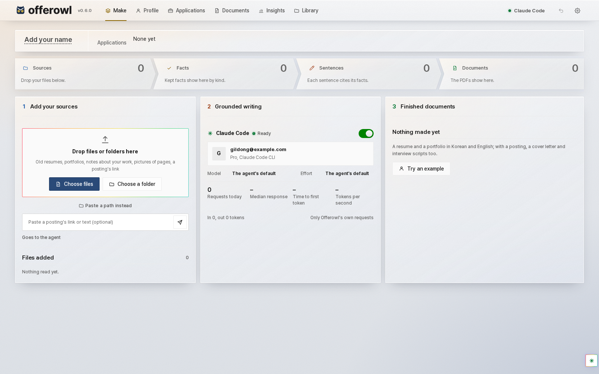
</picture>

1. **Your files.** Drop old resumes, portfolios, reports, notes or pictures of pages (PDF, DOCX, PPTX, text, images) anywhere on
   the page, or a whole folder: hidden folders, code folders such as `node_modules` and the system's own folders such as `AppData`
   and `Library` are skipped, so a whole home folder can be pasted. **Paste a path instead** opens a box for a folder's or a
   file's path, as Windows writes it (`C:\Users\...`) or as Linux does. A zip is opened into the documents in it, and LinkedIn's data
   export (Settings, Data privacy, Get a copy of your data) gives its career files only: your profile, positions, education, skills,
   certifications and the like, never your connections or messages. A run starts the moment they land.
2. **A posting, if you have one.** Paste its link or its text in the posting box before you drop the files, and the run makes the
   documents for that job. Give it later and a second run tailors them from the facts already kept, without reading your files again.
   Without one, the run makes your general edition: it keeps the resume text your profile already has and writes only what is missing.
3. **Progress.** The middle column shows the agent's panel and the run's steps: find the files, read them, sort the career
   facts, find the name and contact, read the posting, write the resume, make the English edition, draw the figures, answer the
   form's questions when the posting lists them, make the PDFs, write interview scripts and save to the Desktop. Without a
   posting, the steps that need one are left out. **Stop** ends it after the step in progress; what was read by then waits in your
   profile for you to confirm, and nothing is kept until you do. Files dropped while a run goes wait for it and are read right after.

<picture>
  <source media="(prefers-color-scheme: dark)" srcset="assets/guide-make-run-dark.png">
  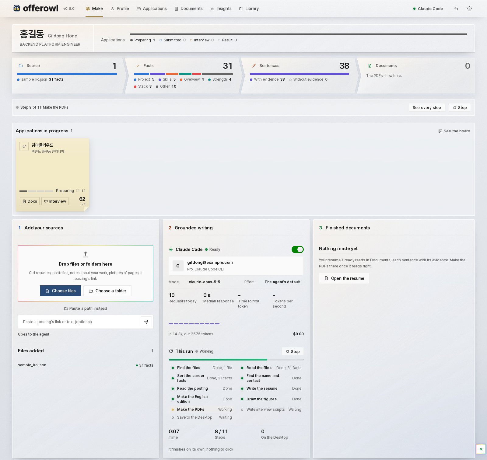
</picture>

4. **Your documents.** Each document comes out as a tile with its first page: the resume and the portfolio in Korean and English and,
   for a posting, the cover letter and the interview scripts. A tile opens its PDF; the scripts' tile opens the application's
   **Interview** tab. The same files are copied to your Desktop under readable names, never over a file already there. A step that
   fails leaves the others to run, and the result lists what went wrong, one line each, beside what did come out. Before a run in
   this session, the column lists the documents made so far, and one opens in **Documents**.

The facts a run keeps are the ones whose quotes are found in their files. The name, email and phone come from the top of your old
resume: the email and the phone by their shape, the name as the files write it. When the files do not write one of them, the result
asks for it in one line and makes the PDFs again.

**Try an example** shows the whole panel with the fictional person in `examples/`, with no agent. When you then drop your own
files, the example leaves first, with its facts and the name and contact it filled in.

## 3. Your profile

Everything Offerowl writes comes from here.

<picture>
  <source media="(prefers-color-scheme: dark)" srcset="assets/guide-profile-dark.png">
  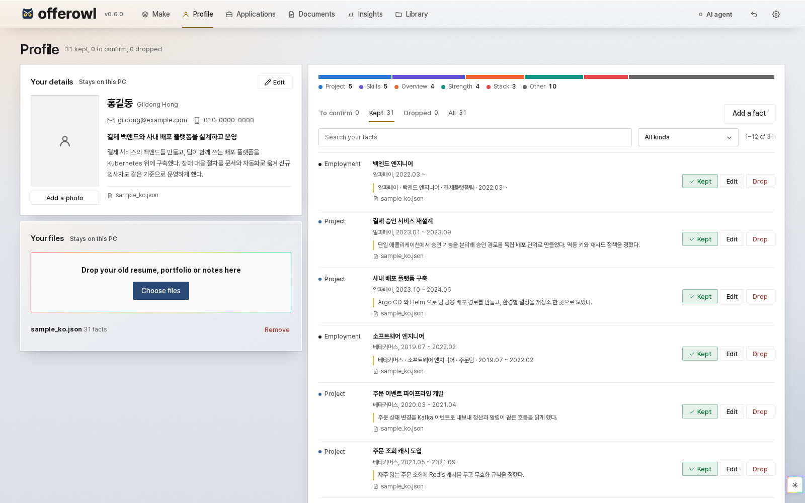
</picture>

- **Your details**: name, contact, headline and introduction, saved as you type, and the resume's **photo**: a JPEG or a PNG,
  printed in a 3:4 cell beside your name in both languages. **On the resume** takes it off without removing it.
- **Your files**: each shows how many facts it gave. **Remove** takes it and its facts out at once; the note that says so
  holds **Undo**, and the [Trash](#9-your-files) brings both back later.
- **Facts**: what each one says, the source's own words, and the file they came from. **Keep**, **Edit** or **Drop** them.
  **Add a fact** takes one in your own words, which then is its own evidence.

Only kept facts reach your documents. A fact that the source does not really say never gets this far: a candidate whose quote is not
in its file is dropped when the file is read.

A profile exported by another tool in Offerowl's ledger form (companies in a career block, projects with their evidence text) reads
the same way: each company, title, period and project shows on its card.

## 4. An application

A posting given on **Make** becomes an application. **Applications** lists them beside the one open and takes more, pasted or by
link. Each application keeps what it asks for in its own tabs: **Fit**, **Documents**, **Application questions**, **Interview** and
**Progress**. You see at once how your profile fits, worked out on your PC.

<picture>
  <source media="(prefers-color-scheme: dark)" srcset="assets/guide-job-fit-dark.png">
  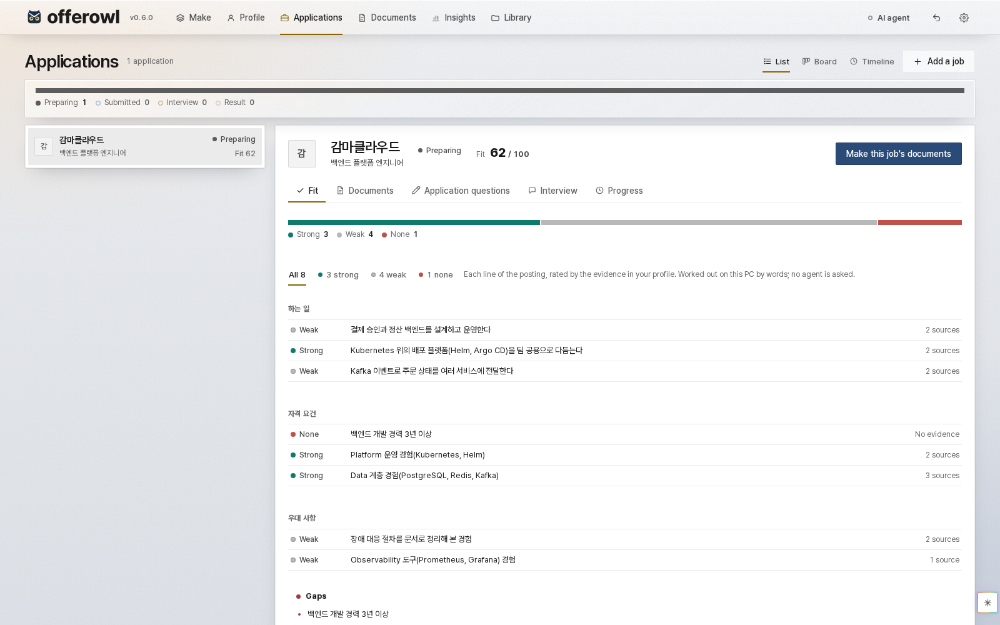
</picture>

- **The fit** is a score out of 100, then each line of the posting rated strong, weak or none, grouped by the posting's own sections.
  A line opens on the evidence that covers it and the tools it names that your profile never shows, and the ratings above the lines
  show one kind at a time. It goes by shared words on your PC, with no agent, so in English it can read lower than a
  person would: on the [measured sets](DECISIONS.md), words alone matched a reviewed cover plan on 53% of English lines, and the agent that
  plans the cover letter on 87%. In Korean both reached 79%.
- **Make this job's documents**, beside its name, runs the whole application on **Make**: the resume ordered and written for the job, the cover letter, the English
  edition, the PDFs on your Desktop and the first interview scripts.
- **Application questions**, on their tab, are read, not typed. A posting that lists its essay questions brings them in with it. For the rest,
  paste the form's questions as the form shows them, or give **Read from a screenshot or a file** a screenshot, a PDF or a saved page of
  the form (a screenshot is read on your PC: on Windows by its own OCR, elsewhere by Tesseract). Each question's limit is read beside it: "700자 이내", "최대 1,000자",
  "300 words", and a limit in bytes counts as half that many characters. You can pick another limit from the list under the
  question. **Write the answers** has the agent write each one from the facts that speak
  to that question, within its limit, and name the facts it used. Each answer is checked like every sentence: a number, name or tool its
  facts do not hold, your rules, and its length; one that fails is written once more, and what still fails shows its problems under it.
  Edit an answer in its box and it is checked again. **Copy all** puts them on the clipboard, **Save to the Desktop** writes them as one
  text file, and a run for the job answers them too. An answer that still has a problem is never saved out.

## 5. Your documents

Open **Documents** to read and change what a run made. The canvas shows the document as it will print, and the inspector beside it shows
where each sentence came from. Every sentence cites its evidence, a check stops what the evidence does not back, and the agent gets one
try to fix it before the sentence is dropped. If you change a fact afterwards, the canvas says so and marks the sentences that rested on it.
With an agent on, **Rewrite with the agent** writes it again from your facts, and on the **Portfolio deck** tab **Draw the figures** draws the
slides' figures from each project's evidence; a figure that says what the evidence does not is left out.

On **Documents**, the picker in the bar chooses the edition in view: under **General editions**, your documents for no job in
particular and any named editions; under **Applications**, each application's own. An application's **Documents** tab opens each
of its documents here with **Open**.

<picture>
  <source media="(prefers-color-scheme: dark)" srcset="assets/guide-documents-dark.png">
  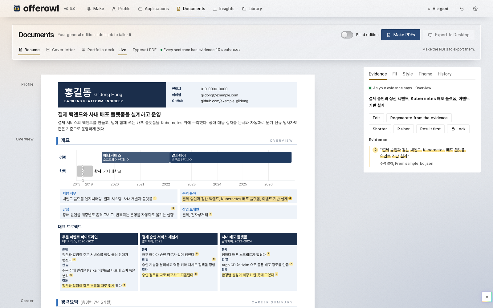
</picture>

**Click any sentence** of the resume or the letter to see its evidence on the right: the source's own words, the project and the file.
Each resume sentence ends in the small numbers of the facts it rests on, and its passages in the inspector carry the same numbers
(the PDF prints none); with no sentence selected, the inspector lists the resume's source files with how many sentences rest on
each. A resume sentence also has these buttons:

- **Edit**, or double-click the sentence to type over it where it stands: your words are checked at once. A number, tool or company the evidence
  does not hold, or "led" where it says "helped", marks the sentence.
- **Regenerate from the evidence**: the agent writes new words from that evidence alone, and they are kept only if they pass the same
  checks.
- **Shorter**, **Plainer**, **Result first**: one press rewrites the sentence that way from the same evidence, under the same checks.
- **Lock**: Edit, Regenerate and the rewrite buttons leave the sentence alone until you unlock it, and a new draft keeps its words.

A sentence with no evidence has a red wave under it. **Show the first one** takes you there, and the export waits until it is fixed.

**Blind edition**, beside **Make PDFs**, makes the edition in view again with the names you choose (your own, the companies,
the customers) under bars of their own width, for a job site that asks for an anonymous resume. Your list of names goes in
under **Style**, from a file ([the table's form](USAGE.md#a-blind-edition)). What no bar can cover stays out and the page says
so: a portfolio file you made, the cover letter and the photo. Before the PDFs go to your Desktop they are read again, and a
covered name that still shows anywhere in them, in the text, the title or a link, stops the export.

The inspector, which only Documents has, also holds **Fit** for the job in view, **Style** for your writing rules, the language, the page limit (two to seven pages) and what tailoring makes,
**Theme** for the resume's form, the deck's look, their colour and the app's look, and **History**, where a click takes back that change and everything after it.

<picture>
  <source media="(prefers-color-scheme: dark)" srcset="assets/guide-inspector-theme-dark.png">
  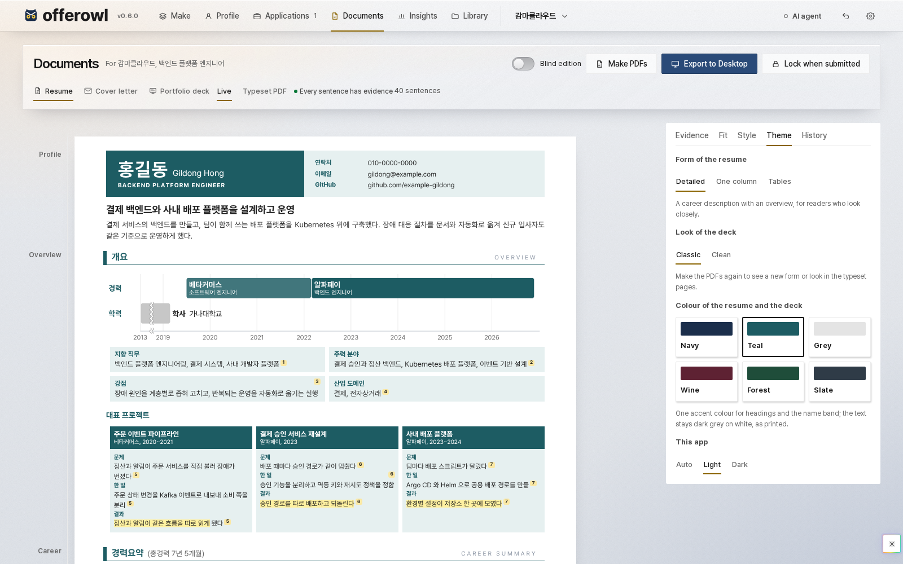
</picture>

The deck's tab shows the slides as they will print, and follows your changes without a PDF.

If you already have a portfolio you made yourself, name its PDF in the profile (`"deck": {"pdf": {"ko": "my_deck_ko.pdf",
"en": "my_deck_en.pdf"}}`, or one path for both). That deck is then used page for page, with its title and your name
written into the file, and nothing is drawn over it.

**Writing rules** in the Style tab choose the rules every sentence is written and checked by. **Offerowl's own** keeps numbers to the
evidence and bans a few hype words. **Add your own rules** takes a rules file of yours (a JSON file, described in
[the writing guide](WRITING.md#style-packs)): no figures in the prose, how many strengths and highlights, words to avoid, the industry's
terms for coined ones, rules in your own words. It is checked when it comes in, kept in your workspace and its backups, and used by every
draft, every rewrite, the English edition, the answers to an application's questions and the document checks.

After a change, **Make PDFs** typesets the resume and the deck again, and the cover letter when one is written. It asks no agent, so the letter stays as it
is. It needs no job: with none in view you get the general edition of your resume and deck. **Typeset PDF** then shows the pages as they
came out, and **Export to Desktop** copies the PDFs: only documents that passed their checks, byte for byte as checked, and each copy
is read back (its pages, and a title and an author of its own, such as "홍길동 이력서", never a build name). **Word and text files on the
Desktop too**, in the Style tab, adds the Word files and the resume in plain words (a one-column Word file and a text file, for a job
site that reads a file by itself or asks you to paste). The resume's and the cover letter's Word files are made ready for Word: Pretendard
goes inside them, so a PC without it shows the same letters, and their lines keep the heights the PDF has. **The portfolio as a PowerPoint
file too** adds the deck as slides, each slide its page as a picture, with the cover's links still links. Where this PC has Word or
PowerPoint, each such file is opened there first, unseen: a Word file must come out with as many pages as its PDF, and the slides
one per page. A file that does not stays here, the PDFs go, and the note that shows in the top bar (across the top of
a phone's screen) says why.

**The latest portfolio kept on the Desktop** copies the general edition's portfolio there each time its PDFs are made and pass their
checks, in each language made, and replaces only the copy it put there itself. A file of that name it did not write, or its copy
after you changed it, is never touched: the new copy takes the next free name. **Lock when submitted** keeps exact copies with their
hashes, so you can always see what you sent; the export of a submitted application gives those copies as they were.

## 6. Prepare for the interview

Open an application's **Interview** tab. It has four parts: **Search the scripts**, where it opens, **Interview deck**,
**Question map and scripts** and **Presentation**; before the kit is made it offers **Make the question map**, made on your PC
with no agent, and **Prepare a presentation**. On **Question map and scripts**, the question map comes from the posting, your
resume, your deck once its PDF is made, and the terms you used, by category, with a lamp for whether a script answers each question.

<picture>
  <source media="(prefers-color-scheme: dark)" srcset="assets/guide-interview-board-dark.png">
  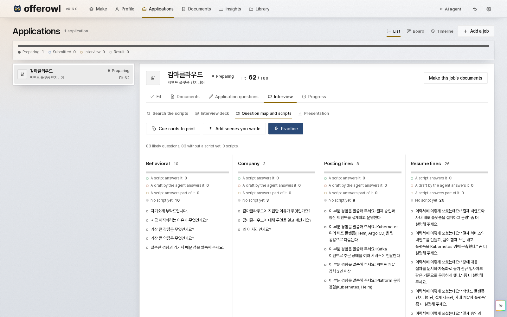
</picture>

**Add scenes you wrote** takes interview scripts written before, in the kit's own markdown (`### Q1. question` headings with
핵심, 면접관 and 나 lines): files named `deep…`, `terms…` and `notes…` keep those roles, a file with no scene is refused, and none is
written over. They join the board, the search view and practice at once.

A run from **Make** with a posting writes the first ten scripts, and **Write 10 more scripts** goes on from there, the likeliest
questions first: behavioral and company questions, then what the agent expects this job to ask about the work itself, then the lines of your
posting, resume and deck. Each script joins the search view and practice as soon as it is written. Below the board every script is listed beside the one you read:
English first, the translation under it, the interviewer dimmed. Each answer marks breaths, sentence ends, stress and one key phrase. What a
draft says you did is checked against your documents; what it says about how a tool works comes from the agent's own knowledge.

- **Open the search view**: type a word from the question and the scene comes up.
- **Practice**: the app asks, you answer aloud, and it shows your length and pauses, and where you left your facts. A transcript needs
  faster-whisper and its speech model on this PC (`OFFEROWL_WHISPER_DOWNLOAD=1` lets it download the model once); without them you type
  what you said.
- **Cue cards to print**: one scene per card.
- **Interview deck to print**: the posting line by line with its scripts, then one script per likely question in the
  order an interview runs, on 16:9 pages to read before the day.

**Your materials**, under the scripts, keeps what you prepared for this interview with other tools: explainer decks and their
PDFs, study notes and company briefs, form answers, live-coding solutions and pictures (PDF, PowerPoint, Word, Markdown, HTML,
text, Python, PNG and JPG, up to 50 MB each). Drop them on that part of the tab or choose them. Each file is kept as it came, and
a name already there gets a number. A row opens on a preview: the pages of a PDF, a deck or a Word file, a note's headings, lists
and code, a saved page that runs nothing, or code and text as written. A deck or a Word file shows its pages where LibreOffice can
print them: with Docker, in the container, or with LibreOffice installed on your PC; elsewhere the row says to open the file.
**Open the file**, **Save to the Desktop** (a copy checked byte for byte) and **Remove** (undo or the Trash brings it back) sit above it. They
stay on your PC, and nothing of them goes to the agent.

**Presentation** prepares an interview that starts with a talk. Write what the interviewers asked for: the topics, one a line in
their order, the minutes, the day and time, the format and, if you have them, their own words. **Save the brief** keeps it, and
**Make the talk** makes the deck, this job's portfolio pages among slides drawn for the talk, and the script to say over it, each
slide with its seconds; with no agent on, the talk keeps to your documents' own words. The script shows in the part, with
**Slides (PDF)**, **Script (PDF)** and **Save to the Desktop** above it. It needs no question map ([the talk](INTERVIEW.md#the-talk)).

From a checkout of the repository, `offerowl interview audit --job <workspace>/jobs/<job>` rates how well the scripts cover each
posting line, and with `--consistency` (calls to the agent) compares each script with the resume and portfolio you submitted
([INTERVIEW.md](INTERVIEW.md)).

## 7. Keep track

An application's **Progress** tab holds its stage and the day of each, how it ended, its next step, its **Interview rounds** and its
reminders. After each call or interview, **Add a round** keeps its kind, day and time, the questions asked and how it went; a round
ahead shows on **Make** under **Next**. **Remind me** adds a reminder, and **Show reminders as notifications on this PC** lets the
browser show the due ones. A link in a next step, a round's notes, a reminder or a file you added (a meeting's, a
booking page's) opens in a new tab, named for its service (Google Meet, Zoom, Teams, Calendly) or its site. **Board** in
**Applications** shows every application by stage:

<picture>
  <source media="(prefers-color-scheme: dark)" srcset="assets/guide-tracker-dark.png">
  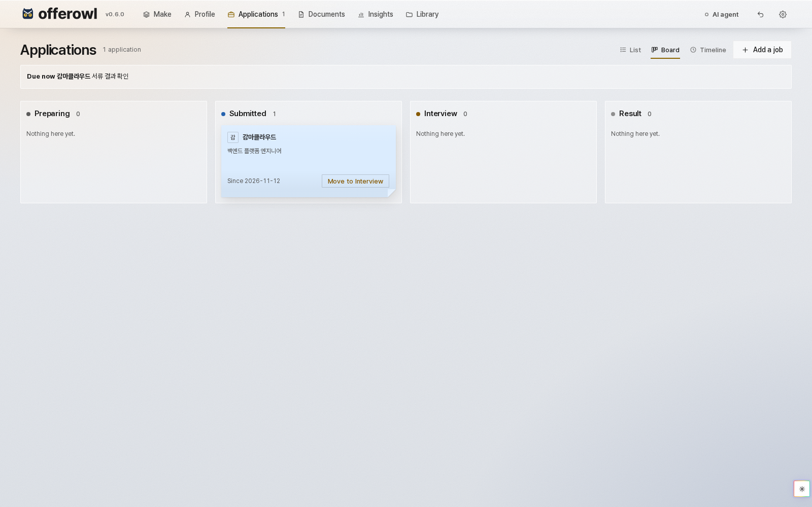
</picture>

Drag a card across the four columns, or use its **Move to** key; a card's name opens its application. **Timeline** lists every dated step.
Reminders show in a band and as a count beside **Applications** in the bar, and **Add them to your calendar** saves a file your calendar can
read.

**Insights** puts the whole search on one screen: who the evidence says you are, how far the applications got and how
they moved week by week, how often the postings ask for each area and how much of it your evidence meets, the
requirements to work on, and how ready each open application is for its interview. Hover a bar or a dot for its numbers.

<picture>
  <source media="(prefers-color-scheme: dark)" srcset="assets/guide-insights-dark.png">
  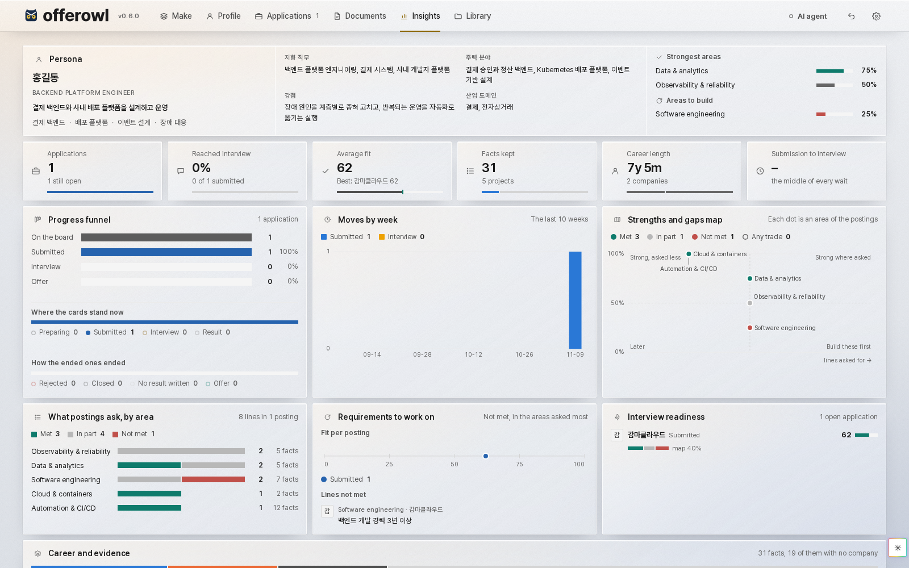
</picture>

## 8. The AI agent

The agent's panel stands in the middle of **Make**, and its lamp in the bar opens it from any view. It shows
the agent in use, its sign-in with the account and the plan, the model the last call ran on and its effort, one switch, and the
day's requests: how many, how long they usually took (**Median response**), the average wait for the first token (**Time to
first token**) and the average tokens a second while writing (**Tokens per second**), the tokens they read and wrote with a bar for
each recent request, the dollar sum the CLI reports for them (on a subscription, what the API would have charged), and the
failures with the last one's code. These figures are counted on your PC from Offerowl's own requests (the CLI's JSON result);
Offerowl never opens the CLI's login files.

<picture>
  <source media="(prefers-color-scheme: dark)" srcset="assets/guide-agent-dark.png">
  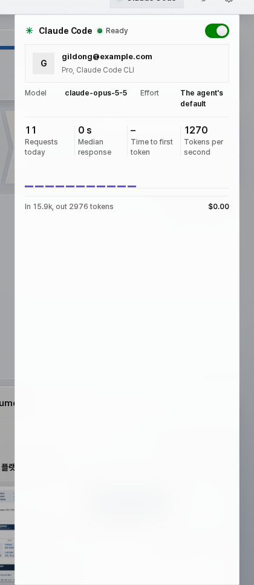
</picture>

| You want | Do this |
|:---|:---|
| Claude Code | Install it from [its page](https://code.claude.com/docs/en/setup), then press **Sign in** on the agent's panel, which opens its own sign-in in your browser, and turn the switch on |
| Codex | Install it, press **Sign in** on the agent's panel, and turn the switch on |
| A local model | Start Ollama, vLLM or LM Studio. In **Settings**, set **AI agent** to **Local model** and type the server's address. `OFFEROWL_LLM=openai-compat` and `OFFEROWL_LLM_URL`, set before starting, do the same and win over a saved choice ([USAGE.md](USAGE.md#the-ai-backend)) |
| No AI | Leave the switch off. You still get the canvas, the fit by words, typesetting, every check, search, practice and the tracker |

**The command bar.** The key at the bottom right of every view (on a phone or a tablet, the bar along the foot of the screen),
or Ctrl+K (Cmd+K on a Mac), opens a bar where you write to the
agent as you would to Claude Code: an interview's result to record, a posting to make a resume for, a question about your
applications. It acts through Offerowl's own tools only, the answer names the tools that ran, and undo takes back what it changed.
Enter sends, Shift+Enter starts a new line, and Escape closes the bar. It needs Claude Code or Codex
([how it runs](APP.md#the-command-bar)).

With an agent on, each action that sends something says so in orange, **Goes to the agent**, and says what it sends. The rest say **Stays on
this PC** in blue. Practice says so beside its agent switch.

## 9. Your files

**Library** lists every file you brought in and every file Offerowl made, in one table: filter it by kind, by
application or by name, then open a file, copy it to the Desktop or remove it from its row. Backup and restore are at
its top.

<picture>
  <source media="(prefers-color-scheme: dark)" srcset="assets/guide-library-dark.png">
  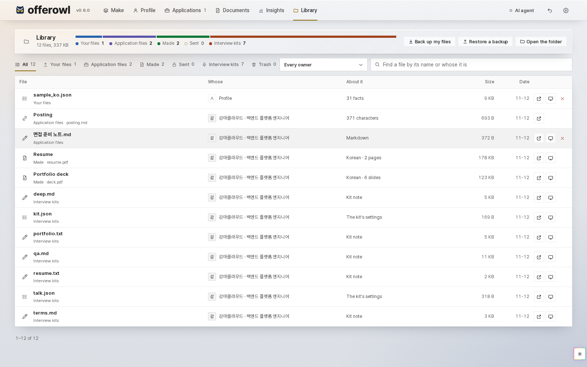
</picture>

Removing never asks: a file, the photo, an application or an edition you remove waits in the **Trash**, the last key of
the Library's kinds, and the note that says it was removed holds **Undo**. **Remove this job**, at the foot of an application's
**Progress** tab, removes an application, and the cross beside a named edition's name on **Documents** removes that edition.
In the Trash, **Put back** returns a thing where it was (a file of your profile with its facts as you decided them), and
**Delete for good** removes it for good, also from the undo history, so no undo brings it back. That one asks first and says what stays: documents already made from a file's
facts, the details it filled in, copies on your Desktop, backups you saved, and the command bar's history. **Empty the trash** does it for everything there. The folders a restore kept
beside your workspace are listed under the Trash too.

<picture>
  <source media="(prefers-color-scheme: dark)" srcset="assets/guide-trash-dark.png">
  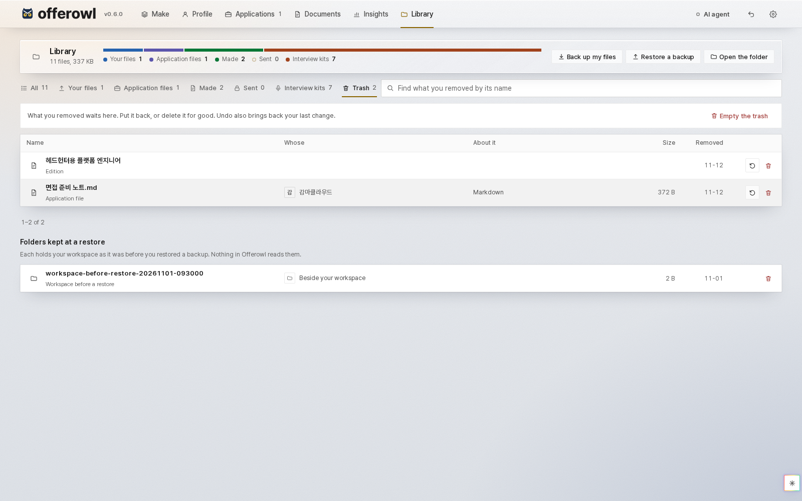
</picture>

Everything is in one folder of plain files:

| System | Folder |
|:---|:---|
| Windows | `%LOCALAPPDATA%\Offerowl` |
| macOS | `~/Library/Application Support/Offerowl` |
| Linux | `~/.local/share/offerowl` |

In the container and the Helm chart, the folder is the data volume, and what goes to the Desktop goes to a folder in it
([INSTALL.md](INSTALL.md#2-a-container-docker-compose)).

To back up or move to another PC, copy the folder. To start over, quit Offerowl and delete it, which deletes your
profile and documents for good. The panel leaves no copy in the engine's own folder. The `offerowl` commands write there, in `output/`, until you
uninstall the package or delete that folder ([INSTALL.md](INSTALL.md#4-the-python-package)). [ARCHITECTURE.md](ARCHITECTURE.md#your-workspace) lists what is inside.

In **Settings**, **Back up my files** has your browser save the whole workspace as one file. **Restore a backup** puts such a
file in its place. The files you had stay in a folder beside it, so nothing is lost; the Trash lists that folder, to delete once
you no longer need it. A backup holds everything you added, including what waits in the Trash.

## 10. Keys, screens and languages

| Key | What it does |
|:---|:---|
| Alt+1 to Alt+6 | Make, Profile, Applications, Documents, Insights, Library |
| Enter or Space | Open a sentence's evidence |
| Arrows, Home, End | Move between the inspector's tabs and an application's tabs; the left and right arrows also move between the setup guide's steps |
| F2 | Type over the sentence in view on the canvas |
| Escape | Close what is open |
| Ctrl+K (Cmd+K on a Mac) | Open or close the command bar |
| Ctrl+Z, outside a field | Undo |

The panel runs from a phone to a 2560-pixel screen. Make's three columns become two below 1280 pixels and one on a phone, the inspector
becomes a drawer below 1100, and on a phone the six views stand two by two under the wordmark. It works with a keyboard and a screen
reader, in Korean and English, light and dark. The gear menu picks the theme, the language and **Motion**: what changes moves
once (a view's cards rise in turn, a finished step lights, the documents arrive tile by tile, the figures count up), and
nothing moves at rest. It is on by default; **Off** stops it, and **Auto** follows your system's setting for less motion.

<picture>
  <source media="(prefers-color-scheme: dark)" srcset="assets/guide-phone-dark.png">
  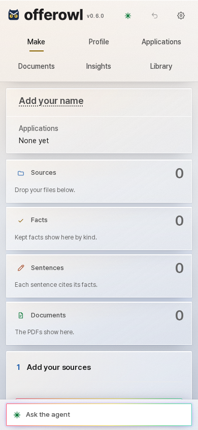
</picture>

## 11. Troubleshooting

Run `offerowl doctor` first if you installed the package. It says what is missing and what to do about it. The logs are in the data folder's
`logs/`.

| What you see | What to do |
|:---|:---|
| **Make PDFs** says typesetting is missing | The app needs Chrome or Edge. The Python package needs Docker, or Chrome or Edge with Node.js 22, which it uses by itself when Docker is not there |
| No agent is found | Install it, start Offerowl again, and press **Sign in** on the agent's panel |
| A run says no job was found | The files hold no job you held. Add an old resume or notes about your work |
| The result asks for your name or email | The files do not write it. Type it there and the PDFs are made again |
| The cover letter says it needs the agent | Turn the agent on: a letter is written, not assembled |
| "Port in use" | Another program holds 8797. Stop it, or use `--port N` |
| The panel answers 403 | The address bar must say `127.0.0.1` or `localhost`, and the panel's own port |
| Windows warns about an unknown publisher | The files are not code-signed yet. Choose **More info**, then **Run anyway**, after checking the file against `SHA256SUMS` |
| A file gives no facts and says it has no text | It is probably a scan. Use the container, install Tesseract, or copy its text into a text file |
| A page runs long or a figure is cut | The check names the page. Shorten the sentence on the canvas or raise the page limit under **Style** |

[INSTALL.md](INSTALL.md#if-something-does-not-work) has more. If it still does not work, [open an issue](https://github.com/kanggu12/offerowl/issues/new/choose).

## 12. Security and privacy

- **What stays on your PC:** your files, profile, documents, tracker and practice sessions.
- **What goes to the agent:** with the agent on, the text of a file you add; your facts and the posting when you write the resume or tailor a
  job; each project's evidence when you draw the deck's figures; the evidence of the part being written; the facts that speak to each form
  question and the posting when it writes the answers; the passages of your profile, facts and documents that speak to a question when it
  writes an interview script; the brief, your evidence and the posting when it makes a talk; the words of your profile that a draft does not
  hold when you ask for the English edition; what you write in the command bar, and what the agent reads through Offerowl's tools to answer
  it; and, in practice, your answers. It goes
  to Anthropic for Claude Code, to OpenAI for Codex, and only to the server you named for a local model. Adding a job and making PDFs send nothing,
  and nothing is sent with the agent off ([what each call sends](ARCHITECTURE.md#what-is-sent-to-the-agent)).
- **A posting's link** is fetched once from your PC, only from the public internet (each redirect is checked too), and only its text is kept.
- **No telemetry.** Offerowl sends nothing about you or your use.
- **The panel has no login**, so it refuses requests addressed to any other host and stays on your own PC: the app and the Python package listen on
  127.0.0.1, the compose file publishes its ports on 127.0.0.1, and the Helm chart's Service stays inside the cluster.
  A Helm install exposes nothing by default, and an Ingress needs a login in front of it ([INSTALL.md](INSTALL.md#3-a-kubernetes-cluster-helm)).
- **Practice recordings** are transcribed on your PC and never saved. Each session's text and feedback are kept in its output folder.

To report a security problem, see [SECURITY.md](../.github/SECURITY.md).
