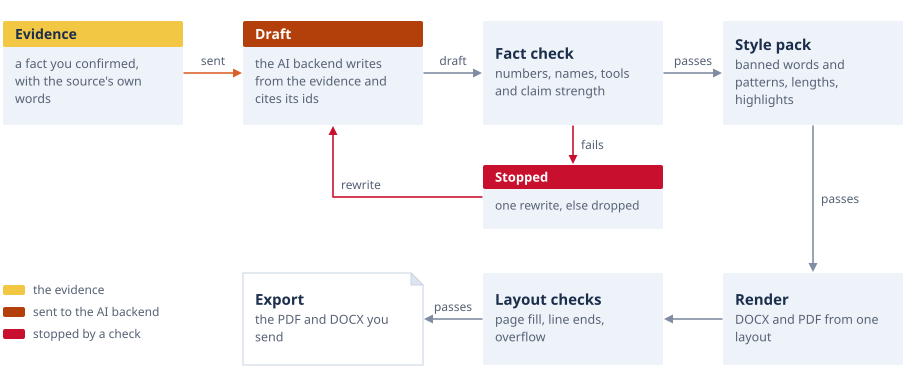
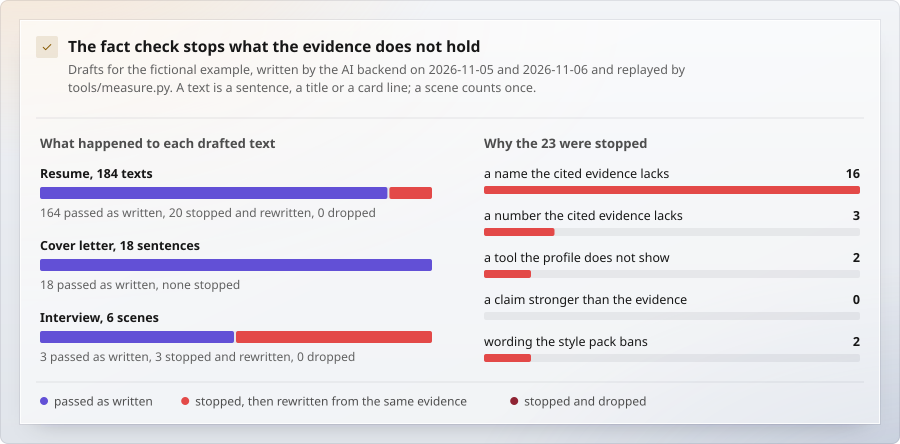

# Writing: drafts from evidence

A profile in the ledger form ([The profile format](DOCUMENTS.md#the-profile-format)) holds facts, not resume sentences. This page describes the step that writes every part
the resume prints from those facts, the checks every drafted sentence passes, the style packs that carry a person's
writing rules, the claim-strength check, how the cover letter uses them, and JSON Resume import and export.

<picture>
  <source media="(prefers-color-scheme: dark)" srcset="assets/diagram-sentence-dark.svg">
  
</picture>

## The drafting step

```bash
./offerowl draft write profile.json --job posting.md --style mine     # writes profile.draft.json, its record in output/_draft/
./offerowl draft check profile.draft.json --style mine                # every drafted sentence against its evidence again
```

`python3 src/write_resume.py write|check` runs the same code. The input profile is never overwritten.

### What it writes

| Part | Profile field | Notes |
|---|---|---|
| Headline | `summary.headline` | one line, no highlight |
| Introduction | `summary.intro` | one or two sentences with one `==highlight==` |
| Overview cards | `summary.cards` | target role, focus, strengths, industries; the target card may use the posting's words |
| Selected projects | `summary.highlights` | challenge, action and result rows; the result row has one highlight; the place line ("Nara Cloud  2024 ~ 2025") is computed, not written |
| Core competencies | `competencies` | four to six (the pack decides), each `{name, text, evidence}`; `evidence` is the projects its cited blocks belong to |
| Company line | `roles[].desc` | one sentence per role, from the role's head and context blocks |
| Work-history items | `roles[].projects[].title`, `short`, `summary` | one item is one project; sentences in the order scope, decision, result; exactly one highlight per item |
| About me | `about` | the pack's number of sections (three by default), an optional quote box |
| Motivation | `motivation` | two or three sentences; a sentence about the company may only use the posting's own text |
| Deck cover and overview | `summary.stats`, `summary.focus`, `roles[].journey`, `summary.contents`, `summary.glance` | four proof tiles `[value, note]`, four focus columns `[title, line]` and a career path station per printed role `{phase, line, key}` for the deck's cover, one line over the contents and one over the career at a glance; no highlight |

Every text is written in Korean and in English (`--langs ko,en`), as a language pair (`{"ko": ..., "en": ...}`), which the
profile loader (`src/profile_loader.js`) reads for each edition. Projects the draft does not choose stay in the profile with
`resume: false`; a drafted project keeps what it replaced under `ledger`.

With `--job`, every part is written for that posting. Without it, only the parts the profile lacks are written, and
what the person wrote stays. `--parts items,summary,competencies,about,deck` picks parts by hand.

### Stages and calls

| Stage | Calls | Reads |
|---|---|---|
| items | one per group of roles (a group holds about 45,000 characters of ledger text) | the roles' head, context and project blocks, the hierarchy rows, the posting's lines |
| summary | one | the drafted items with the blocks they cite, every role's head, skills, sections, education, hierarchy rows |
| competencies | one | the same |
| about | one | the same, and the posting's text about the company |
| deck | one | the same; a form of its own, asked apart so the other prompts stay as they are |
| repair | one, only when something failed | each failing text with the reasons, and its evidence |

A profile with five roles and 58 projects took seven calls. Space follows tenure: each role gets an item range and a word
budget in proportion to its months (`work_words`, 1,200 English words over the whole resume by default), the posting
decides which projects, and after the checks each role is trimmed to its budget in the model's order of importance (at
least the role's minimum stays; the record lists what gave way under `trimmed`). Counting words rather than items matters:
a role with many small projects and a role with a few large ones of the same tenure get the same space. `--raw answers.json` keeps every answer as it comes (saved after each call), and `--replay answers.json`
runs the checks and the assembly again with no call.

### Evidence ids

Ids are the units of `src/cover.py`, listed under [cover.json](DOCUMENTS.md#coverjson-offerowl-cover01): `nara-2#3` is the
third block of a project. Notes to the ledger's owner (HTML comments) are never evidence and never reach a prompt.
A drafted text may cite ledger units and hierarchy rows only; the summary, competency, about and motivation units are what
the draft writes, so they cannot be cited by it.

Every surviving sentence is recorded in the new profile:

```json
"evidence": [{"at": "project.nara-1.summary", "lang": "en", "text": "...", "ev": ["nara-1#2", "nara-1#3"], "names": {}}]
```

`at` names the field (`summary.headline`, `summary.cards.focus`, `summary.highlights.0.result`, `competencies.2.text`,
`about.1.text`, `motivation`, `role.<key>.desc`, `project.<id>.title`, `project.<id>.summary`). The ids keep their meaning
after drafting: a drafted summary would otherwise become block 1 of its project and shift every other block, so ids are
always read against `ledger_view(profile)`, the profile as the ledger had it.

## The checks

Each language of each text is held against the text of the ids it cites:

| Level | Codes | Effect |
|---|---|---|
| facts | `unknown_id`, `no_ev`, `frame_where`, `number`, `number_word`, `name`, `org`, `name_src`, `empty` | dropped after the repair round |
| style | `banned_char`, `banned_pattern`, `banned_word`, `coined`, `too_long`, `highlight` | dropped after the repair round |
| claims | `claim` | sent to repair; dropped when still too strong |
| polish | `ending` (a Korean item ending like prose), `routine` (a highlight that reads as a routine duty), `title_end` | reported only |

- **Numbers** follow the pack: `evidence` (the default) allows a number the cited evidence states; `forbid` allows none
  in the prose. A product name that starts with digits (`389DS`) is a name; a figure with a unit (`400Gbps`) is a number.
- **Names** use the cover letter's rules (capitalised, upper-case and mixed-case words in English; every Latin word and
  every organisation in Korean). A spelling in the other language passes when the text declares it
  (`"names": {"Gasang Bank": "가상은행"}`) and the source stands in the cited evidence, or when a glossary pair has one side
  in the text and the other in the evidence. The glossary is built from the profile: its own `glossary` field
  (`{"가상은행": "Gasang Bank"}`), the two spellings of each role's name, short name and places, a heading such as
  `가나전자 (Gana Electronics)`, the cell-by-cell pairs of bilingual summary rows, and general place names (`중국` and China).
- **Both editions say the same thing**: a sentence that fails in one language is dropped in both.
- **One item is one project**: a sentence of an item may not cite another project's blocks; such ids are removed before
  the check.

`draft check` repeats all of it on a drafted profile and also reports text that no linked sentence covers (`unlinked`, or
`edited` when the field changed after drafting). Its last line is the verdict, for example
`resume check: PASS (310 sentences, 0 fact flags, 0 claim flags, 4 to polish)`. Facts, style and unlinked text fail it;
claims and polish are counted.

What the checks stopped when the AI backend drafted for the fictional example:

<picture>
  <source media="(prefers-color-scheme: dark)" srcset="assets/chart-factcheck-dark.svg">
  
</picture>

<sub>Measured by `tools/measure.py`, replaying one recorded run of the AI backend.</sub>

## Claim strength

`factcheck.claim_issues(sentence, evidence)` flags a sentence that says the person **led**, **designed**, **built** or
**owned** something (and the Korean forms: 주도, 이끌다, 총괄, 설계, 구축, 구현, 개발, 신설, 담당, 맡다, and a bare work noun at
the end of a resume bullet) when the evidence it cites says the person **helped**, **proposed**, **took part**, or did it
**with the team** or **a colleague** (도왔다, 제안했다, 참여했다, 팀과 함께, 동료와, 공동으로). It passes when the evidence
makes the same claim without a qualifier, or when the sentence keeps the qualifier ("designed and proposed").

- An adopted proposal (관철, 채택, 합의를 받다, adopted) is the person's own result.
- "led the team" and "founded the SRE team" are not qualifiers; "A와 B를 함께 개발했다" lists two objects and is not "with
  someone".
- For a cited project, the claim is held against the three blocks that share the most words with the sentence.

It runs in the resume draft (repaired, then dropped), in the cover-letter draft (the same), in `cover.py check` (a
`claims` check that fails the letter), in the interview scene drafts (`src/interview/draft.py`: an overclaim in my
lines sends the scene back once with the reason, then to the rejected file), in the talk's texts
(`src/interview/talk_write.py`: sent back once, then dropped) and on a sentence you edit on the canvas, which is then
marked unsupported and blocks the export. `claim_text(issue, lang)` gives the message in Korean or English.

## Style packs

A style pack is one JSON file. The shipped `src/style/default.json` holds rules for everyone: numbers from the evidence
only, and a short list of hype words. A person's own pack lives in their workspace (`<workspace>/style/<name>.json`, found
from the folders above the profile or the plan) or anywhere by path, and overrides only the keys it sets.

In the panel, the inspector's Style tab chooses the pack (**Writing rules**) and takes a new one (**Add your own rules**): the file is
checked first (a JSON object; `banned_chars` text; `resume` and `cover` objects; every `banned_patterns` entry a `[pattern, why]` pair
whose pattern compiles), kept as `<workspace>/style/<name>.json` and chosen. From then on every draft, rewrite, translation, application
answer and document check uses it (`Tasks.style_spec`). The interview scenes and the talk read the kit's own pack instead
(`style` in kit.json, [Style packs](INTERVIEW.md#style-packs)); the Style tab's choice does not reach them.

```json
{
 "banned_chars": "—",
 "banned_patterns": [["(?:가|이) 아니라 ", "the 'not A but B' pattern"]],
 "resume": {
  "numbers": "forbid",
  "items": 20, "competencies": [4, 6], "about_items": 3, "about_quote": false, "highlights": 3,
  "highlight": {"ko": [10, 22], "en": [2, 8]},
  "banned_words": {"en": ["spearheaded"], "ko": ["성공적으로"]},
  "coined": {"ko": {"관측 가능성": "Observability"}},
  "routine": {"en": ["handed over"], "ko": ["인수인계"]},
  "title_end": {"ko": ["구축", "설계", "개발"], "en": ["build", "design", "development"]},
  "rules": {"en": ["Write the client's name when the evidence has it."], "ko": ["고객사 이름이 근거에 있으면 쓴다."]},
  "avoid_lead": ["first-startup"],
  "ko_ending": "nominal"
 },
 "cover": {"numbers": "forbid", "banned_words": ["leverage"], "max_words": {"en": 520}}
}
```

| Key | Default | Meaning |
|---|---|---|
| `numbers` | `evidence` | `forbid`: no numbers in the prose, dates aside (they live in the period fields) |
| `items` | 20 | work-history items over the whole resume |
| `work_words` | en 1,200 | the space of all work-history items, shared out by tenure |
| `competencies`, `about_items`, `highlights` | [4, 6], 3, 3 | how many |
| `highlight` | ko 6 to 24 characters, en 2 to 9 words | the size of one highlighted phrase |
| `*_chars`, `*_words` | see `RESUME_DEFAULTS` in `src/write_resume.py` | length limits per part |
| `banned_words`, `coined` | none | words that may not appear; coined terms and the term the industry uses |
| `routine`, `title_end` | none | polish checks: a highlight that reads as a routine duty; titles that end with a work noun |
| `rules` | none | rules in words, carried by every prompt (scope words, what not to lead with) |
| `avoid_lead` | none | role keys the headline and the introduction should not lead with |
| `ko_ending` | `nominal` | Korean items, cards and competencies end in a noun (resume bullet style); `plain` allows ~했다 |

The rules every pack shares are in the prompts (`src/prompts/write_rules.md`): only facts of the cited evidence, the
person's part as the evidence states it (scope words kept), no dressed-up routine work, names kept, the industry's terms.

### Printed words

The drafting checks see each text as it is written; the document checks (`src/check_documents.py`) read the words the PDFs
print, so a sentence the person edited, an edition brought in and the deck are held to the same rules. Some hold for
every document, whatever the pack:

- a value a build left empty (`undefined`, `[object Object]`; in English only where it stands alone);
- marks left as they were typed (`==`, `**`);
- an editing note (`(확인 필요`, `TODO`, `TBD`, `FIXME`, `<!-- -->`, a document file's name such as `notes.docx`).

The rest are the pack's, in its `printed` object, and off until it turns them on:

```json
"printed": {
 "comma_after_endings": true, "instead": true, "not_a_but_b": 0, "latin_and": true, "repeated_words": true,
 "colloquial": ["(?:에서|으로|로) 도는 "], "editing_notes": [["이직\\s*사유", "a reason for leaving"]],
 "lines": "fail", "highlight_names": ["Gasang Bank", "가상은행"]
}
```

| Key | Meaning |
|---|---|
| `comma_after_endings` | no comma after a Korean connective ending (`만들고,`, `맡아,`); nouns that end alike (`보고`, `이해`) pass |
| `instead` | no contrastive 대신 or "instead of" (`사용자를 대신해` is a verb and passes) |
| `not_a_but_b` | how many "A가 아니라 B" (in English, "rather than") one document may hold |
| `latin_and` | 와/과 between two Latin words: a slash instead (`Kafka/Redis`) |
| `repeated_words` | one word twice in one sentence (Korean words of three syllables and more, read without their particle; English words of six letters and more) |
| `colloquial` | patterns of words the person does not want printed, such as a machine said to act like a person |
| `editing_notes` | more editing notes, each a `[pattern, why]` pair |
| `lines` | `fail` makes the line checks below defects; by default they are notes to polish, shown and never in the way |
| `highlight_names` | names that never stand inside a highlight (a client's, an institution's), besides the never-shown words of the blind table |

**Line checks** (`src/check_lines.py`) read the PDF's word boxes against what the typesetting set: `src/layout.js` writes
`<name>.highlights.json` beside the document, every highlight in the order it was drawn and every paragraph it set (the
introduction, a card's cells, a competency, an item, about me, the motivation). They say when a highlight breaks across two
lines, when it is shorter or longer than the pack's `highlight` range, when it holds a name of `highlight_names` or of the
blind table, and when a paragraph's last line holds one word alone. A highlight or a paragraph the checks cannot find on the
page is said too: a check that measured nothing does not pass in silence.

**A deck source's own checks.** When the workspace's `deck/` folder ships `tools/check_deck.py`, `check_align.py`,
`check_density.py` or `check_contrast.py`, each runs on every build's deck (the first on its PDF and its `.probe.json`, the
others on its page) before the engine's folder is cleaned; a check that fails gives its lines as the deck's issues, and one
that breaks says it did not run.

The panel words every finding by its code in the person's language (`--report` writes them with their values), lists the
defects over the pages, which keep the PDFs home as before, and the notes to polish in a quieter band.

## Cover letters

- **Weak lines get a paragraph** when the model judged them partly shown (a compiler requirement shown by porting work,
  an English line shown by work with partners abroad). A line lowered only because a tool it names is missing, or rated by
  word overlap alone, needs its other words in the evidence (`partial_cover` at least 0.3). Lines about degrees, years of
  experience or certificates stay with the resume. The plan notes which lines were added.
- **Trimming keeps duties, then requirements, then preferred lines**, strong before weak inside a kind, so a partly shown
  requirement outranks a fully shown nice-to-have.
- **Wider evidence pools.** A duty paragraph also sees up to two projects per line that word matching ranks close to the
  best; the opening sees every project the planned lines rest on, the summary rows, and the person's statements (about,
  motivation, `summary.direction`). Long projects keep the blocks that fit the paragraphs they serve.
- **Names.** The evidence block ends with the names it holds and their spelling in the other language, and the checker
  accepts a glossary spelling without a declaration. The prompt asks to keep the names the evidence holds.
- **Direction.** `summary.direction` (the person's own statement of the direction or position they work from) is a unit
  the opening and the motivation may cite; a `direction` written into `plan.json` is shown to the model as the person's
  words for a framing sentence. Paragraph themes in `plan.json` are printed in the prompt, so an edited theme steers its
  paragraph.
- **Matching** sees more of each project: the index row adds the two blocks that share the most words with the posting.
- **Claim strength** is checked while drafting and by `check` (see above).

## JSON Resume

```bash
python3 src/write_jsonresume.py import resume.json [-o profile.json]
python3 src/write_jsonresume.py export profile.json [--lang en|ko] [-o resume.json]
```

| JSON Resume | Offerowl profile |
|---|---|
| `basics` | `person` (name, `tagline` from label, email, phone, links from url and profiles, location, image), `summary.intro` |
| `work` | `roles` (org, title, place, start, end; no end date means ongoing); `summary` becomes `desc`; `highlights` become one project per role whose points are the highlights (the drafting step reads them as evidence) |
| `projects` | a project of the role it names (`entity`) or whose dates hold it; the rest go to a "Projects" section |
| `education` | `education` (school, major, degree, note from score, courses, start, end) |
| `skills` | `skills` (category, items from keywords, level) |
| `awards`, `certificates`, `publications`, `languages` | sections of dated lines or items, marked with `_jr` |
| anything else (`volunteer`, `interests`, `references`, `meta`, unknown keys) | kept under `_jsonresume` and given back on export |

On export a role's resume items become its highlights ("Title (period): summary", highlight marks removed); a role whose
only project came from imported highlights gives them back as they were. Dates go out as `YYYY-MM`; a day is not kept,
because the resume prints months.

## What the checks cannot see

- Whether a sentence means what its evidence means. The checks compare numbers, names, tools and the strength of the
  person's part; a person reads the rest (the panel shows each sentence with its evidence).
- Whether an English spelling is the right translation of a Korean name: only that the source exists in the evidence.
- Whether a fact is the person's own work when the ledger states it without a qualifier. The claim check only sees
  qualifiers the evidence writes down.
- The judgment that makes a document good: which project leads, what the narrative is, which facts a reader remembers.
  The draft follows the posting and the pack's rules; a person decides.

## Tests

```bash
python3 -m unittest discover -s tests/write    # drafting with a stand-in model, claim strength, style packs, JSON Resume
python3 -m unittest discover -s tests/cover    # the cover letter, with the gap tests in test_cover_gaps.py
```

The stand-in (`tests/write/standin.py`) answers for a fictional ledger (`tests/write/fixtures/ledger_ko.json`) and plants
an overclaim, a counted amount under a pack that forbids numbers, and a client no evidence names; the tests check that
the first two are repaired, the third dropped in both languages, and that the drafted profile loads in the profile loader.
